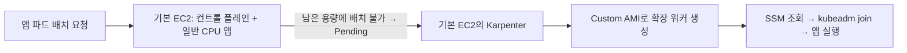

# AL2023 Custom AMI 이후 CPU 클러스터 실행 가이드

선행 문서: [CPU AMI 설치·확인](./al2023-cpu-ami-setup-guide.md)

**목표:** 최초 EC2 한 대가 컨트롤 플레인과 일반 CPU 워커를 겸한다. 이 노드의 배치 가능 용량을 초과하는 파드가 생기면 Karpenter가 Custom AMI로 워커를 추가하고, 빈 워커는 정리한다. EKS가 아닌 kubeadm 구성이다.

**현재 네트워크:** private subnet 없이 기존 public subnet을 사용한다. 기본 노드에는 EIP가 연결되어 있고 확장 워커도 이 public subnet에 생성한다. **public subnet에서도 모든 노드는 사설 IP를 가지며, 노드 간 통신에는 사설 IP를 사용한다.** 워커의 공인 IPv4는 NAT 없이 외부 AWS API·이미지 저장소에 접근하는 데 사용한다.

AMI가 `available`이고, 최초 EC2에서 아직 `kubeadm init`을 하지 않은 상태부터 시작한다. 이미 클러스터를 만들었다면 완료한 단계를 확인하고 이어서 진행한다. 기존 클러스터에 `init/reset`을 다시 실행하지 않는다.

## 실행 위치·구조·버전

필요한 이유: AWS 자원을 만드는 작업과 Kubernetes를 설정하는 작업은 실행 위치가 다르다. 기본 노드가 관리 역할과 앱 실행 역할을 함께 맡는다는 기준으로 위치를 통일한다.

이 문서에는 별도의 “관리 터미널”이나 추가 관리용 EC2가 없다.

| 표기 | 실제 위치·담당 작업 |
|---|---|
| **AWS 콘솔** | 브라우저에서 AWS에 로그인. AMI·VPC·SG·태그 확인, IAM 역할·정책, SSM 파라미터 생성, EC2 상태 확인 |
| **Argo CD 웹 콘솔** | Ingress 도메인으로 로그인한 화면. 저장소 연결, Application 생성, Helm 설정 입력, Sync·상태·로그 확인 |
| **기본 노드 셸** | 최초 AL2023 EC2에 SSH 또는 Session Manager로 접속한 터미널. kubeadm·kubectl·Helm 실행 및 YAML·userData 파일 작성 |
| **확장 워커 내부** | Karpenter가 만든 새 EC2. cloud-init이 userData를 자동 실행. 문제 진단 때만 직접 접속 |

IAM·태그·파라미터 생성은 AWS 콘솔에서 처리한다. AWS CLI는 기본 노드의 **현재 역할 신원 확인**, 워커 userData의 **SSM 자동 조회**에 사용한다. 기존 EC2의 IMDS hop limit 변경은 콘솔에서 지원하지 않아 12-1단계에서 **AWS CloudShell**을 사용한다. Karpenter의 EC2 생성·종료는 설치된 controller가 자동 수행하므로 사람이 콘솔에서 매번 인스턴스를 만들 필요는 없다.

기본 노드의 **컨트롤 플레인**은 API 서버·etcd·scheduler 등 클러스터를 관리하는 역할이다. 같은 EC2의 kubelet이 일반 앱 파드도 실행하므로 이 노드는 **워커 역할도 겸한다**. 아래에서는 이 EC2를 “기본 노드”, 변수에서는 `CP_...`로 표기한다.



- CCM·LBC·Argo CD·Karpenter는 기본 노드에 고정한다. 기본 노드는 Karpenter 관리 대상에 넣지 않아 워커가 0대여도 유지된다.
- 일반 CPU 앱은 기본 노드와 확장 워커에 공통 라벨을 사용한다. 기본 노드를 선호하는 배치는 15단계에서 다룬다.
- **Karpenter는 실제 CPU 사용률이 100%가 됐다는 이유만으로 확장하지 않는다.** 스케줄러가 파드의 `resources.requests`·노드의 allocatable·배치 조건을 보고 배치 불가로 판단한 파드가 있어야 확장한다. 부하에 따라 파드 수를 늘리는 기능은 HPA/KEDA로 별도 구성한다.
- 기본 노드가 앱도 실행하므로 앱의 requests/limits를 지정하고 관리 프로세스에 여유를 둔다. 이 예시는 kubelet에 시스템·Kubernetes 프로세스용 예약량도 설정한다.

| 통신 | 사용할 주소 |
|---|---|
| 외부 PC의 kubectl → 기본 노드 API | 기본 노드 EIP:6443. SG 소스는 관리자 공인 IP/32 |
| 확장 워커의 join·kubelet → 기본 노드 API | 기본 노드 **사설 IP:6443** |
| Karpenter·CNI → 기본 노드 API | 기본 노드 **사설 IP:6443** |
| 기본 노드 ↔ 워커, Pod 간 통신 | VPC **사설 IP** |
| 각 노드·일반 Pod → 인터넷의 AWS API·이미지 저장소 | 기본 노드는 EIP, 워커는 자동 할당 공인 IPv4를 통한 외부 통신 |

| 구성 | 기준 |
|---|---|
| OS·아키텍처 | Amazon Linux 2023, x86_64 |
| Kubernetes | 선행 AMI에 설치한 1.35.x 그대로 |
| AWS CCM | v1.35.2, 소스 커밋·이미지 tag 고정 |
| VPC CNI | v1.21.1 소스 커밋 고정 |
| AWS Load Balancer Controller(LBC) | controller v3.6.1·Helm chart 3.6.1 |
| Argo CD | v3.5.5, non-HA 매니페스트 |
| Karpenter controller·CRD | 1.15.0으로 일치 |
| Helm | v3.19.0 설치 예시 |
| 확장 워커 | m6i.large/c6i.large, on-demand |
| 첫 테스트 상한 | 확장 풀 전체 CPU 4개·메모리 16Gi, 노드당 maxPods 20 |

최신 버전이라는 뜻은 아니다. CNI 해당 릴리스의 README 호환성 표에는 1.35 인증이 명시되어 있지 않아 실제 PoC 검증이 필요하다. 다른 Kubernetes minor라면 CCM·provider·Karpenter 호환성을 다시 맞춘다.

**지금 진행할 순서:** kubeadm init → VPC CNI → CCM → 기본 노드 준비 → **LBC → Argo CD → Ingress·CloudFront 공개 → 웹 콘솔 로그인 → 일반 앱 배포**. **12-2단계까지 완료하면 Argo CD 공개가 끝난다.** Karpenter 설치는 이 과정의 선행 조건이 아니다.

**Karpenter는 앱 배포 후 필요할 때 설치한다.** 9~11단계의 SSM·워커 가입 준비를 아직 하지 않았어도 12단계의 Argo CD 공개를 먼저 진행할 수 있다. 이후 확장이 필요해지면 이 준비를 마친 뒤 문서의 **“이후 선택: Karpenter 설치” → 13~18단계**를 진행한다. 그전까지 앱은 현재 노드의 가용 자원 범위에서 실행된다.

**Argo CD에서 가능한 작업은 웹 콘솔 기준으로 안내한다.** Application YAML을 직접 만들거나 `kubectl apply`로 등록하지 않는다. 앱의 실제 Deployment·Service 등은 Git 매니페스트 또는 Helm 차트로 준비하고, 해당 소스의 연결·배포·동기화는 웹 콘솔에서 처리한다.

## 0. 콘솔에서 값을 확인하고 기본 노드에 기록한다

필요한 이유: 클러스터 이름은 태그·SSM 경로·워커 IAM 리소스 경로·Karpenter 설정을 연결한다. 같은 값을 기록해야 콘솔과 노드 설정이 서로 다른 자원을 가리키지 않는다.

먼저 콘솔 오른쪽 위에서 사용할 리전과 계정 ID를 확인한다. 이 문서의 예시는 서울 `ap-northeast-2`, 클러스터 이름 `sayscene`이다. 다른 이름이면 이후의 태그 키·값과 SSM 경로까지 함께 바꾼다.

| 기록할 값 | 콘솔 확인 위치 |
|---|---|
| 기본 EC2 ID | EC2 → 인스턴스 → 최초 EC2 → 인스턴스 ID |
| 기본 EC2 EIP | EC2 → 인스턴스 → 최초 EC2 → 네트워킹 / 탄력적 IP 주소 |
| CPU AMI ID | EC2 → AMI → 내 소유 → 생성한 AMI |
| 워커 서브넷 ID·VPC CIDR | VPC → 서브넷 / VPC |
| 공통 노드 SG ID | EC2 → 보안 그룹 |
| AMI 루트 장치·원본 크기 | EC2 → AMI → 해당 이미지 → 세부 정보·스토리지/블록 디바이스 매핑. 예: `/dev/xvda`, 30GiB |
| 워커 인스턴스 프로파일 이름 | 2단계에서 생성·확인. IAM 콘솔 EC2 역할 신규 생성 시 역할과 같은 이름 |

**기본 노드 셸**에서 작업 폴더와 설정 파일을 만든다. `REPLACE` 항목을 실제 값으로 수정한다.

```bash
mkdir -p "$HOME/sayscene-bootstrap"
cd "$HOME/sayscene-bootstrap"

cat > settings.env <<'EOF'
export AWS_REGION="ap-northeast-2"
export CLUSTER_NAME="sayscene"
export CONTROL_PLANE_INSTANCE_ID="i-REPLACE_BASE_NODE"
export CP_EIP="REPLACE_BASE_NODE_EIP"
export CPU_AMI_ID="ami-REPLACE_CPU_AMI"
export SUBNET_ID="subnet-REPLACE_WORKER_SUBNET"
export NODE_SG_ID="sg-REPLACE_SHARED_NODE_SG"
export CP_ROLE="SaySceneControlPlaneRole"
export WORKER_ROLE="SaySceneWorkerRole"
export WORKER_PROFILE="SaySceneWorkerRole"
export ROOT_DEVICE="REPLACE_AMI_ROOT_DEVICE"
export ROOT_VOLUME_GIB="40"
export SERVICE_CIDR="10.96.0.0/12"
export MAX_PODS="30"
export WORKER_PUBLIC_IP="true"
export HELM_VERSION="v3.19.0"
export KARPENTER_VERSION="1.15.0"
export CCM_COMMIT="1c494fbc3edacf55e2a1e06df21858c03ff9c457"
export CNI_COMMIT="e082bae7c03ddc28357b01595f3746b117ac08c7"
export AWS_PAGER=""
EOF

if grep -q REPLACE settings.env; then
  echo "실제 자원 값을 먼저 입력하세요."
else
  . ./settings.env
fi
```

`ROOT_VOLUME_GIB`는 최소 원본 AMI 루트 크기 이상으로 정한다. 40GiB는 예시다.

현재 구성에서는 `WORKER_PUBLIC_IP=true`를 유지한다. 별도 NAT·엔드포인트 경로가 없으므로 워커는 자동 할당 공인 IPv4로 외부 서비스에 접근한다. 워커마다 EIP를 만들 필요는 없다. **이 설정이 워커의 join·노드 간 통신에 공인 IP를 사용한다는 뜻은 아니다.** `SERVICE_CIDR`은 VPC의 기본·추가 CIDR 및 연결 네트워크의 대역과 겹치면 안 된다.

새 셸을 열 때마다 같은 **기본 노드**에서 실행한다. 파일을 다른 관리 PC로 복사할 필요는 없다.

```bash
cd "$HOME/sayscene-bootstrap"
. ./settings.env
if [[ -f cluster-runtime.env ]]; then
  . ./cluster-runtime.env
fi
```

## 1. 콘솔에서 네트워크와 태그를 준비한다

필요한 이유: 태그는 Karpenter가 사용할 자원을 고르고 CCM이 클러스터를 식별하게 한다. 실제 통신 허용은 별도로 SG·라우팅·DNS에서 설정해야 한다.

### 1-1. AMI·VPC·보안 그룹 확인

**AWS 콘솔**에서 다음 순서로 확인한다.

1. **EC2 → AMI → 내 소유**: CPU AMI가 `available`, 아키텍처 `x86_64`인지 확인한다. init 이전의 AMI를 선택한다.
2. **VPC → 서브넷**: 기본 노드가 있는 기존 public subnet을 워커 후보로 사용한다. VPC·AZ·사용 가능한 IPv4 수를 확인한다. 기본 노드·서브넷·노드 SG가 같은 VPC여야 한다.
3. **VPC → VPC → 해당 VPC → 작업 → VPC 설정 편집**: DNS 확인과 DNS 호스트 이름을 활성화한다. VPC의 모든 IPv4 CIDR과 `SERVICE_CIDR`이 겹치지 않는지 확인한다.
4. **EC2 → 인스턴스 → 기본 노드 → 작업 → 보안 → 보안 그룹 변경**: 기존 필요한 SG를 유지하면서 공통 노드 SG를 연결한다. 기존 SG를 공통 노드 SG로 재사용하면 추가 SG를 만들거나 중복 연결할 필요가 없다.
5. **EC2 → 보안 그룹 → 공통 노드 SG → 인바운드 규칙 편집**: 유형 **모든 트래픽**, 소스 **동일 SG의 ID**로 자기 참조 규칙을 추가한다. 이미 있으면 추가하지 않는다.
6. SSH는 자신의 접속 IP 범위를 유지한다. 외부 kubectl용으로 **사용자 지정 TCP / 6443 / 내 공인 IP/32** 인바운드를 추가한다. `0.0.0.0/0`으로 전체 공개하지 않는다. 자기 참조 규칙은 별도로 유지하여 기본 노드↔워커의 사설 IP 통신을 허용한다.
7. 서브넷의 연결된 라우팅 테이블·인터넷 경로·SG 아웃바운드·NACL을 확인한다. AWS API·ECR·`registry.k8s.io`·`public.ecr.aws`·GitHub 등에 접근할 수 있어야 한다.

**VPC → 서브넷 → 해당 public subnet → 라우팅 테이블**에서 `0.0.0.0/0 → 인터넷 게이트웨이(igw-...)`를 확인한다. 기본 노드는 EIP, 워커는 NodeClass의 `associatePublicIPAddress: true`로 공인 IPv4를 사용한다. public subnet에 있다는 사실만으로 공인 IP 없는 워커의 인터넷 연결이 생기지는 않는다.

현재 경로에는 NAT Gateway가 필요하지 않다. 일반 Pod는 사설 IP를 사용하며 VPC CNI의 기본 SNAT와 노드의 공인 IPv4/EIP를 통해 인터넷으로 나간다. `AWS_VPC_K8S_CNI_EXTERNALSNAT=true`로 변경하지 않는다. VPC CNI 파드가 서브넷 IP를 소비하므로 EC2 대수보다 많은 IP 여유가 필요하다.

VPC CIDR은 실제 노드·Pod 주소 범위이고 Service CIDR은 ClusterIP용 가상 주소 범위다. 예를 들어 VPC `10.0.0.0/16`과 Service `10.96.0.0/12`는 겹치지 않는다. VPC에 `10.96.0.0/16`이 추가 연결되어 있다면 Service 범위와 겹치므로 다른 Service 대역을 선택해야 한다.

### 1-2. 직접 붙일 AWS 태그 — 현재 단계에서는 세 대상

아래 예시는 `CLUSTER_NAME=sayscene`이다. 키와 값은 대소문자까지 정확히 입력한다.

| 대상        | 콘솔 경로                            | 태그 키                             | 태그 값       | 붙이는 이유                                          |
| --------- | -------------------------------- | -------------------------------- | ---------- | ----------------------------------------------- |
| 워커 후보 서브넷 | VPC → 서브넷 → 대상 → 태그 → 태그 관리      | `karpenter.sh/discovery`         | `sayscene` | NodeClass의 subnetSelectorTerms가 이 값으로 후보를 검색    |
| 공통 노드 SG  | EC2 → 보안 그룹 → 대상 → 태그 → 태그 관리    | `karpenter.sh/discovery`         | `sayscene` | NodeClass의 securityGroupSelectorTerms가 이 SG를 검색 |
| 기본 EC2    | EC2 → 인스턴스 → 최초 EC2 → 태그 → 태그 관리 | `kubernetes.io/cluster/sayscene` | `owned`    | AWS CCM이 이 EC2의 클러스터 소속을 식별                     |

기존 태그는 유지하고 **새 태그 추가 → 키·값 입력 → 저장**한다. 확인할 때는 각 자원의 태그 탭을 다시 연다. `Name` 태그는 사람이 보는 이름이며, 이번 자동 확장의 필수 입력은 아니다.

`karpenter.sh/discovery`는 **이 가이드가 선택한 검색 규칙**이다. 태그를 붙이는 것만으로 통신이 열리거나 노드가 가입하지 않는다. 같은 discovery 값을 불필요한 서브넷·SG에 붙이지 않는다. 일치하는 SG가 여러 개면 모두 연결될 수 있다. AMI는 ID로 지정하므로 AMI에 discovery 태그를 붙이지 않는다.

### 1-3. Karpenter가 자동으로 붙일 태그 — 직접 입력하지 않음

| 생성된 확장 EC2의 태그 키 | 값 예시 | 용도 |
|---|---|---|
| `kubernetes.io/cluster/sayscene` | `owned` | 클러스터 소속 식별. 이번 단순화 IAM 정책에서는 태그를 권한 조건으로 사용하지 않음 |
| `karpenter.sh/nodepool` | `general` | 이 EC2를 만든 NodePool |
| `karpenter.k8s.aws/ec2nodeclass` | `general` | EC2 설정을 제공한 NodeClass |
| `karpenter.sh/nodeclaim` | 자동 생성된 이름 | Kubernetes의 NodeClaim과 EC2 연결 |
| `eks:eks-cluster-name` | `sayscene` | AWS provider의 기본 클러스터 식별. EKS를 생성한다는 의미가 아님 |

이 표는 EC2 인스턴스 기준이다. 볼륨·Launch Template 등 자원별 태그 집합은 다를 수 있다. Karpenter 예약 소유권 태그를 NodeClass의 `spec.tags`에 수동 복제하지 않는다. **기본 노드에는 `karpenter.sh/nodepool` 소유권 태그나 Kubernetes 라벨을 붙이지 않는다.**

### 1-4. SSM 경로·IAM·Kubernetes 라벨은 AWS 태그와 별개

| 항목                                                 | 설정 위치                       | 이번 구성에서 의미                                                  |
| -------------------------------------------------- | --------------------------- | ----------------------------------------------------------- |
| `/sayscene/kubeadm/token` 등                        | SSM Parameter Store의 **이름** | 파라미터 조회 경로. 태그가 아님                                          |
| ~~SSM 파라미터의 태그~~                                   | Parameter Store → 파라미터 → 태그 | 선택적 관리 정보. 이 가이드에서는 불필요                                     |
| IAM 역할·프로파일의 discovery 태그                          | IAM                         | 미리 만든 프로파일 이름을 사용하므로 불필요                                    |
| `sayscene.io/workload=general`                     | kubectl / NodePool YAML     | 앱을 받을 노드의 **Kubernetes 라벨**. AWS 콘솔 태그로 추가해도 스케줄링에는 반영되지 않음 |
| `node-role.kubernetes.io/control-plane:NoSchedule` | kubectl로 조회·삭제              | 일반 파드를 막는 **Kubernetes taint**. 8단계에서 기본 노드에 한해 해제          |
| `kubernetes.io/role/elb` 등                         | 나중에 ALB/LBC 도입 시 서브넷        | 현재 기본 노드U 확장 단계에서는 추가하지 않음                                  |

**통과 기준:** AMI·네트워크·IP 여유 확인, 위 세 대상에 정확한 태그 저장, 불필요한 discovery 후보 없음.

## 2. 콘솔에서 EC2 역할과 프로파일을 준비한다

필요한 이유: EC2는 역할의 임시 자격 증명으로 ECR·CNI·SSM에 접근한다. 기본 노드의 EC2 생성·종료 권한과 확장 워커의 조회 권한을 분리한다.

**AWS 콘솔 → IAM → 역할 → 역할 생성**에서 각각 만든다. 이미 만든 역할·프로파일이 있으면 사용처·정책을 확인하고 재사용한다.

1. 신뢰할 수 있는 엔터티: **AWS 서비스**.
2. 서비스/사용 사례: **EC2**.
3. 권한 정책에서 아래 공통 정책을 선택한다.
4. 역할 이름을 지정해 생성한다.

| 역할 이름                      | 연결 대상  | 공통 AWS 관리형 정책                                                |
| -------------------------- | ------ | ------------------------------------------------------------ |
| `SaySceneControlPlaneRole` | 기본 노드만 | `AmazonEC2ContainerRegistryReadOnly`, `AmazonEKS_CNI_Policy` |
| `SaySceneWorkerRole`       | 확장 워커만 | `AmazonEC2ContainerRegistryReadOnly`, `AmazonEKS_CNI_Policy` |

CNI 정책 이름에 EKS가 있어도 self-managed 클러스터의 aws-node가 사용할 수 있다. Session Manager로 접속한다면 해당 역할에 `AmazonSSMManagedInstanceCore`도 추가하고 SSM Agent·통신 경로를 준비한다. 이는 **Session Manager 접속용**이며, 워커의 가입 파라미터 읽기 권한은 3단계에서 별도로 준다.

IAM 콘솔에서 **EC2 사용 사례로** 역할을 만들면 **동일 이름의 인스턴스 프로파일이 자동 생성**된다. 따라서 신규 콘솔 구성의 `WORKER_PROFILE`은 `SaySceneWorkerRole`이다. 이전 CLI 절차로 `SaySceneWorkerInstanceProfile`을 만들었다면 실제 그 프로파일을 유지하고 `settings.env`에 그 이름을 적는다. 역할 이름과 프로파일 이름이 항상 같은 것은 아니다.

각 역할의 **신뢰 관계**에서 `ec2.amazonaws.com`에 `sts:AssumeRole`이 허용되는지 확인한다. 이 단계에서 Karpenter용 IAM 역할·프로파일 discovery 태그를 추가할 필요는 없다.

**통과 기준:** 역할 둘의 공통 정책·신뢰 관계 확인, 실제 워커 프로파일 이름 기록.

## 3. 콘솔에서 추가 IAM 정책을 입력하고 기본 노드에 역할을 연결한다

필요한 이유: Karpenter는 EC2 생성·태그·조회·종료와 지정 워커 역할 전달 권한이 필요하다. 워커는 지정된 SSM 가입 경로만 읽으면 되므로 권한을 따로 연결한다.

### 3-1. 기본 노드 정책은 그대로 사용하고 워커 정책만 값 치환

문서와 함께 제공하는 파일을 편집기로 연다. 파일 편집은 로컬 PC에서 해도 되며 노드에 업로드할 필요는 없다.

- [기본 노드의 Karpenter·CCM 정책](./aws-console-iam/base-node-controller-policy.template.json)
- [워커의 가입 정보 읽기 정책](./aws-console-iam/worker-join-read-policy.template.json)

기본 노드 정책은 **24개 고유 Action을 사용처·목적별 6개 Statement로 구분하고, 모든 Resource를 "*"로 통일**했다. 각 `Sid`를 보면 어떤 구성 요소가 무슨 목적으로 사용하는지 알 수 있다. ARN·리전·태그·PassRole 조건이 없어 **값 치환 없이 그대로 사용**하며, `ec2:*` 같은 Action 와일드카드는 사용하지 않는다.

| Sid | 사용처·목적 |
|---|---|
| `KarpenterEC2Lifecycle` | Karpenter: EC2·Fleet·Launch Template 생성, 태그 지정, 인스턴스 종료·Launch Template 삭제 |
| `KarpenterEC2Discovery` | Karpenter: AMI·인스턴스·유형·서브넷·SG 등 배치에 필요한 EC2 정보 조회 |
| `CCMEC2Discovery` | CCM: EC2 인스턴스·가용 영역·인스턴스 토폴로지 조회 |
| `KarpenterIAMIntegration` | Karpenter: 기존 인스턴스 프로파일 조회 및 EC2에 역할 전달 |
| `KarpenterPricingRead` | Karpenter: 인스턴스 가격 정보 조회 |
| `KarpenterSSMRead` | Karpenter: SSM 파라미터 기반 AMI 정보 조회 |

`ec2:DescribeInstances`는 Karpenter와 CCM 양쪽에서 사용하므로 두 Statement에 명시했다. `Sid`는 읽기 위한 구분이며, 이 정책을 사용하는 프로세스별로 권한을 격리하는 장치는 아니다.

이 정책은 지정 Action을 클러스터·리전·역할로 제한하지 않는다. 다른 EC2에 대한 종료 권한과 다른 역할에 대한 PassRole도 포함하므로 기본 노드 역할의 권한 범위가 기존 정책보다 넓어진다.

**워커 정책 파일에서만** 아래 문자열을 모두 찾아 바꾼다. 워커의 SSM 읽기 권한은 기존 가입 경로 범위를 유지한다.

| 치환할 문자열                    | 입력값 예시                                       |
| -------------------------- | -------------------------------------------- |
| `REPLACE_REGION`           | `ap-northeast-2`                             |
| `REPLACE_ACCOUNT_ID`       | 자신의 12자리 AWS 계정 ID                           |
| `REPLACE_CLUSTER_NAME`     | `sayscene`                                   |

원본 템플릿에 실제 계정 값을 저장할 필요는 없다. 기본 노드 JSON 원문과 값을 치환한 워커 JSON을 다음 콘솔 입력에 사용한다.

### 3-2. 콘솔의 역할별 인라인 정책 생성

1. **IAM → 역할 → SaySceneControlPlaneRole → 권한 → 권한 추가 → 인라인 정책 생성**.
2. **JSON** 편집기에서 기존 내용을 지우고, 기본 노드 정책 전체를 그대로 붙여 넣는다.
3. 검증 메시지를 확인하고 정책 이름 `SaySceneKarpenterAndCCM`으로 저장한다. 이미 같은 정책이 있으면 해당 정책을 편집해 교체한다.
4. **SaySceneWorkerRole**에도 같은 방식으로 치환한 워커 정책을 넣고 `SaySceneJoinRead`로 저장한다.

| 추가 정책                            | 핵심 내용                                                                | 적용 대상    |
| -------------------------------- | -------------------------------------------------------------------- | -------- |
| `SaySceneControlPlaneAdditional` | EC2 생성·조회·태그·종료, 프로파일 조회·PassRole, 가격·SSM 조회. 모두 `Resource: "*"`     | 기본 노드 역할 |
| `SaySceneJoinRead`               | `ssm:GetParameter`, `arn:aws:ssm:리전:계정:parameter/sayscene/kubeadm/*` | 워커 역할    |

워커 정책의 권한은 **파라미터 이름 경로**로 제한하며 SSM 태그 조건을 사용하지 않는다. 기본 `alias/aws/ssm` KMS 키를 기준으로 한다. 고객 관리 키를 선택하면 그 키 정책과 `kms:Decrypt`도 준비한다.

기본 노드 정책의 `ssm:GetParameter`는 AMI 발견용 공개 경로를 포함한 모든 파라미터를 대상으로 한다. 가입 경로도 IAM 리소스 범위에 포함되며 암호화 값의 복호화에는 해당 KMS 권한도 적용된다. 가입 파라미터는 사람이 콘솔에서 생성하므로 `ssm:PutParameter`는 추가하지 않는다.

워커 프로파일을 미리 만들었으므로 Karpenter에 프로파일 생성·삭제 권한을 주지 않는다. EKS 조회·SQS interruption·Zonal Shift 정책은 이번 예제에서 사용하지 않는다. CCM은 노드 controller 두 개만 사용하는 정책이며 Service LB·route·EBS 전체 권한을 뜻하지 않는다.

이전 CLI 절차의 inline 정책이 이미 있으면 중복 추가 전에 내용을 대조한다. 동일 내용은 재사용하고, `SaySceneJoinManage` 같은 기존 가입 관리 정책은 다른 사용처가 없는지 확인한 뒤 정리한다. 조직 SCP·permissions boundary 및 역할의 inline 총량 제한도 적용된다.

### 3-3. 기본 EC2에 역할 연결

**EC2 → 인스턴스 → 기본 노드 → 작업 → 보안 → IAM 역할 수정**에서 기본 노드 프로파일을 선택하고 업데이트한다. 신규 콘솔 구성이라면 `SaySceneControlPlaneRole`로 표시된다. 기존 역할을 바꿀 때 필요한 운영 권한을 보존한다.

전파 후 **기본 노드 셸**에서 확인한다.

```bash
aws sts get-caller-identity
```

ARN이 `assumed-role/SaySceneControlPlaneRole/...` 형태여야 한다. 이 명령은 **로그인이 아니라 현재 신원 조회**다. `aws configure`나 액세스 키 저장은 필요 없다. 예상하지 못한 사용자 ARN이면 환경 변수·기존 AWS 설정 파일의 정적 자격 증명이 EC2 역할보다 우선하는지 확인한다.

기본 노드의 일반 앱도 호스트 자격 증명 접근을 막는 별도 구성이 없으면 높은 권한에 접근할 수 있다. 이 문서는 신뢰하는 앱을 실행하는 PoC 구성이며, 운영에서는 파드별 신원·접근 격리를 설계한다.

**통과 기준:** 각 역할에 해당 JSON·공통 정책 연결, 기본 EC2의 역할 ARN 확인. 이 조회만으로 모든 AWS 권한을 검증한 것은 아니다.

## 4. 원래 EC2에서 kubeadm init을 실행한다

필요한 이유: API 서버·etcd·scheduler가 있어야 워커가 가입하고 파드를 배치한다. kubelet의 `cloud-provider=external`은 AWS 노드 초기화를 CCM에 맡기는 설정이며 이미지 인증과 별개다.

**기본 노드 셸**의 같은 터미널에서 진행한다. AMI가 available이고 아직 init/join을 실행하지 않은 상태가 전제다.

```bash
. ./settings.env

IMDS_TOKEN="$(curl -fsS --retry 5 --connect-timeout 3 --max-time 15 \
  -X PUT -H 'X-aws-ec2-metadata-token-ttl-seconds: 3600' \
  http://169.254.169.254/latest/api/token)"

metadata() {
  curl -fsS --retry 5 --connect-timeout 3 --max-time 15 \
    -H "X-aws-ec2-metadata-token: $IMDS_TOKEN" \
    "http://169.254.169.254/latest/meta-data/$1"
}

export CP_IP="$(metadata local-ipv4)"
export CP_NODE_NAME="$(metadata local-hostname)"
export CP_INSTANCE_ID="$(metadata instance-id)"
export CP_AZ="$(metadata placement/availability-zone)"
export K8S_VERSION="$(kubeadm version -o short)"

test "$CP_INSTANCE_ID" = "$CONTROL_PLANE_INSTANCE_ID"
test "$(metadata placement/region)" = "$AWS_REGION"

case "$K8S_VERSION" in
  v1.35.*) printf 'Kubernetes: %s\n' "$K8S_VERSION" ;;
  *) echo "Kubernetes 1.35 기준과 다릅니다."; false ;;
esac
```

위 확인이 실패하면 진행하지 않는다. 노드 이름은 EC2 실제 사설 hostname을 사용하고 임의의 `master` 같은 이름으로 바꾸지 않는다.

```bash
cat > kubeadm-init.yaml <<EOF
apiVersion: kubeadm.k8s.io/v1beta4
kind: InitConfiguration
localAPIEndpoint:
  advertiseAddress: "10.0.4.232"
  bindPort: 6443
nodeRegistration:
  name: "ip-10-0-4-232.ap-northeast-2.compute.internal"
  criSocket: unix:///run/containerd/containerd.sock
  kubeletExtraArgs:
    - name: cloud-provider
      value: external
    - name: provider-id
      value: "aws:///ap-northeast-2d/i-042a82bd6ddd4e20c"
    - name: node-ip
      value: "10.0.4.232"
---
apiVersion: kubeadm.k8s.io/v1beta4
kind: ClusterConfiguration
clusterName: "sayscene"
kubernetesVersion: "v1.35.0"
controlPlaneEndpoint: "10.0.4.232:6443"
apiServer:
  certSANs:
    - "10.0.4.232"
    - "ip-10-0-4-232.ap-northeast-2.compute.internal"
    - "3.35.66.49"
networking:
  serviceSubnet: "10.96.0.0/12"
  dnsDomain: cluster.local
---
apiVersion: kubelet.config.k8s.io/v1beta1
kind: KubeletConfiguration
cgroupDriver: systemd
maxPods: 30
systemReserved:
  cpu: 100m
  memory: 256Mi
kubeReserved:
  cpu: 200m
  memory: 256Mi
EOF

sudo kubeadm config validate --config kubeadm-init.yaml
sudo kubeadm init --config kubeadm-init.yaml

mkdir -p "$HOME/.kube"
sudo cp /etc/kubernetes/admin.conf "$HOME/.kube/config"
sudo chown "$(id -u):$(id -g)" "$HOME/.kube/config"
chmod 600 "$HOME/.kube/config"

kubectl get nodes -o wide
kubectl get pods -A

printf 'export CP_IP=%q\nexport CP_NODE_NAME=%q\nexport K8S_VERSION=%q\n' \
  "$CP_IP" "$CP_NODE_NAME" "$K8S_VERSION" > cluster-runtime.env
```

`admin.conf`는 관리자 권한이므로 AMI·userData에 넣지 않는다. 새 기본 노드 셸에서는 `settings.env` 다음 `cluster-runtime.env`도 읽는다.

외부 PC에서 직접 kubectl을 사용할 경우 kubeconfig를 안전하게 준비하고, **외부 PC용 파일의** `clusters[].cluster.server`를 `https://기본노드EIP:6443`으로 설정한다. 위 `certSANs`에 EIP를 포함한 것은 이 접속의 TLS 검증을 위한 것이다. 기본 노드의 kubeconfig·SSM endpoint·Karpenter endpoint는 사설 IP를 유지한다.

이미 init한 클러스터에서는 YAML에 EIP를 추가해도 기존 인증서에 자동 반영되지 않는다. 해당 EIP가 SAN에 없다면 기존 클러스터의 인증서 재발급 절차가 필요하며 `kubeadm init`을 다시 실행하지 않는다.

**통과 기준:** init 성공, kubectl로 API 조회 가능. CNI·CCM 전 Node NotReady와 CoreDNS Pending은 예상 상태다. 아직 CoreDNS Ready를 기다리지 않고 다음으로 진행한다.

## 5. Helm을 설치한다

필요한 이유: Helm chart는 controller 파드와 ServiceAccount·RBAC를 함께 배포한다. 관리 도구이므로 기본 노드에 설치해도 워커 AMI를 다시 만들 필요는 없다.

**기본 노드 셸**에서 실행한다. Helm 3이 있으면 설치 블록을 생략하고 버전을 확인한다.

```bash
HELM_BUILD_DIR="$(mktemp -d)"
(
  set -e
  cd "$HELM_BUILD_DIR"
  curl -fsSLO "https://get.helm.sh/helm-${HELM_VERSION}-linux-amd64.tar.gz"
  curl -fsSLO "https://get.helm.sh/helm-${HELM_VERSION}-linux-amd64.tar.gz.sha256sum"
  sha256sum -c "helm-${HELM_VERSION}-linux-amd64.tar.gz.sha256sum"
  tar -xzf "helm-${HELM_VERSION}-linux-amd64.tar.gz"
  sudo install -m 0755 linux-amd64/helm /usr/local/bin/helm
)
helm version --short
```

**통과 기준:** checksum 성공, 의도한 Helm 버전 출력.

## 6. AWS VPC CNI를 설치한다

필요한 이유: containerd만으로는 파드에 VPC IP를 할당하고 통신을 연결하지 못한다. aws-node가 ENI·보조 IP를 관리하고 각 노드의 컨테이너 네트워크를 준비한다.

**선행 확인:** 일반 AL2023 AMI에는 [OS 네트워크와 CNI의 충돌 방지 설정](./al2023-vpc-cni-network-prevention-guide.md)이 필요하다. 기본 노드와 워커 AMI 모두 대상이다. Pod IP가 호스트 ENI에 중복 등록되면 CoreDNS의 API·DNS 접근과 health probe가 실패할 수 있다. 현재 동작 중인 기본 노드의 전환은 별도 유지보수로 처리하며, 새 AMI ID만 바꿔도 기존 노드 설정이 수정되는 것은 아니다.

이 예방 설정은 OS의 `systemd-networkd` 설정이므로 **CNI가 없는 제작용 EC2에도 적용할 수 있다.** AMI에 OS 설정을 저장한 뒤, CNI 자체는 아래 명령으로 클러스터에 설치한다.

**기본 노드 셸**에서 고정 매니페스트를 적용한다.

```bash
. ./settings.env
. ./cluster-runtime.env

curl -fsSLo aws-k8s-cni.yaml \
  "https://raw.githubusercontent.com/aws/amazon-vpc-cni-k8s/${CNI_COMMIT}/config/master/aws-k8s-cni.yaml"

kubectl apply -f aws-k8s-cni.yaml
kubectl -n kube-system set env daemonset/aws-node \
  CLUSTER_NAME="$CLUSTER_NAME" CLUSTER_ENDPOINT="https://10.0.4.232:6443"

kubectl -n kube-system rollout status daemonset/aws-node --timeout=300s
kubectl -n kube-system get pods -l k8s-app=aws-node -o wide
```

매니페스트의 hostNetwork·toleration으로 일반 파드 네트워크와 초기 taint가 남아 있어도 기동한다. IPv4 보조 IP 모드를 사용하고 prefix delegation·network policy는 별도로 켜지 않는다.

CNI 이미지가 AWS private ECR 형태 주소를 사용하므로 기본 노드에도 ECR provider·권한이 필요하다.

**통과 기준:** aws-node 롤아웃 성공. 실패 시 해당 파드의 `describe`에서 이미지 pull·IAM·init 오류를 확인한다. cloud 초기화 taint가 남았다면 CCM 설치를 계속한다.

## 7. AWS Cloud Controller Manager를 설치한다

필요한 이유: CCM은 Kubernetes Node를 실제 EC2와 연결하고 AWS 주소·영역·초기화 상태를 반영한다. ECR provider는 이미지 인증만 하므로 CCM을 대신하지 못한다.

**기본 노드 셸**에서 고정 소스를 가져온다. 이미 디렉터리가 있으면 clone을 다시 하지 말고 checkout을 확인한다.

```bash
git clone --no-checkout \
  https://github.com/kubernetes/cloud-provider-aws.git cloud-provider-aws-ccm
git -C cloud-provider-aws-ccm checkout --detach "$CCM_COMMIT"
test "$(git -C cloud-provider-aws-ccm rev-parse HEAD)" = "$CCM_COMMIT"

cat > aws-ccm-values.yaml <<EOF
namespace: kube-system
nameOverride: aws-cloud-controller-manager
image:
  repository: registry.k8s.io/provider-aws/cloud-controller-manager
  tag: v1.35.2
hostNetworking: true
dnsPolicy: Default
nodeSelector:
  node-role.kubernetes.io/control-plane: ""
tolerations:
  - key: node-role.kubernetes.io/control-plane
    operator: Exists
    effect: NoSchedule
  - key: node.cloudprovider.kubernetes.io/uninitialized
    operator: Exists
    effect: NoSchedule
args:
  - --cloud-provider=aws
  - --cluster-name=${CLUSTER_NAME}
  - --controllers=cloud-node-controller,cloud-node-lifecycle-controller
  - --configure-cloud-routes=false
  - --use-service-account-credentials=false
  - --leader-elect=true
  - --v=2
EOF

helm template aws-cloud-controller-manager \
  ./cloud-provider-aws-ccm/charts/aws-cloud-controller-manager \
  --namespace kube-system --values aws-ccm-values.yaml > aws-ccm-rendered.yaml

helm upgrade --install aws-cloud-controller-manager \
  ./cloud-provider-aws-ccm/charts/aws-cloud-controller-manager \
  --namespace kube-system --values aws-ccm-values.yaml

kubectl -n kube-system rollout status \
  daemonset/aws-cloud-controller-manager --timeout=300s
kubectl -n kube-system logs daemonset/aws-cloud-controller-manager --tail=100
```

chart 기본 이미지가 소스 릴리스보다 오래될 수 있어 `tag: v1.35.2`를 명시한다. `hostNetworking`은 이 chart의 실제 옵션명이다. node controller 두 개만 사용하고 Service LB·route controller는 켜지 않는다.

hostNetwork·기본 DNS·초기 taint toleration은 CoreDNS 준비 전에도 CCM을 띄우기 위한 설정이다. 기본 노드 역할의 임시 자격 증명을 사용하며 정적 키를 파드에 넣지 않는다.

**통과 기준:** CCM 실행, 지속적인 AWS 권한·인스턴스 조회 오류 없음. 클러스터 태그·노드 이름·providerID도 확인한다.

## 8. 기본 노드에 일반 앱 배치를 허용하고 준비 상태를 확인한다

필요한 이유: kubeadm은 기본적으로 컨트롤 플레인에 일반 파드를 막는 taint를 붙인다. 이 아키텍처는 같은 EC2에서 앱도 실행하므로 해당 taint를 해제하고 공통 앱 라벨을 붙여야 한다.

**기본 노드 셸**에서 먼저 CCM 초기화가 정상 완료됐는지 확인한다.

```bash
kubectl wait --for=condition=Ready "node/$CP_NODE_NAME" --timeout=300s
kubectl get node ip-10-0-4-232.ap-northeast-2.compute.internal \
  -o jsonpath='{.spec.providerID}{"\n"}{.spec.taints}{"\n"}'
```

`node.cloudprovider.kubernetes.io/uninitialized`가 남아 있으면 CCM의 태그·IAM·providerID·로그를 먼저 해결한다. 이 taint는 수동 삭제하지 않는다.

정상 초기화 후 **기본 노드 한 대에만** 다음을 적용한다.

```bash
if kubectl get node "$CP_NODE_NAME" -o json \
  | python3 -c 'import json,sys; n=json.load(sys.stdin); sys.exit(0 if any(t["key"]=="node-role.kubernetes.io/control-plane" and t["effect"]=="NoSchedule" for t in n["spec"].get("taints",[])) else 1)'; then
  kubectl taint node "$CP_NODE_NAME" \
    node-role.kubernetes.io/control-plane:NoSchedule-
fi

kubectl label node "$CP_NODE_NAME" \
  sayscene.io/workload=general sayscene.io/node-role=base --overwrite

kubectl -n kube-system rollout status deployment/coredns --timeout=300s
kubectl -n kube-system rollout status daemonset/kube-proxy --timeout=300s
kubectl get nodes -o wide
kubectl get pods -A -o wide
kubectl describe node "$CP_NODE_NAME"
sudo grep -A 4 -E '^(cgroupDriver|systemReserved|kubeReserved):' \
  /var/lib/kubelet/config.yaml
```

`node-role.kubernetes.io/control-plane` **라벨은 유지**한다. CCM·LBC·Argo CD·Karpenter가 이 라벨로 기본 노드에 고정된다. 해제한 것은 같은 이름의 NoSchedule **taint**이며, 라벨과 다른 항목이다. `sayscene.io/node-role=base`는 일반 앱의 배치 선호도에 사용한다.

4단계 예약량은 시스템 100m/256Mi + Kubernetes 프로세스 200m/256Mi인 예시다. 예약량은 파드에 노출되는 allocatable을 줄이며, CCM·Karpenter 등 **파드**의 requests는 이와 별도로 계산된다. 실제 컨트롤 플레인·앱 부하에 맞춰 여유를 늘리고 앱 requests/limits도 지정한다.

**통과 기준:** 기본 노드 Ready, CNI·CCM·DNS·kube-proxy 정상, 올바른 providerID, cloud 초기화 taint와 control-plane NoSchedule taint 없음, 공통 앱 라벨 있음. 기본 노드에는 `karpenter.sh/nodepool` 라벨이 없어야 한다.

## 9. 기본 노드에서 가입 정보를 만들고 콘솔의 SSM에 저장한다

필요한 이유: 토큰을 AMI·userData에 넣지 않으면 AMI 재사용과 토큰 교체를 분리할 수 있다. 새 워커는 자신의 역할로 부팅 시점의 가입 정보를 읽는다.

### 9-1. 기본 노드에서 생성

**기본 노드 셸**에서 실행한다. `--ttl 0`은 자동 만료되지 않는 PoC 설정이다. 토큰을 교체하거나 종료할 때 Kubernetes 토큰과 SSM 값을 함께 관리한다.

```bash
JOIN_TOKEN="$(sudo kubeadm token create --ttl 0)"
CA_HASH="$(sudo openssl x509 -pubkey -in /etc/kubernetes/pki/ca.crt \
  | openssl pkey -pubin -outform DER \
  | openssl dgst -sha256 -hex | awk '{print "sha256:" $2}')"

printf 'endpoint: %s:6443\nca-hash: %s\ntoken: %s\n' \
  "$CP_IP" "$CA_HASH" "$JOIN_TOKEN"
```

마지막 출력은 본인이 콘솔에 옮겨 적기 위한 것이다. token을 공유 로그·스크린샷·Git에 남기지 않는다. 스크립트나 명령 인수에 실제 토큰을 적을 필요는 없다.

### 9-2. AWS 콘솔에서 세 파라미터 생성

**같은 리전 → Systems Manager → Parameter Store → 파라미터 생성**으로 각각 저장한다.

| 이름 — 클러스터 이름이 sayscene인 예시   | 계층·데이터 형식       | 유형           | 값                                       |
| ---------------------------- | --------------- | ------------ | --------------------------------------- |
| `/sayscene/kubeadm/endpoint` | Standard · text | String       | 위 endpoint 출력. `https://` 없이 사설 IP:6443 |
| `/sayscene/kubeadm/token`    | Standard        | SecureString | 위 token 출력. KMS 키는 기본 `alias/aws/ssm`   |
| `/sayscene/kubeadm/ca-hash`  | Standard · text | String       | 위 ca-hash 출력. `sha256:` 접두사 포함          |

기존 파라미터가 있으면 새로 중복 생성하지 않고 해당 항목의 **편집**에서 값을 갱신한다. endpoint·ca-hash의 데이터 형식은 `aws:ec2:image`가 아닌 일반 `text`다. SecureString은 암호화용 KMS 키를 선택한다.

**이 단계에서 SSM 태그는 붙이지 않는다.** 워커는 이름 경로로 조회하고, IAM도 `parameter/sayscene/kubeadm/*` 리소스 ARN으로 허용한다. 태그를 붙여도 이름·값·읽기 권한을 대신하지 않는다.

목록과 각 세부 정보에서 이름·리전·유형·최신 버전을 확인하고, 입력한 endpoint·CA hash를 대조한다. token은 SecureString인지 확인하며 검증을 위해 다시 출력·공유하지 않는다. 입력을 마쳤으면 **기본 노드 셸**에서 지운다.

```bash
unset JOIN_TOKEN CA_HASH
```

최종 조회 성공 여부는 11단계 수동 가입 또는 15단계 Karpenter 가입으로 검증한다. 기본 노드의 IP 변경은 SSM뿐 아니라 API 인증서·Karpenter endpoint에도 영향을 주므로 사설 주소를 안정적으로 유지한다.

**통과 기준:** 같은 리전에 세 이름·타입·값을 저장, token은 SecureString, 워커 IAM의 경로와 일치.

## 10. 워커 가입 userData를 작성한다

필요한 이유: AMI는 공통 프로그램만 제공한다. 새 EC2의 실제 이름·IP·providerID와 현재 토큰을 부팅 때 결합해야 각 워커가 고유 신원으로 가입한다.

**기본 노드 셸**에서 아래 블록을 그대로 실행해 파일만 만든다. `settings.env`를 읽거나 미리 `export`할 필요는 없다. 스크립트 상단에 필요한 값을 직접 적고, 새 노드마다 달라지는 정보는 부팅 시 조회한다. 바깥 `<<'EOF'` 따옴표를 유지하고 파일을 기본 노드에서 직접 실행하지 않는다.

| 스크립트 상단 입력 | 현재 예시 | 확인할 연결 대상 |
|---|---|---|
| `CLUSTER_NAME` | `sayscene` | 9단계 SSM 이름의 `/sayscene/kubeadm/*` 및 워커 IAM 경로 |
| `EXPECTED_REGION` | `ap-northeast-2` | SSM을 저장하고 워커를 생성하는 리전 |
| `MAX_PODS` | `20` | 13단계 NodeClass 및 실제 kubelet의 maxPods |
| `KARPENTER_MANAGED` | `true` | Karpenter 생성 워커. 11단계 수동 검증 파일에서는 `false` |

아래 예시가 실제 값과 다르면 스크립트 상단의 문자열만 수정한다. 기본 노드에서 설정한 환경변수는 새 워커에 전달되지 않으며, 이 스크립트는 그 환경변수에 의존하지 않는다.

```bash
cat > worker-userdata.sh <<'EOF'
#!/bin/bash
set -euo pipefail
umask 077

CLUSTER_NAME="sayscene"
EXPECTED_REGION="ap-northeast-2"
MAX_PODS="30"
KARPENTER_MANAGED=true

[[ "$CLUSTER_NAME" =~ ^[A-Za-z0-9][A-Za-z0-9_-]*$ ]]
[[ "$EXPECTED_REGION" =~ ^[a-z0-9-]+$ ]]
[[ "$MAX_PODS" =~ ^[1-9][0-9]*$ ]]

if [[ -s /etc/kubernetes/kubelet.conf ]]; then
  echo "이미 가입한 노드입니다. 자동 재가입을 생략합니다."
  exit 0
fi

IMDS_TOKEN="$(curl -fsS --retry 5 --connect-timeout 3 --max-time 15 \
  -X PUT -H 'X-aws-ec2-metadata-token-ttl-seconds: 3600' \
  http://169.254.169.254/latest/api/token)"

metadata() {
  curl -fsS --retry 5 --connect-timeout 3 --max-time 15 \
    -H "X-aws-ec2-metadata-token: $IMDS_TOKEN" \
    "http://169.254.169.254/latest/meta-data/$1"
}

AWS_REGION="$(metadata placement/region)"
NODE_IP="$(metadata local-ipv4)"
NODE_NAME="$(metadata local-hostname)"
INSTANCE_ID="$(metadata instance-id)"
AZ="$(metadata placement/availability-zone)"
test "$AWS_REGION" = "$EXPECTED_REGION"

ssm_value() {
  aws ssm get-parameter --region "$AWS_REGION" \
    --name "$1" --with-decryption --query Parameter.Value --output text
}
API_ENDPOINT="$(ssm_value "/${CLUSTER_NAME}/kubeadm/endpoint")"
JOIN_TOKEN="$(ssm_value "/${CLUSTER_NAME}/kubeadm/token")"
CA_HASH="$(ssm_value "/${CLUSTER_NAME}/kubeadm/ca-hash")"

[[ "$JOIN_TOKEN" =~ ^[a-z0-9]{6}\.[a-z0-9]{16}$ ]]
[[ "$CA_HASH" =~ ^sha256:[0-9a-f]{64}$ ]]
[[ "$API_ENDPOINT" != *$'\n'* ]]

JOIN_FILE=/run/sayscene-kubeadm-join.yaml
trap 'rm -f "$JOIN_FILE"' EXIT

cat > "$JOIN_FILE" <<JOIN
apiVersion: kubeadm.k8s.io/v1beta4
kind: JoinConfiguration
discovery:
  bootstrapToken:
    apiServerEndpoint: "${API_ENDPOINT}"
    token: "${JOIN_TOKEN}"
    caCertHashes:
      - "${CA_HASH}"
nodeRegistration:
  name: "${NODE_NAME}"
  criSocket: unix:///run/containerd/containerd.sock
JOIN

if [[ "$KARPENTER_MANAGED" == true ]]; then
  cat >> "$JOIN_FILE" <<'TAINTS'
  taints:
    - key: karpenter.sh/unregistered
      effect: NoExecute
TAINTS
else
  printf '  taints: []\n' >> "$JOIN_FILE"
fi

cat >> "$JOIN_FILE" <<JOIN
  kubeletExtraArgs:
    - name: cloud-provider
      value: external
    - name: provider-id
      value: "aws:///${AZ}/${INSTANCE_ID}"
    - name: node-ip
      value: "${NODE_IP}"
    - name: max-pods
      value: "${MAX_PODS}"
JOIN

systemctl start containerd
kubeadm join --config "$JOIN_FILE"
unset JOIN_TOKEN
EOF

bash -n worker-userdata.sh
wc -c worker-userdata.sh
```

스크립트 안의 `$NODE_IP`·`$NODE_NAME`·`$AWS_REGION` 등은 IMDSv2 조회 결과를 담는 **내부 변수**다. `$JOIN_TOKEN`·`$API_ENDPOINT`·`$CA_HASH`도 스크립트가 SSM에서 조회해 설정하므로 외부 환경변수가 없어도 동작한다. AWS CLI는 워커의 EC2 역할을 사용하며 별도 로그인·액세스 키 입력은 필요 없다.

userData 원문은 16KB 안에 있어야 한다. 토큰·정적 키를 파일에 넣지 않고, 조회 후 만드는 임시 파일은 root만 읽고 종료 시 삭제한다. `set -x`나 토큰 출력은 추가하지 않는다.

AMI의 `/etc/sysconfig/kubelet`에 있는 ECR provider 설정은 덮어쓰지 않는다. maxPods는 NodeClass와 실제 kubelet에 동일하게 반영한다.

| 등록 taint                                         | 처리 주체     |
| ------------------------------------------------ | --------- |
| `node.cloudprovider.kubernetes.io/uninitialized` | CCM       |
| `karpenter.sh/unregistered`                      | Karpenter |

`kubelet.conf` 생성 뒤 가입이 일부 실패했다면 단순 재실행으로 복구된다고 가정하지 않는다. 로그를 확인하고 실패한 테스트 워커를 교체해 새 부팅으로 검증한다.

**통과 기준:** Bash 문법 통과, 16KB 미만, 외부 환경변수 치환 불필요, 토큰·기본 노드 사설 IP가 고정되지 않은 파일. 이 파일을 11단계 수동 실행용으로 변환하거나 13단계 NodeClass의 `spec.userData`에 그대로 삽입한다.

## 11. 선택: 콘솔에서 수동 워커를 띄워 가입 경로를 검증한다

필요한 이유: AMI·SSM·통신·가입 문제를 Karpenter와 분리해 확인할 수 있다. 수동 노드는 NodeClaim이 없으므로 Karpenter 전용 등록 taint를 넣지 않는다.

이미 가입 경로를 검증했다면 생략한다. **기본 노드 셸**에서 수동 검증용 userData만 만든다.

```bash
sed 's/^KARPENTER_MANAGED=true$/KARPENTER_MANAGED=false/' \
  worker-userdata.sh > worker-manual-userdata.sh
bash -n worker-manual-userdata.sh
cat worker-manual-userdata.sh
```

**AWS 콘솔 → EC2 → 인스턴스 시작**에서 설정한다.

| 항목                       | 입력                                                                           |
| ------------------------ | ---------------------------------------------------------------------------- |
| 이름                       | `sayscene-manual-test`                                                       |
| AMI                      | 내 AMI → 앞에서 만든 CPU Custom AMI ID                                             |
| 유형                       | `m6i.large`                                                                  |
| 키 페어                     | SSH가 필요하면 본인의 키 페어. Session Manager 사용 시 그 접속 조건 준비                          |
| 네트워크                     | 기존 VPC·워커 후보 서브넷·공통 노드 SG                                                    |
| 퍼블릭 IP                   | 자동 할당 활성화. 워커에는 별도 EIP 불필요                                                   |
| 스토리지                     | 원본 AMI 크기 이상, 예시 40GiB gp3                                                   |
| 고급 세부 정보 → IAM 인스턴스 프로파일 | 실제 워커 프로파일. 신규 콘솔 구성은 `SaySceneWorkerRole`                                   |
| 고급 세부 정보 → 메타데이터         | 메타데이터 접근 활성, IMDSv2 필수, hop limit 1                                          |
| 고급 세부 정보 → 사용자 데이터       | 위 `worker-manual-userdata.sh` 전체를 평문으로 붙여 넣음. 이미 base64 인코딩한 데이터 옵션은 선택하지 않음 |
| 태그 추가                    | 대상 인스턴스, 키 `kubernetes.io/cluster/sayscene`, 값 `owned`                       |

인스턴스 1대를 시작하고 ID를 기록한다. 수동 노드에 `karpenter.sh/nodepool` 등 소유권 태그는 추가하지 않는다.

**기본 노드 셸**에서 새 이름을 확인한다.

```bash
kubectl get nodes -o wide
# 실제 새 워커 이름으로 실행:
# kubectl wait --for=condition=Ready node/NEW_NODE_NAME --timeout=600s
# kubectl describe node NEW_NODE_NAME
```

수동 노드가 Ready이고 providerID가 기록한 EC2 ID인지 확인한다. 검증 후 **기본 노드 셸**에서 해당 워커의 일반 파드를 확인하고 drain한다.

```bash
# 실제 수동 워커 이름으로 실행:
# kubectl drain NEW_NODE_NAME --ignore-daemonsets
```

그다음 **EC2 콘솔 → 기록한 수동 검증 인스턴스 선택 → 인스턴스 상태 → 인스턴스 종료**로 정리한다. 기본 노드를 선택하지 않는다. 이 수동 워커는 Karpenter가 자동 인수하거나 정리하지 않는다.

**통과 기준:** 수동 워커 Ready·고유 providerID 확인, 검증 후 EC2 종료 및 CCM의 Node 정리 확인.

## 12. 먼저 Argo CD를 Ingress로 공개하고 웹 콘솔에서 앱을 배포한다

필요한 이유: 먼저 LBC·Argo CD·Ingress를 준비해야 브라우저에서 앱을 배포할 수 있다. 이 단계에서는 Argo CD 로그인과 일반 앱 배포까지 진행하고, Karpenter 설치는 뒤로 미룬다.

### 12-1. AWS Load Balancer Controller를 먼저 설치한다

필요한 이유: 이후 앱·Argo CD를 ALB로 공개할 때 사용할 controller를 준비한다. 설치 자체가 ALB를 생성하지는 않으며, 여기서는 기본 노드 IAM 역할로 AWS API를 호출한다.

**AWS 콘솔에서 준비:**

1. [LBC v3.6.1 공식 IAM JSON](https://raw.githubusercontent.com/kubernetes-sigs/aws-load-balancer-controller/v3.6.1/docs/install/iam_policy.json)을 열고 전체 내용을 복사한다. **IAM → 정책 → 정책 생성 → JSON**에 붙여 넣고 `AWSLoadBalancerControllerIAMPolicy`로 저장한다.
2. **IAM → 역할 → SaySceneControlPlaneRole → 권한 추가 → 정책 연결**에서 위 정책을 연결한다. 기존 Karpenter·CCM 정책에 합치지 않고 LBC용 정책으로 구분한다. 확장 워커 역할에는 연결하지 않는다.
3. **VPC → VPC**에서 기본 노드가 속한 VPC ID를 확인한다. 아래 `vpc-REPLACE_VPC_ID`에 입력한다. `vpc-076fc1434b446f1ae`
4. 실제 internet-facing ALB를 만들 때 사용할 public subnet에 **`kubernetes.io/role/elb=1`** 태그를 붙인다. LBC의 서브넷 선택을 명확히 하는 태그이며 `karpenter.sh/discovery=sayscene`과 목적이 다르다. 일반 ALB에는 **서로 다른 AZ의 public subnet 두 개 이상**, 각 서브넷에 가용 IP 최소 8개가 필요하다. 지금은 서브넷이 하나여도 controller 설치를 진행할 수 있다.
5. 공통 노드 SG의 자기 참조 **모든 트래픽**을 유지한다. API 서버 → LBC webhook의 TCP **9443** 통신도 필요하며 인터넷에 이 포트를 공개하지 않는다.

**기본 노드의 IMDSv2 hop limit은 2로 설정한다.** LBC는 일반 Pod 네트워크에서 노드 IAM 자격 증명을 가져오기 때문이다. `region`·`vpcId`를 명시해도 자격 증명 조회는 필요하다. Argo CD 자체에는 IMDS 접근이 필요하지 않다.

기존 EC2의 hop limit 변경은 [AWS 공식 문서상 CLI·SDK로 지원](https://docs.aws.amazon.com/AWSEC2/latest/UserGuide/configuring-IMDS-existing-instances.html#modify-PUT-response-hop-limit)하므로, 이 작업만 **AWS 콘솔 오른쪽 위 CloudShell**에서 실행한다. 인스턴스 ID는 EC2 콘솔에서 확인한 실제 기본 노드 ID로 바꾼다. 기본 노드 역할에 메타데이터 수정 권한을 추가할 필요는 없다. CloudShell 로그인 사용자에게 해당 권한이 있어야 한다.

```bash
aws ec2 modify-instance-metadata-options \
  --region ap-northeast-2 \
  --instance-id i-REPLACE_BASE_NODE \
  --http-endpoint enabled \
  --http-tokens required \
  --http-put-response-hop-limit 2

aws ec2 describe-instances \
  --region ap-northeast-2 \
  --instance-ids i-REPLACE_BASE_NODE \
  --query 'Reservations[0].Instances[0].MetadataOptions'
```

`State=applied`, `HttpTokens=required`, `HttpPutResponseHopLimit=2`를 확인한다. 변경은 재부팅 없이 적용된다. **같은 기본 노드의 Argo CD·일반 앱 Pod도 노드 IAM 역할에 접근할 수 있다.** 그 역할에는 Karpenter의 EC2 생성·종료 권한도 있으므로 hop 2를 파드별 권한 격리로 해석하면 안 된다. 현재의 신뢰하는 앱용 PoC 기준이며, 운영에서 격리가 필요하면 controller별 신원·IMDS 접근 제어를 별도로 설계한다. **13단계 확장 워커의 hop limit 1은 유지한다.**

이후 **기본 노드 셸**에서 실행한다. 아래 YAML은 외부 환경변수를 사용하지 않는다. 다른 클러스터라면 이름·리전도 수정한다.

```bash
cd "$HOME/sayscene-bootstrap"

cat > aws-load-balancer-controller-values.yaml <<'EOF'
clusterName: sayscene
region: ap-northeast-2
vpcId: vpc-REPLACE_VPC_ID
replicaCount: 1
hostNetwork: false
nodeSelector:
  node-role.kubernetes.io/control-plane: ""
tolerations:
  - key: node-role.kubernetes.io/control-plane
    operator: Exists
    effect: NoSchedule
serviceAccount:
  create: true
  name: aws-load-balancer-controller
EOF
```

`aws-load-balancer-controller-values.yaml`의 VPC ID를 수정한 뒤 설치한다. `eks`는 공식 Helm 저장소의 별칭이며 kubeadm에서도 사용한다. 최초 Helm 설치에서 CRD·webhook 인증서를 함께 준비하므로 별도 cert-manager 설치는 필요 없다.

```bash
helm repo add eks https://aws.github.io/eks-charts
helm repo update eks
helm show chart eks/aws-load-balancer-controller --version 3.6.1

helm upgrade --install aws-load-balancer-controller \
  eks/aws-load-balancer-controller \
  --namespace kube-system --version 3.6.1 \
  --values aws-load-balancer-controller-values.yaml --wait --timeout 5m

kubectl -n kube-system rollout status \
  deployment/aws-load-balancer-controller --timeout=300s
kubectl -n kube-system logs deployment/aws-load-balancer-controller --tail=80
```

**통과 기준:** LBC가 기본 노드에서 Ready이며 IMDS·AWS 인증·권한 오류가 없다. 아직 Ingress/Service를 만들지 않았으므로 ALB가 없는 상태가 정상이다.

### 12-2. Argo CD를 설치하고 ALB·CloudFront로 접속한다

필요한 이유: 아직 Argo CD가 없으므로 최초 한 번은 직접 설치해야 한다. CNI·CoreDNS가 정상인 상태에서 설치하고 Ingress 도메인으로 접속한 뒤, 이후 앱의 생성·배포·동기화는 웹 콘솔에서 진행한다.

**기본 노드 셸**에서 실행한다. Argo CD v3.5 계열은 Kubernetes 1.35를 공식 테스트 대상으로 명시한다. 아래는 v3.5.5의 단일 인스턴스 구성이다.

```bash
kubectl -n kube-system rollout status deployment/coredns --timeout=300s
kubectl describe node -l node-role.kubernetes.io/control-plane

kubectl create namespace argocd --dry-run=client -o yaml | kubectl apply -f -
kubectl apply -n argocd --server-side \
  -f https://raw.githubusercontent.com/argoproj/argo-cd/v3.5.5/manifests/install.yaml

# Argo CD의 Deployment·StatefulSet도 기본 노드에 고정한다.
kubectl -n argocd get deployment,statefulset -o name | while read -r resource; do
  kubectl -n argocd patch "$resource" --type merge \
    -p '{"spec":{"template":{"spec":{"nodeSelector":{"node-role.kubernetes.io/control-plane":""}}}}}'
done

kubectl -n argocd rollout status deployment/argocd-server --timeout=300s
kubectl -n argocd rollout status deployment/argocd-repo-server --timeout=300s
kubectl -n argocd rollout status statefulset/argocd-application-controller --timeout=300s
kubectl -n argocd get pods -o wide
```

Argo CD·LBC·Karpenter도 기본 노드의 메모리·CPU·Pod 수를 소비한다. `Pending`이면 `kubectl describe pod -n argocd POD_NAME`의 이벤트를 확인하고 기본 노드 용량부터 확보한다. **Karpenter 설치 전에는 자동 확장이 해결해 주지 않는다.** Argo CD 매니페스트를 나중에 다시 적용·업그레이드하면 위 배치 설정도 함께 유지한다.

초기 계정은 `admin`이다. **기본 노드 셸**에서 초기 암호를 확인한다.

```bash
kubectl -n argocd get secret argocd-initial-admin-secret \
  -o jsonpath='{.data.password}' | base64 -d
printf '\n'
```

#### ALB Ingress·CloudFront 연결

필요한 이유: LBC 설치 후 Ingress를 생성하면 ALB로 Argo CD를 공개할 수 있다. CloudFront는 별도 AWS 자원이므로 **Ingress YAML만으로 생성되지 않으며**, 콘솔에서 ALB를 origin으로 연결한다.

접속 주소는 **`https://기존-CloudFront-도메인/argocd/`**다. 예를 들어 `https://d111111abcdef8.cloudfront.net/argocd/`로 접속한다. 별도 Argo CD 전용 도메인이나 포트 포워딩은 필요 없다. 기존 앱과 같은 CloudFront 배포에서 `/argocd` 경로만 분리한다.

통신은 **브라우저 ─HTTPS→ CloudFront ─HTTP→ ALB ─HTTP→ Argo CD**이며 TLS는 CloudFront에서 종료한다. ALB용 인증서는 발급하지 않는다. CloudFront 이후 구간은 암호화되지 않으며, 아래 prefix list·검증 헤더로 접근을 제한한다.

**AWS 콘솔에서 준비:**

1. 12-1단계의 **서로 다른 AZ에 있는 public subnet 두 개**, `kubernetes.io/role/elb=1` 태그·가용 IP를 확인한다. private subnet이나 기본 노드 EIP를 ALB에 연결할 필요는 없다.
2. **CloudFront → 현재 사용할 배포 → General**에서 **Distribution domain name**을 확인한다. 예: `d111111abcdef8.cloudfront.net`. 이 기본 도메인은 CloudFront 기본 HTTPS 인증서를 사용하므로 **별도 ACM 발급·DNS 설정이 필요 없다.** 기존 사용자 도메인을 사용한다면 이미 연결한 도메인·인증서를 그대로 사용한다.
3. **VPC → 관리형 접두사 목록**에서 서울 리전의 AWS 관리 목록 **`com.amazonaws.global.cloudfront.origin-facing`**을 찾아 `pl-...` ID를 기록한다. 아래 annotation은 **LBC가 만드는 ALB SG**에 이 목록만 허용한다. 공통 노드 SG를 이 목록으로 바꾸는 작업이 아니다.
4. 충분히 긴 임의의 `X-Origin-Verify` 값을 준비한다. 아래 YAML과 CloudFront origin의 사용자 지정 헤더에 같은 값을 넣는다. 이 값이 담긴 YAML은 공개 저장소·공유 로그에 노출하지 않는다.

**기본 노드 셸**에서 HTTP 모드와 `/argocd` 경로를 설정한다. `REPLACE_CLOUDFRONT_DOMAIN`을 위에서 확인한 실제 도메인으로 바꾼다. `rootpath`는 UI·API 경로를 함께 변경하며, `basehref`도 같은 값으로 명시한다. ConfigMap 변경 후 server를 재시작한다.

```bash
kubectl -n argocd patch configmap argocd-cmd-params-cm --type merge \
  -p '{"data":{"server.insecure":"true","server.rootpath":"/argocd","server.basehref":"/argocd"}}'
kubectl -n argocd patch configmap argocd-cm --type merge \
  -p '{"data":{"url":"https://REPLACE_CLOUDFRONT_DOMAIN/argocd"}}'
kubectl -n argocd rollout restart deployment/argocd-server
kubectl -n argocd rollout status deployment/argocd-server --timeout=300s
```

다음 파일의 prefix list ID·검증 헤더의 `REPLACE` 값을 실제 값으로 수정한 뒤 적용한다. `host` 조건은 생략하므로 CloudFront 기본 도메인과 기존 사용자 도메인 모두 사용할 수 있다. `argocd-server` Service의 **80** 포트는 Pod의 **8080** 포트로 연결된다.

```bash
cat > argocd-ingress.yaml <<'EOF'
apiVersion: networking.k8s.io/v1
kind: Ingress
metadata:
  name: argocd
  namespace: argocd
  annotations:
    alb.ingress.kubernetes.io/scheme: internet-facing
    alb.ingress.kubernetes.io/target-type: ip
    alb.ingress.kubernetes.io/listen-ports: '[{"HTTP":80}]'
    alb.ingress.kubernetes.io/security-group-prefix-lists: pl-REPLACE_CLOUDFRONT_PREFIX_LIST
    alb.ingress.kubernetes.io/backend-protocol: HTTP
    alb.ingress.kubernetes.io/backend-protocol-version: HTTP1
    alb.ingress.kubernetes.io/healthcheck-protocol: HTTP
    alb.ingress.kubernetes.io/healthcheck-path: /argocd/healthz
    alb.ingress.kubernetes.io/success-codes: '200'
    alb.ingress.kubernetes.io/conditions.argocd-server: >-
      [{"field":"http-header","httpHeaderConfig":{"httpHeaderName":"X-Origin-Verify","values":["REPLACE_RANDOM_ORIGIN_SECRET"]}}]
    alb.ingress.kubernetes.io/actions.deny: >-
      {"type":"fixed-response","fixedResponseConfig":{"contentType":"text/plain","statusCode":"403","messageBody":"Forbidden"}}
spec:
  ingressClassName: alb
  defaultBackend:
    service:
      name: deny
      port:
        name: use-annotation
  rules:
    - http:
        paths:
          - path: /argocd
            pathType: Prefix
            backend:
              service:
                name: argocd-server
                port:
                  number: 80
EOF
```

```bash
kubectl apply --dry-run=server -f argocd-ingress.yaml
kubectl apply -f argocd-ingress.yaml
kubectl -n argocd get ingress argocd -w
```

`ADDRESS`에 ALB DNS 이름이 표시되면 `Ctrl+C`로 조회를 종료한다.

**CloudFront 콘솔 → 기존 배포 → Origins → Create origin**에서 ALB origin을 추가한다. 이미 같은 ALB origin을 사용 중이면 재사용하고 검증 헤더 값을 일치시킨다.

| 항목                   | 설정                                                     |
| -------------------- | ------------------------------------------------------ |
| Origin domain        | 위에서 확인한 **ALB DNS 이름**. `https://`·경로·기본 노드 EIP를 넣지 않음 |
| Origin protocol      | **HTTP only**, 포트 **80**                               |
| Origin path          | **비워 둠**. `/argocd`를 입력하면 요청 경로가 중복될 수 있음              |
| Origin custom header | `X-Origin-Verify` = YAML과 동일한 임의 값                     |
|                      |                                                        |

이어서 **Behaviors → Create behavior**에서 아래 두 경로를 **각각 생성**한다. `/argocd/*`만으로는 `/argocd` 요청이 포함되지 않는다.

| Path pattern | Origin       |
| ------------ | ------------ |
| `/argocd`    | 위 ALB origin |
| `/argocd/*`  | 위 ALB origin |

두 behavior에 다음 설정을 동일하게 적용한다.

| 항목 | 설정 |
|---|---|
| Viewer protocol policy | **Redirect HTTP to HTTPS** |
| Allowed HTTP methods | **GET, HEAD, OPTIONS, PUT, POST, PATCH, DELETE** |
| Cache policy | **Managed-CachingDisabled** |
| Origin request policy | **Managed-AllViewer**. `Host`·인증 헤더·쿠키·쿼리를 origin으로 전달 |
| Function associations / Lambda@Edge | URI를 변경하는 함수는 **연결하지 않음** |

두 behavior는 더 넓게 일치하는 기존 규칙보다 앞에 둔다. **기존 앱의 Default behavior `*`·S3 origin·기본 도메인 설정은 유지**한다. 새 `/argocd` behavior에는 SPA용 `index.html` 재작성 함수를 연결하지 않으며, CloudFront 오류 응답을 배포 전체에서 `index.html`로 바꾸는 설정도 넣지 않는다.

**경로는 그대로 전달한다.** 브라우저의 `/argocd/...`가 CloudFront·ALB를 거쳐 Argo CD까지 유지되어야 한다. ALB의 prefix 제거 rewrite나 CloudFront의 Origin path 추가는 필요 없다. Argo CD가 자체적으로 `/argocd` 아래의 UI·API를 처리한다.

**검증:** CloudFront 설정 배포가 끝나면 브라우저로 **`https://실제-CloudFront-도메인/argocd/`**에 접속해 초기 계정으로 로그인하고 admin 암호를 변경한다. 새로고침·로그인·앱 목록 표시가 정상이고, EC2 콘솔의 대상 그룹이 `healthy`인지 확인한다. ALB health check는 `/argocd/healthz`를 사용하며 기존 kubelet의 `/healthz` probe는 유지해도 된다. ALB 직접 접근은 prefix list·헤더 조건으로 제한한다.

ALB는 **HTTP 80 listener만** 사용한다. HTTPS 리다이렉트는 CloudFront가 처리하므로 Ingress에 `certificate-arn`·`ssl-redirect`를 추가하지 않는다. prefix list는 모든 CloudFront 배포가 공유하므로 임의 헤더로 자신의 배포도 구분한다. LBC가 ALB→Pod용 노드 SG 규칙을 관리하며, ALB SG·listener를 수정할 때는 콘솔 직접 편집 대신 이 Ingress를 수정한다.

**기존 루트 경로 또는 HTTPS backend로 설치했다면:** Argo CD를 다시 설치하지 않고 위 ConfigMap·Ingress만 수정하고 server를 재시작한다. CloudFront origin을 **HTTP only / 80**으로 맞춘 뒤 두 behavior를 추가한다. 변경이 모두 반영되기 전에는 일시적으로 접속이 실패할 수 있다.

사용자 마이크 기능의 HTTPS 조건도 **실제 프런트엔드 페이지를 브라우저에 HTTPS로 제공하는지**를 기준으로 한다. 앱의 API 요청은 `https://서비스도메인/api/...`처럼 CloudFront를 경유하게 하고 브라우저에서 ALB HTTP 주소를 직접 호출하지 않는다. `/argocd`는 관리 화면이며 기존 앱의 `/`·`/api/*` 경로와 나누어 사용한다.

**통과 기준:** Argo CD 파드가 기본 노드에서 정상 실행되고 ALB 대상 그룹이 healthy이며, 외부 브라우저의 **`https://실제-CloudFront-도메인/argocd/`**로 로그인할 수 있다. Argo CD 업그레이드 시에도 HTTP·rootpath·basehref 설정을 유지한다.

**현재 목표가 Argo CD 공개라면 여기까지 진행한다.** 아직 Karpenter나 Karpenter Application을 만들 필요는 없다. 이후에는 아래 웹 콘솔 절차로 일반 앱부터 배포한다.

### 12-3. 웹 콘솔에서 저장소를 연결하고 일반 앱을 배포한다

필요한 이유: Application은 “어떤 소스를 어느 클러스터에 배포할지” 연결하는 설정이다. 웹 콘솔의 생성 양식으로 등록할 수 있으므로 Application YAML 파일을 직접 작성할 필요가 없다.

1. **Argo CD → Settings → Repositories → CONNECT REPO**를 연다. Git 저장소 URL을 입력하고, 비공개 저장소라면 HTTPS 토큰 또는 SSH 키 방식으로 인증해 **Connection Status = Successful**을 확인한다. 이미 연결했다면 재사용한다.
2. **Applications → NEW APP**에서 아래 항목을 입력한다. `apps/my-app`은 실제 배포 매니페스트나 차트가 있는 경로로 바꾼다.

| 웹 콘솔 항목               | 입력 기준                                            |
| --------------------- | ------------------------------------------------ |
| Application Name      | 앱 이름. 예: `my-app`                                |
| Project Name          | `default`                                        |
| Sync Policy           | 처음에는 **Manual**                                  |
| Repository URL        | 앞에서 연결한 앱 Git 저장소                                |
| Revision              | 배포할 브랜치·태그. 예: `main`                            |
| Path                  | 예: `apps/my-app`. 저장소 안의 실제 앱 경로                 |
| Destination Cluster   | `https://kubernetes.default.svc` 또는 `in-cluster` |
| Destination Namespace | 앱 namespace. 예: `my-app`                         |
| Sync Options          | namespace가 아직 없으면 **Auto-Create Namespace** 선택   |

3. **CREATE**로 Application을 생성한다. 앱 상세 화면에서 **DIFF**로 변경 내용을 확인하고 **SYNC → SYNCHRONIZE**로 배포한다. 최초에는 Prune·Force를 선택하지 않는다.
4. **Synced·Healthy**, 리소스 트리의 Deployment·Pod 상태를 확인한다. Pod의 **LOGS·EVENTS**도 웹 콘솔에서 확인할 수 있다.
5. 이후에는 Git의 앱 설정을 바꾸고 웹 콘솔에서 **REFRESH → DIFF → SYNC**한다. 이 단계에서 Karpenter가 없어도 앱을 배포할 수 있다. 다만 `Pending`의 원인이 자원 부족이면 현재 노드 용량을 확보하거나, 아래 Karpenter 설치를 진행해야 한다.

## 이후 선택: 앱 배포 후 Karpenter를 Argo CD 웹 콘솔로 설치한다

필요한 이유: Karpenter는 앱 배포 자체에 필수가 아니라, 현재 노드로 수용하지 못하는 파드를 위해 EC2 워커를 추가하는 구성요소다. 일반 앱을 배포한 뒤 확장이 필요해지는 시점에 설치한다.

9~11단계의 워커 AMI·SSM·IAM·가입 준비를 확인한 뒤 시작한다. **아래 Application도 파일을 작성하지 않고 Argo CD 웹 콘솔에서 생성한다.**

기본 노드에는 아래 Karpenter controller의 requests인 **CPU 500m·메모리 512Mi와 Pod 슬롯**을 확보한다. 앱을 먼저 배포해도 이 여유는 남겨 두어야 controller 자체가 실행되고 워커를 확장할 수 있다.

### K-1. 웹 콘솔에서 공개 OCI Helm 저장소를 연결한다

필요한 이유: Argo CD가 Karpenter의 공개 차트를 직접 읽게 한다. 개인 ECR 로그인이나 Application YAML 작성은 필요 없다.

**Settings → Repositories → CONNECT REPO → VIA HTTPS**에서 아래와 같이 입력하고 **CONNECT**를 누른다.

| 항목 | 입력값 |
|---|---|
| Type | `helm` |
| Name | `karpenter` |
| Repository URL | `public.ecr.aws/karpenter` — `oci://`를 붙이지 않음 |
| Enable OCI | 선택 |
| Username / Password | 공개 저장소이므로 비워 둠 |

**Connection Status = Successful**을 확인한다. 이후 같은 저장소를 재사용한다.

### K-2. 웹 콘솔에서 Karpenter Application을 생성·설치한다

필요한 이유: Karpenter controller와 차트에 포함된 CRD를 하나의 Application으로 설치한다. Argo CD가 Helm 차트를 렌더링해 적용하므로 별도 CRD Application이나 `skipCrds` 설정이 필요 없다.

**Applications → NEW APP**에서 다음을 입력한다. 아래 절차는 아직 Karpenter·CRD를 설치하지 않은 최초 설치 기준이다. 기존에 별도 `karpenter-crd` Application을 만들었다면 동일 CRD를 두 Application에서 동시에 관리하지 않는다.

| 항목 | 입력값 |
|---|---|
| Application Name | `karpenter` |
| Project Name | `default` |
| Sync Policy | **Manual** |
| Sync Options | **Server-Side Apply** 선택. 큰 CRD의 annotation 크기 제한을 피하기 위한 설정 |
| Repository URL | K-1에서 연결한 `public.ecr.aws/karpenter` |
| Chart | `karpenter` |
| Version / Revision | `1.15.0` |
| Destination Cluster | `https://kubernetes.default.svc` 또는 `in-cluster` |
| Destination Namespace | `kube-system` |

소스를 선택하면 나타나는 **HELM → VALUES** 입력란에 아래 내용을 그대로 붙여 넣는다. **Application YAML이 아니라 화면에 입력할 Helm 설정값**이다. 파일을 만들거나 `kubectl apply`를 실행하지 않는다. 클러스터 이름·리전·사설 API 주소가 다르면 해당 값만 바꾼다.

```yaml
replicas: 1
hostNetwork: true
dnsPolicy: ClusterFirstWithHostNet
nodeSelector:
  kubernetes.io/os: linux
  node-role.kubernetes.io/control-plane: ""
tolerations:
  - key: node-role.kubernetes.io/control-plane
    operator: Exists
    effect: NoSchedule
  - key: CriticalAddonsOnly
    operator: Exists
topologySpreadConstraints: []
settings:
  clusterName: sayscene
  clusterEndpoint: https://10.0.4.232:6443
  eksControlPlane: false
  enableZonalShift: false
  interruptionQueue: ""
controller:
  env:
    - name: AWS_REGION
      value: ap-northeast-2
    - name: EKS_CONTROL_PLANE
      value: "false"
  resources:
    requests:
      cpu: 500m
      memory: 512Mi
    limits:
      memory: 1Gi
```

1. **CREATE**로 Application을 만든다. 생성 후 설정을 바꿀 때도 Application 상세 화면의 **PARAMETERS → HELM → VALUES** 편집 기능을 사용한다.
2. **DIFF/매니페스트**에서 controller 이미지 버전, 사설 API 주소, `EKS_CONTROL_PLANE="false"`가 한 번만 설정되는지, 기본 노드 selector·hostNetwork를 확인한다. chart의 기본 `karpenter.sh/nodepool DoesNotExist` affinity는 유지한다.
3. **SYNC → SYNCHRONIZE**로 설치한다. Server-Side Apply가 설정되어 있는지 확인하고 Prune·Force는 선택하지 않는다. CRD를 제외하거나 일부 리소스만 선택하지 않고 전체를 동기화한다. Argo CD는 CRD를 먼저 적용하도록 리소스 종류에 따른 순서를 사용한다.
4. 리소스 트리에서 controller Deployment·Pod가 기본 노드에서 정상 실행되는지 확인한다. Pod의 **LOGS**에서 반복적인 AWS 인증·권한 오류가 없어야 한다.
5. 리소스 트리의 CRD 세 개를 열어 **실제 매니페스트(LIVE MANIFEST)의 `status.conditions`**에서 `Established=True`를 확인한다. 대상은 `nodepools.karpenter.sh`, `nodeclaims.karpenter.sh`, `ec2nodeclasses.karpenter.k8s.aws`다. 이 확인 후 13·14단계로 진행한다.

**통과 기준:** `karpenter` Application이 Synced이고 controller Deployment가 Healthy이며 CRD 세 개가 Established다. Karpenter는 기본 노드 IAM 역할을 사용하므로 확장 워커에 기본 노드의 높은 권한 역할을 붙이지 않는다.

이후 Karpenter 설정 변경도 웹 콘솔에서 **VALUES 수정 → DIFF → SYNC**로 처리한다. 같은 리소스를 별도의 Helm 설치나 다른 Application으로 중복 관리하지 않는다. 13·14단계의 NodeClass·NodePool도 Git에 준비한 뒤 웹 콘솔에서 별도 Application으로 연결한다. LBC는 현재의 Helm 관리 상태를 유지한다.


## 13. 이후 확장용 CPU EC2NodeClass 파일을 준비한다

필요한 이유: NodeClass는 EC2의 AMI·네트워크·IAM·디스크·부트스트랩을 정의한다. Custom AMI에서는 Karpenter가 가입 스크립트를 자동 보완하지 않으므로 전체 userData를 연결한다.

**Karpenter를 나중에 설치한 뒤 진행한다.** AMI·IAM·userData를 결합하는 파일 생성만 기본 노드 셸에서 처리하고, 실제 배포는 14단계에서 Argo CD 웹 콘솔로 진행한다. 루트 장치와 크기는 0단계의 `settings.env` 값을 사용한다. `ROOT_DEVICE`는 원본 AMI의 루트 매핑과 일치시킨다.

```bash
. ./settings.env
test -n "$ROOT_DEVICE"
test "$ROOT_VOLUME_GIB" -ge 1

cat > ec2nodeclass-general.yaml <<EOF
apiVersion: karpenter.k8s.aws/v1
kind: EC2NodeClass
metadata:
  name: general
spec:
  amiFamily: Custom
  amiSelectorTerms:
    - id: ${CPU_AMI_ID}
  instanceProfile: ${WORKER_PROFILE}
  subnetSelectorTerms:
    - tags:
        karpenter.sh/discovery: ${CLUSTER_NAME}
  securityGroupSelectorTerms:
    - tags:
        karpenter.sh/discovery: ${CLUSTER_NAME}
  associatePublicIPAddress: ${WORKER_PUBLIC_IP}
  metadataOptions:
    httpEndpoint: enabled
    httpTokens: required
    httpPutResponseHopLimit: 1
  blockDeviceMappings:
    - deviceName: ${ROOT_DEVICE}
      ebs:
        volumeSize: ${ROOT_VOLUME_GIB}Gi
        volumeType: gp3
        encrypted: true
        deleteOnTermination: true
  kubelet:
    maxPods: ${MAX_PODS}
    systemReserved:
      cpu: 100m
      memory: 256Mi
    kubeReserved:
      cpu: 200m
      memory: 256Mi
EOF

printf '  userData: |\n' >> ec2nodeclass-general.yaml
sed 's/^/    /' worker-userdata.sh >> ec2nodeclass-general.yaml

```

NodeClass의 예약량은 kubeadm을 통해 워커가 받는 kubelet 설정과 일치시켰다. Custom AMI에서는 NodeClass 설정만으로 kubelet 파일이 자동 수정되지 않는다.

루트 40Gi는 용량 예시이며 원본 AMI가 더 크면 그 크기를 사용한다. CPU AMI를 루트 EBS 하나로 만들었다는 전제다. 추가 EBS에 필요한 데이터가 있다면 그 매핑·스냅샷도 보존한다. 고객 관리 KMS 키를 사용한다면 시작에 필요한 키 권한도 준비한다.

**이 단계의 결과:** 실제 값과 전체 worker userData가 포함된 `ec2nodeclass-general.yaml` 파일이다. 아직 클러스터에 적용하지 않는다. 실제 조회·Ready 상태는 14단계의 웹 콘솔 Sync 후 확인한다. Karpenter 예약 소유권 태그는 controller가 부여하므로 수동 추가하지 않는다.

## 14. NodePool 파일을 준비하고 웹 콘솔에서 확장 설정을 배포한다

필요한 이유: NodePool은 허용 인스턴스 유형·구매 방식·라벨·용량 상한을 정한다. 첫 검증은 on-demand로 진행해 Spot 중단 처리와 권한 문제를 분리한다.

**기본 노드 셸**에서 NodePool 파일을 만든다. 이 파일도 Application YAML이 아니라 Karpenter가 사용할 실제 노드 풀 설정이다.

```bash
cat > nodepool-general.yaml <<'EOF'
apiVersion: karpenter.sh/v1
kind: NodePool
metadata:
  name: general
spec:
  template:
    metadata:
      labels:
        sayscene.io/workload: general
    spec:
      nodeClassRef:
        group: karpenter.k8s.aws
        kind: EC2NodeClass
        name: general
      requirements:
        - key: kubernetes.io/arch
          operator: In
          values: ["amd64"]
        - key: kubernetes.io/os
          operator: In
          values: ["linux"]
        - key: node.kubernetes.io/instance-type
          operator: In
          values: ["m6i.large", "c6i.large"]
        - key: karpenter.sh/capacity-type
          operator: In
          values: ["on-demand"]
  limits:
    cpu: "4"
    memory: 16Gi
  disruption:
    consolidationPolicy: WhenEmpty
    consolidateAfter: 1m
EOF

```

두 파일을 Git 저장소에 준비한 뒤 **Argo CD 웹 콘솔**에서 배포한다.

1. 앱 Git 저장소의 `platform/karpenter/nodes/` 경로에 **`ec2nodeclass-general.yaml`과 `nodepool-general.yaml` 두 파일**을 저장·커밋한다. GitHub 등의 저장소 웹 화면에서 파일을 업로드해도 된다. 생성한 NodeClass 파일은 `userData`까지 포함한 전체를 저장한다.
2. **Applications → NEW APP**에서 아래 항목을 입력하고 **CREATE**한다. 저장소 연결 방법은 12-3단계와 같다.

| 항목 | 입력값 |
|---|---|
| Application Name | `karpenter-nodes` |
| Project Name | `default` |
| Sync Policy | **Manual** |
| Repository URL | 두 YAML을 넣은 Git 저장소 |
| Revision | 해당 커밋이 반영된 브랜치. 예: `main` |
| Path | `platform/karpenter/nodes` |
| Destination Cluster | `https://kubernetes.default.svc` 또는 `in-cluster` |
| Destination Namespace | `kube-system`. NodeClass·NodePool 자체는 클러스터 범위 리소스 |

3. **DIFF → SYNC → SYNCHRONIZE**로 두 리소스를 적용한다. Prune·Force는 선택하지 않는다.
4. 리소스 트리에서 EC2NodeClass `general`과 NodePool `general`을 열고, 실제 매니페스트의 **`status.conditions`에서 `Ready=True`**인지 확인한다. NodeClass의 AMI·서브넷·SG·프로파일 조회가 실패하면 상세 조건과 controller Pod의 LOGS를 확인한다. Custom Resource의 Healthy 표시만으로 판단하지 않는다.
5. 이후 변경은 Git의 해당 파일을 수정·커밋한 다음 웹 콘솔에서 **REFRESH → DIFF → SYNC**한다.

두 유형의 리전·AZ 가용성과 On-Demand CPU 쿼터가 필요하다. maxPods 20은 이 유형의 IPv4 ENI 수용량 안에서 사용하는 예시다. 다른 유형·CNI 모드를 사용하면 다시 계산한다.

limits는 풀 전체 EC2 용량이다. 병렬 생성 중 일시 초과할 수 있어 절대적 지출 하드 캡이 아니다. AMI drift·기본 노드 만료는 WhenEmpty consolidation과 다른 동작이다.

**통과 기준:** NodePool Ready. 수요가 없으면 워커가 아직 없어도 정상이다.

## 15. 기본 노드 앱 실행 → 용량 부족 → 워커 확장을 검증한다

필요한 이유: 일반 앱이 기본 노드에서 먼저 실행되고 용량 부족 때만 확장되는 흐름을 확인해야 한다. 기본 노드와 워커에 공통 라벨을 사용하고, 기본 노드 선호는 강제가 아닌 soft affinity로 표현한다.

### 15-1. 기본 노드에서 앱 한 개 실행

**기본 노드 셸**에서 여유와 라벨을 확인한다. 가능하면 다른 일반 앱을 올리기 전 수행한다.

```bash
kubectl get nodes -L sayscene.io/workload,sayscene.io/node-role,karpenter.sh/nodepool
kubectl describe node "$CP_NODE_NAME"
```

`Allocated resources`의 **Requests**와 `Allocatable`을 비교한다. 기준 노드에 100m CPU·64Mi 메모리와 파드 슬롯 여유가 있어야 다음 파드 한 개가 먼저 배치된다. 여유가 이미 없으면 첫 파드부터 확장되는 것도 정상이다.

```bash
cat > cpu-test.yaml <<'EOF'
apiVersion: apps/v1
kind: Deployment
metadata:
  name: cpu-test
spec:
  replicas: 1
  selector:
    matchLabels:
      app: cpu-test
  template:
    metadata:
      labels:
        app: cpu-test
    spec:
      nodeSelector:
        sayscene.io/workload: general
      affinity:
        nodeAffinity:
          preferredDuringSchedulingIgnoredDuringExecution:
            - weight: 100
              preference:
                matchExpressions:
                  - key: sayscene.io/node-role
                    operator: In
                    values: ["base"]
      containers:
        - name: pause
          image: registry.k8s.io/pause:3.10
          resources:
            requests:
              cpu: 100m
              memory: 64Mi
            limits:
              cpu: 100m
              memory: 64Mi
EOF

kubectl apply -f cpu-test.yaml
kubectl rollout status deployment/cpu-test --timeout=900s
kubectl get pods -l app=cpu-test -o wide
kubectl get nodeclaims
```

처음 워커가 없고 기본 노드에 여유가 있다면 기본 노드에서 실행되며 NodeClaim이 없어도 정상이다. 이 파드는 CPU를 실제로 소모하는 부하 발생기가 아니라 **스케줄러의 자원 요청·노드 용량을 확인하는 테스트**다.

앱의 `nodeSelector`에는 공통 라벨만 둔다. `node-role.kubernetes.io/control-plane`이나 `sayscene.io/node-role=base`를 **필수 조건**으로 넣으면 확장 워커에서 실행할 수 없다. 위 preference는 기본 노드 점수를 높이는 설정이며 다른 스케줄링 점수까지 포함한 배치를 항상 보장하지는 않는다.

### 15-2. 기본 노드 단독 수용량을 넘기는 파드 수로 확장

이 PoC는 기본 노드의 `maxPods=20`을 사용한다. 테스트 파드를 기본 노드의 전체 파드 슬롯보다 하나 더 요청하면, 기존 시스템 파드를 고려하지 않아도 기본 노드 한 대로는 모두 수용할 수 없다.

```bash
BASE_POD_CAPACITY="$(kubectl get node "$CP_NODE_NAME" \
  -o jsonpath='{.status.allocatable.pods}')"
if [[ "$BASE_POD_CAPACITY" != "$MAX_PODS" || "$MAX_PODS" != 20 ]]; then
  echo "이 테스트는 maxPods=20 기준입니다. 실제 용량과 테스트 예산을 확인하세요."
else
  kubectl scale deployment cpu-test --replicas="$((BASE_POD_CAPACITY + 1))"
fi

kubectl get pods -l app=cpu-test -o wide
kubectl get nodeclaims
kubectl get nodes -o wide
kubectl rollout status deployment/cpu-test --timeout=900s
kubectl get pods -l app=cpu-test -o wide

kubectl get nodeclaims \
  -o custom-columns='NAME:.metadata.name,NODE:.status.nodeName,PROVIDER_ID:.status.providerID'
# 실제 이름으로 실행:
# kubectl describe nodeclaim ACTUAL_NODECLAIM_NAME
```

21개 파드의 요청 합계는 CPU 2.1개·메모리 약 1.31Gi다. 실제로는 기본 노드의 **CPU requests 부족 또는 파드 슬롯 부족 중 먼저 도달한 조건**에서 확장된다. 기본 노드가 CPU를 실제로 100% 쓸 때까지 기다리는 테스트가 아니다.

```text
기본 노드의 남은 용량에 앱 배치
→ 남은 파드 Pending
→ NodeClaim → EC2 생성
→ userData → SSM 조회 → kubeadm join
→ CCM·Karpenter 등록 → CNI 준비 → 추가 파드 Running
```

NodeClaim의 Launched·Registered·Initialized·Ready가 True인지 확인한다. Node와 NodeClaim의 providerID가 같은 EC2를 가리켜야 한다. **AWS 콘솔 → EC2 → 인스턴스**에서도 해당 ID·워커 프로파일·서브넷·SG·자동 태그를 대조한다.

현재 NodePool은 확장 워커 총 CPU 4개까지다. 다른 앱이 이미 용량을 쓰고 있으면 테스트를 줄이거나 먼저 그 요청량을 확인한다. 기본 노드 용량은 이 NodePool 한도에 포함되지 않는다.

앱 배포에도 위 공통 selector·requests·선택적 기본 노드 preference를 적용한다. 이미 워커에서 실행 중인 파드는 기본 노드에 여유가 생겨도 자동으로 이동하지 않는다. `WhenEmpty`는 빈 워커만 축소하며, 앱이 남은 워커에서 기본 노드로 재배치하는 정책은 아니다.

**통과 기준:** 기본 노드의 앱 실행 확인, 수용량 초과 시 워커 생성·가입·앱 Running, EC2 자동 태그·프로파일 확인.

## 16. 실제 private ECR pull을 검증한다

필요한 이유: 공개 pause 이미지는 ECR 인증 경로를 입증하지 못한다. kubelet이 private 이미지를 받아야 provider·역할·저장소 권한이 함께 확인된다.

이미 접근 가능한 private ECR 테스트 이미지가 있다면 실제 값을 넣어 **기본 노드 셸**에서 실행한다. 아래는 셸과 sleep이 있는 작은 이미지 기준이며, 확장 워커에서 확인하도록 이 진단 파드에만 NodePool 라벨을 요구한다. 일반 앱의 공통 selector와는 구분한다.

```bash
# 실제 이미지로 바꿔 실행:
# export ECR_TEST_IMAGE="ACCOUNT.dkr.ecr.REGION.amazonaws.com/test:IMMUTABLE_TAG"
# kubectl run ecr-pull-test --image="$ECR_TEST_IMAGE" \
#   --image-pull-policy=Always --restart=Never \
#   --overrides='{"spec":{"nodeSelector":{"karpenter.sh/nodepool":"general"}}}' \
#   --command -- sh -c 'sleep 300'
# kubectl wait --for=condition=Ready pod/ecr-pull-test --timeout=300s
# kubectl describe pod ecr-pull-test
# kubectl delete pod ecr-pull-test
```

이미지에 셸이 없다면 정상 실행 명령에 맞춘다. imagePullSecrets나 수동 토큰을 추가하지 않아야 이번 provider 경로를 확인할 수 있다. `crictl pull`·`ctr pull`은 kubelet의 exec provider 연결 검증을 대신하지 않는다.

**통과 기준:** kubelet의 private ECR pull과 컨테이너 실행. 테스트 이미지가 없다면 이 항목은 미검증으로 기록한다.

## 17. 스케일인과 콘솔의 EC2 종료 상태를 검증한다

필요한 이유: 테스트 수요가 사라지면 확장 워커·NodeClaim·실제 EC2가 정리되어야 비용과 생명주기 검증이 끝난다. 기본 노드는 관리 기능과 앱 실행을 계속할 수 있어야 한다.

**기본 노드 셸**에서 **Karpenter 워커만** 기록하고 테스트를 삭제한다. 공통 workload 라벨에는 기본 노드도 포함되므로 소유권 라벨로 조회한다.

```bash
kubectl get nodes -l karpenter.sh/nodepool=general \
  -o custom-columns='NAME:.metadata.name,PROVIDER_ID:.spec.providerID'

kubectl delete deployment cpu-test
kubectl get pods -A -o wide
kubectl get nodeclaims
kubectl get nodes -o wide
```

`consolidateAfter: 1m`과 drain·종료 처리 시간을 기다린 뒤 다시 확인한다. 워커에 DaemonSet 외의 일반 앱·테스트 파드가 남아 있으면 `WhenEmpty` 조건이 충족되지 않는다.

**AWS 콘솔 → EC2 → 인스턴스**에서 기록한 워커 ID를 검색한다. 실행 중 필터가 있으면 해제하고 **종료됨(terminated)** 상태인지 확인한다. 인스턴스를 직접 종료하지 않고 Karpenter가 정리하는지 관찰한다. 기본 노드 ID는 계속 **실행 중(running)**이어야 한다.

**통과 기준:** 테스트 외 앱이 없는 경우 확장 워커 Node·NodeClaim 삭제 및 해당 EC2 terminated 확인. 기본 노드는 Ready이며 Karpenter도 계속 실행된다. IAM·AMI·EBS snapshot은 consolidation이 삭제하지 않는다.

## 18. 실패 지점에 따라 진단한다

필요한 이유: provisioning·가입·초기화·이미지 pull은 서로 다른 단계다. 첫 실패 조건을 기준으로 확인하면 정상 설정을 반복 설치하거나 클러스터를 초기화하는 일을 줄일 수 있다.

| 증상 | 우선 확인 |
|---|---|
| NodeClaim 없음 | 파드 Pending 사유, selector·requests, NodePool/NodeClass Ready |
| EC2 생성 실패 | lifecycle·discovery·PassRole, 프로파일, 타입·쿼터·KMS |
| EC2만 있고 Node 없음 | userData, SSM·IMDS, API 6443·DNS, 토큰·CA hash |
| Registered/Initialized 대기 | providerID, 등록 taint, CCM·CNI·실제 kubelet 설정 |
| cloud uninitialized 잔존 | CCM 권한·EC2 태그·노드 이름·로그 |
| ImagePullBackOff | ECR provider·역할·저장소 정책·통신 |
| 유휴 노드 잔존 | 일반 파드·drain/PDB·disruption·종료 권한 |
| CoreDNS Pending | CNI·CCM·taint·자원 부족 |
| crictl 설정 없음 경고 | crictl 기본 설정 파일과 RuntimeReady를 구분 |

**기본 노드 셸**:

```bash
kubectl get events -A --sort-by=.metadata.creationTimestamp
kubectl -n kube-system logs deployment/karpenter --tail=100
kubectl -n kube-system logs daemonset/aws-cloud-controller-manager --tail=100
# 실제 이름으로 실행:
# kubectl describe nodeclaim NODECLAIM_NAME
# kubectl describe node NODE_NAME
# kubectl describe pod POD_NAME
```

**문제가 난 워커 내부**:

```bash
sudo tail -n 100 /var/log/cloud-init-output.log
sudo journalctl -u kubelet --no-pager -n 100
sudo journalctl -u containerd --no-pager -n 100
sudo crictl --runtime-endpoint unix:///run/containerd/containerd.sock info
```

crictl 설정 파일 경고는 다음 기본값으로 없앨 수 있다. 서비스 재시작은 필요 없다.

```bash
sudo tee /etc/crictl.yaml >/dev/null <<'EOF'
runtime-endpoint: unix:///run/containerd/containerd.sock
image-endpoint: unix:///run/containerd/containerd.sock
timeout: 10
debug: false
EOF
sudo crictl info
```

가입 전 RuntimeReady=true·NetworkReady=false는 가능하다. CNI 설치 후에도 false면 원인을 확인한다. 공유할 로그에 토큰·인증 정보가 들어 있지 않은지 확인한다.

CoreDNS의 health probe가 연결 거부되고 `ip route get Pod_IP`가 `local ... dev lo`이면, Pod IP가 호스트 주소로 중복 등록됐는지 확인한다. 현장에서 확인된 원인과 새 AMI 예방 설정은 [AL2023 VPC CNI 재발 방지 가이드](./al2023-vpc-cni-network-prevention-guide.md)에 정리했다. IP 한 개를 수동 삭제한 것만으로 모든 Pod·새 ENI의 재발 방지가 완료되지는 않는다.

## 완료 판정과 다음 범위

필요한 이유: 문서 작성·매니페스트 적용과 실제 자동 확장 성공은 다르다. 각 단계의 증거를 남겨 GPU·앱 배포의 출발점으로 사용한다.

| 항목 | 완료 증거 |
|---|---|
| 기본 노드 | init 성공·Node Ready·안정적인 사설 API·일반 앱 배치 허용 |
| CNI·CCM·DNS | 파드 정상·cloud 초기화 taint 제거 |
| LBC·Argo CD | 기본 노드에서 Ready·Ingress 도메인으로 Argo CD 로그인. 여기까지는 Karpenter 불필요 |
| 앱 배포 | 웹 콘솔에서 저장소 연결·Application 생성·Sync, 앱 정상 상태 확인 |
| IAM | CP·워커 역할 분리·인증/권한 오류 없음 |
| 자동 가입 | 새 워커가 SSM 조회 후 고유 신원으로 join |
| 이후 선택: Karpenter | 웹 콘솔로 생성한 `karpenter`·`karpenter-nodes` Synced, NodeClass/NodePool Ready·NodeClaim 준비 조건 정상 |
| CPU 확장 | 기본 노드에서 앱 실행 → 용량 부족 → 추가 EC2·파드 실행 |
| ECR | private pull 검증 또는 미검증 명시 |
| 축소 | 워커·NodeClaim·EC2 정리 |
| 재확장 기반 | 워커 0대에도 CP·Karpenter 정상 |

이후 범위는 앱·KEDA·관측성 또는 GPU 풀이다. 여기서는 Argo CD의 ALB·CloudFront 공개 경로까지 다루며 앱용 Ingress·CloudFront behavior는 별도 구성한다. Spot을 추가할 때는 service-linked role·interruption queue·권한·중단 동작을 준비한다. 이 가이드는 단일 CP PoC이며 HA·백업 구성은 포함하지 않는다.

## 문서 검증 범위

필요한 이유: 로컬 문법·설정 생성 검증과 실제 AWS 동작 검증을 구분해야 문서의 통과 기준을 배포 성공으로 오인하지 않는다. 실행 결과는 위 단계별 완료 증거로 남긴다.

- Bash 코드 블록 구문과 내장 Python 코드 구문 검사 통과.
- LBC·Karpenter Helm values 파싱, Ingress 공개 → 일반 앱 웹 콘솔 배포 → 이후 선택 Karpenter 설치 순서, Application YAML 파일 생성·apply 절차 제거, CRD 포함 단일 Helm Application·수동 Sync·Server-Side Apply 설정, 기본 노드 selector·워커 hop limit 1 유지 확인. Argo CD 배치 patch는 Deployment·StatefulSet 두 종류를 대상으로 모의 실행했다.
- Argo CD Ingress YAML·annotation 내부 JSON 파싱, HTTP listener/backend·Service 80 포트, `/argocd` rootpath·basehref·외부 URL·health check, server 재시작 순서, CloudFront의 `/argocd`·`/argocd/*` behavior와 HTTP origin·HTTPS viewer·기본 403·prefix list 연결 확인. 실제 ALB·CloudFront 배포·TLS 통신은 실행하지 않았다.
- 사용처별 재구성 전후 기본 노드 정책의 24개 고유 Action 집합 일치, 6개 Statement의 Allow·Resource "*"·조건/치환값 없음 및 JSON 파싱 확인.
- YAML 템플릿의 maxPods·예약량·외부 cloud 설정·NodeClass 참조·공통 파드 selector·기본 노드 선호 연결 확인.
- 워커 userData 모의 검증 10건: 사전 환경변수 없는 Karpenter·수동 가입, 다른 값의 외부 환경변수 무시, SSM 오류·잘못된 토큰/CA hash·가입 실패·리전 불일치·잘못된 maxPods에서 중단, 이미 가입한 노드 재가입 생략 확인. 임시 파일 삭제와 토큰 미출력도 확인.
- userData의 16KB 제한 확인. 현재 예시는 2,378바이트다.
- 실제 AWS IAM 적용·EC2 생성·kubeadm 실행·Helm OCI 렌더링·Argo CD Sync·클러스터 네트워크 검증은 이 작업 환경에서 수행하지 않았다. 사용 환경에서 각 단계의 통과 기준을 확인해야 한다.

## 공식 근거

필요한 이유: self-managed kubeadm에 맞춰 조합한 구성인 만큼 버전 변경 시 공식 문서·고정 소스와 다시 대조해야 한다. 변경 가능한 최신 문서와 고정 소스를 구분한다.

- [kubeadm v1beta4](https://kubernetes.io/docs/reference/config-api/kubeadm-config.v1beta4/)
- [kubeadm 클러스터 생성](https://kubernetes.io/docs/setup/production-environment/tools/kubeadm/create-cluster-kubeadm/)
- [컨트롤 플레인에 일반 파드 허용](https://kubernetes.io/docs/setup/production-environment/tools/kubeadm/create-cluster-kubeadm/#control-plane-node-isolation)
- [IAM 콘솔 역할 생성](https://docs.aws.amazon.com/IAM/latest/UserGuide/id_roles_create_for-service.html)
- [EC2 인스턴스 프로파일·콘솔 자동 생성](https://docs.aws.amazon.com/IAM/latest/UserGuide/id_roles_use_switch-role-ec2_instance-profiles.html)
- [기존 EC2에 역할 연결](https://docs.aws.amazon.com/AWSEC2/latest/UserGuide/attach-iam-role.html)
- [IAM 인라인 정책 입력](https://docs.aws.amazon.com/IAM/latest/UserGuide/access_policies_manage-attach-detach.html)
- [콘솔에서 SSM 파라미터 생성](https://docs.aws.amazon.com/systems-manager/latest/userguide/parameter-create-console.html)
- [EC2 태그 편집](https://docs.aws.amazon.com/AWSEC2/latest/UserGuide/Using_Tags.html)
- [public subnet·인터넷 게이트웨이·공인 IPv4 조건](https://docs.aws.amazon.com/vpc/latest/userguide/VPC_Internet_Gateway.html)
- [EC2 사설·공인 IP와 EIP](https://docs.aws.amazon.com/AWSEC2/latest/UserGuide/using-instance-addressing.html)
- [VPC CNI Pod 인터넷 통신·기본 SNAT](https://docs.aws.amazon.com/eks/latest/userguide/external-snat.html)
- [AWS cloud provider 준비·노드 이름](https://cloud-provider-aws.sigs.k8s.io/prerequisites/)
- [ECR credential provider](https://cloud-provider-aws.sigs.k8s.io/credential_provider/)
- [고정 VPC CNI 매니페스트](https://github.com/aws/amazon-vpc-cni-k8s/blob/e082bae7c03ddc28357b01595f3746b117ac08c7/config/master/aws-k8s-cni.yaml)
- [CNI README·호환성](https://github.com/aws/amazon-vpc-cni-k8s/blob/e082bae7c03ddc28357b01595f3746b117ac08c7/README.md)
- [고정 CCM chart](https://github.com/kubernetes/cloud-provider-aws/tree/1c494fbc3edacf55e2a1e06df21858c03ff9c457/charts/aws-cloud-controller-manager)
- [CCM 노드 정보 구현](https://github.com/kubernetes/cloud-provider-aws/blob/1c494fbc3edacf55e2a1e06df21858c03ff9c457/pkg/providers/v1/instances_v2.go)
- [LBC 설치·non-EKS·IMDS·네트워크 요구사항](https://kubernetes-sigs.github.io/aws-load-balancer-controller/latest/deploy/installation/)
- [고정 LBC 차트 버전](https://github.com/kubernetes-sigs/aws-load-balancer-controller/blob/v3.6.1/helm/aws-load-balancer-controller/Chart.yaml)
- [LBC 서브넷 선택](https://kubernetes-sigs.github.io/aws-load-balancer-controller/latest/deploy/subnet_discovery/)
- [LBC Ingress annotation·prefix list·헤더 조건](https://kubernetes-sigs.github.io/aws-load-balancer-controller/latest/guide/ingress/annotations/)
- [Argo CD Ingress·TLS 종료·server.insecure](https://argo-cd.readthedocs.io/en/release-3.5/operator-manual/ingress/)
- [CloudFront origin의 프로토콜·포트 설정](https://docs.aws.amazon.com/AmazonCloudFront/latest/DeveloperGuide/DownloadDistValuesOrigin.html)
- [CloudFront behavior 경로 패턴·우선순위](https://docs.aws.amazon.com/AmazonCloudFront/latest/DeveloperGuide/DownloadDistValuesCacheBehavior.html#DownloadDistValuesPathPattern)
- [ACM 일반 공개 인증서 무료 발급](https://aws.amazon.com/certificate-manager/pricing/)
- [CloudFront 인증서 리전·요구사항](https://docs.aws.amazon.com/AmazonCloudFront/latest/DeveloperGuide/cnames-and-https-requirements.html)
- [CloudFront 관리형 origin request 정책](https://docs.aws.amazon.com/AmazonCloudFront/latest/DeveloperGuide/using-managed-origin-request-policies.html)
- [CloudFront 관리형 cache 정책·CachingDisabled](https://docs.aws.amazon.com/AmazonCloudFront/latest/DeveloperGuide/using-managed-cache-policies.html)
- [CloudFront에서만 ALB 접근 허용](https://docs.aws.amazon.com/AmazonCloudFront/latest/DeveloperGuide/restrict-access-to-load-balancer.html)
- [기존 EC2의 IMDS hop limit 변경](https://docs.aws.amazon.com/AWSEC2/latest/UserGuide/configuring-IMDS-existing-instances.html#modify-PUT-response-hop-limit)
- [고정 Argo CD v3.5.5 설치 릴리스](https://github.com/argoproj/argo-cd/releases/tag/v3.5.5)
- [Argo CD의 Kubernetes 테스트 버전](https://argo-cd.readthedocs.io/en/stable/operator-manual/installation/#tested-versions)
- [Argo CD 웹 콘솔의 앱 생성·동기화](https://argo-cd.readthedocs.io/en/stable/getting_started/#creating-apps-via-ui)
- [Argo CD 웹 콘솔의 Helm·OCI 저장소 연결](https://argo-cd.readthedocs.io/en/stable/user-guide/private-repositories/#helm)
- [Argo CD Helm 차트 렌더링·CRD 포함](https://argo-cd.readthedocs.io/en/stable/user-guide/helm/)
- [Argo CD 초기 로그인](https://argo-cd.readthedocs.io/en/stable/getting_started/)
- [Argo CD Server-side apply](https://argo-cd.readthedocs.io/en/stable/user-guide/sync-options/#server-side-apply)
- [Karpenter controller 차트·CRD 차트의 CRD 포함 범위](https://karpenter.sh/docs/upgrading/upgrade-guide/#crd-upgrades)
- [Karpenter 호환성](https://karpenter.sh/docs/upgrading/compatibility/)
- [Karpenter controller 설정](https://karpenter.sh/docs/reference/settings/)
- [고정 Karpenter IAM 템플릿](https://github.com/aws/karpenter-provider-aws/blob/b2896451034b61e8641b8b891e4a0f10d905608f/website/content/en/docs/getting-started/getting-started-with-karpenter/cloudformation.yaml)
- [Karpenter NodeClass·Custom AMI](https://karpenter.sh/docs/concepts/nodeclasses/)
- [Karpenter NodePool·상한](https://karpenter.sh/docs/concepts/nodepools/)
- [다른 Kubernetes 배포판](https://karpenter.sh/docs/faq/#what-kubernetes-distributions-are-supported)
- [Helm 설치](https://helm.sh/docs/v3/intro/install/)
- [EC2 userData·16KB](https://docs.aws.amazon.com/AWSEC2/latest/UserGuide/user-data.html)
- [crictl 설정](https://github.com/kubernetes-sigs/cri-tools/blob/master/docs/crictl.md)
