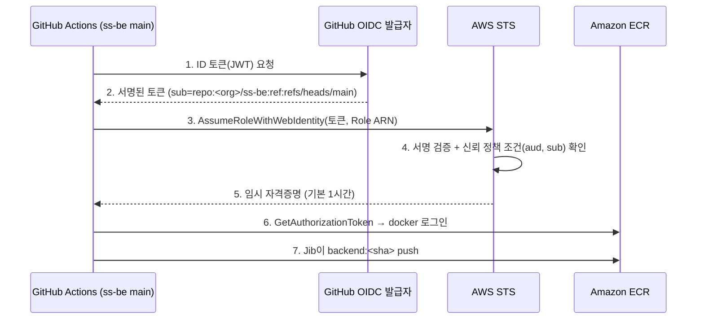

# GitHub Actions → ECR 이미지 push: AWS 인증 방식 의사결정

> 상태: **확정 (② GitHub OIDC + IAM Role)** · 작성일: 2026-10-21 · 확정일: 2026-10-22
> 구축 매뉴얼: [gha-ecr-jib-push-manual-v1.md](gha-ecr-jib-push-manual-v1.md)
> 근거 문서: [english-speaking-prd-architecture-v1.md](../../english-speaking-prd-architecture-v1.md) §6.10 CI/CD

---

## 0. 배경과 전제

- 목표: `ss-be`(backend) 레포의 `main`에 merge되면 GitHub Actions가 이미지를 빌드해서 Amazon ECR에 push한다.
- 아키텍처 문서 §6.10의 결정 사항:
  - 인증은 **"AWS OIDC 롤로 인증 — 장기 액세스 키 없음"**으로 적혀 있다. 이 문서는 그 결정을 다시 확인하기 위한 자료다.
  - backend는 **Jib**으로 빌드한다. Dockerfile과 Docker 데몬이 필요 없다.
  - 산출물은 ECR `backend:<git sha>`이고, ECR **tag immutability**를 켠다.
  - `k8s-manifests`의 이미지 태그 갱신에는 GitHub App 토큰이나 PAT를 쓴다. 이는 **AWS 인증과 별개**이므로 이 문서의 범위가 아니다.
- 확인 필요: 문서에는 레포 이름이 `backend`이지만 실제 이름은 `ss-be`다. 권한 조건에 레포 이름이 그대로 들어가므로 이름을 확정해야 한다.

---

## 1. 한눈에 보는 비교

| # | 방식 | 장기 비밀 | 설정 난이도 | 운영 부담 | 보안 | 비용 | 적합도 |
|---|---|---|---|---|---|---|---|
| ① | IAM User Access Key → GitHub Secrets | **있음** | 매우 쉬움 | 키 로테이션 필요 | 낮음 | 무료 | ✗ (문서 방침과 충돌) |
| ② | **GitHub OIDC + IAM Role** | 없음 | 쉬움~보통 | 거의 없음 | **높음** | 무료 | **◎ 권장** |
| ③ | Access Key + AssumeRole (role chaining) | 있음 | 보통 | 키 로테이션 필요 | 중간 | 무료 | △ |
| ④ | Self-hosted runner(EC2) + Instance Profile | 없음 | 높음 | 러너 패치·스케일 | 중간~높음 | EC2 비용 | △ (triton 디스크 부족할 때만) |
| ⑤ | AWS CodeBuild 호스팅 Actions 러너 | 없음 | 보통 | 낮음 | 높음 | CodeBuild 분당 과금 | ○ (대형 빌드용 대안) |
| ⑥ | IAM Roles Anywhere (X.509 인증서) | 인증서·개인키 | 높음 | PKI 운영 | 중간~높음 | 무료(+CA 비용) | ✗ (온프렘용) |

> 용어가 낯설다면 먼저 [§3 용어 풀이](#3-용어-풀이-쉬운-설명)를 읽는다.

---

## 2. 방식별 상세

### ① IAM User Access Key를 GitHub Secrets에 저장

- **핵심**: `AWS_ACCESS_KEY_ID`와 `AWS_SECRET_ACCESS_KEY`를 GitHub Secrets에 넣고, 워크플로에서 꺼내 쓴다.
- **장점**: 설정이 5분이면 끝나고 예제가 가장 많다.
- **단점**
  - 만료되지 않는 비밀번호가 GitHub에 계속 남는다. 유출되면 키를 직접 폐기할 때까지 누구나 쓸 수 있다.
  - 키 교체(로테이션)를 사람이 챙겨야 한다.
  - 감사 기록에는 "IAM User가 했다"까지만 남는다. 어느 레포의 어떤 실행인지는 구분하기 어렵다.
  - 브랜치나 레포 단위로 권한을 제한할 수 없다.
- **판단**: 문서 방침과 충돌한다. 대안인 ②의 설정 비용이 작아서 고를 이유가 거의 없다.

### ② GitHub OIDC + IAM Role — 권장

- **핵심**: 워크플로가 실행될 때마다 GitHub가 "이 실행은 `ss-be` 레포의 `main` 브랜치에서 왔다"는 **서명된 증명서(토큰)**를 발급한다. AWS는 이 증명서를 확인한 뒤 **1시간짜리 임시 자격증명**을 내준다.
- **동작 흐름**

- **AWS 측 구성** (계정당 1회 + 레포당 Role 1개)
  1. **IAM OIDC Provider** 등록
     - URL: `token.actions.githubusercontent.com`
     - Audience: `sts.amazonaws.com`
  2. **IAM Role**의 신뢰 정책 조건
     - `token.actions.githubusercontent.com:aud` = `sts.amazonaws.com`
     - `token.actions.githubusercontent.com:sub` = `repo:<org>/ss-be:ref:refs/heads/main`
     - GitHub Environment를 쓰는 경우에는 `repo:<org>/ss-be:environment:<env>`
  3. **권한 정책**(ECR push에 필요한 최소 권한)
     - `ecr:GetAuthorizationToken`: Resource `*` (이 권한은 리소스를 지정할 수 없다)
     - `backend` 리포지토리 ARN으로 한정:
       - `ecr:BatchCheckLayerAvailability`
       - `ecr:InitiateLayerUpload`
       - `ecr:UploadLayerPart`
       - `ecr:CompleteLayerUpload`
       - `ecr:PutImage`
       - `ecr:BatchGetImage`
- **GitHub 측 구성**
  - 워크플로에 `permissions: { id-token: write, contents: read }`를 넣는다.
  - `aws-actions/configure-aws-credentials`에 `role-to-assume`을 지정해 실행한다.
  - 이어서 `aws-actions/amazon-ecr-login`을 실행하면 `~/.docker/config.json`에 로그인 정보가 기록된다.
  - Jib이 이 파일을 읽어 push한다. Docker 데몬은 필요 없다.
- **장점**
  - GitHub에 저장하는 비밀이 0개다. 토큰이 유출되더라도 최대 1시간 안에 쓸모가 없어진다.
  - "어느 레포의, 어느 브랜치에서"만 허용할지 조건으로 정할 수 있다.
  - CloudTrail에 Role 세션 이름이 남아 누가 push했는지 추적할 수 있다.
  - 레포별로 Role을 나눌 수 있다(`ss-be`는 backend만, `triton`은 triton만).
  - AWS와 GitHub가 모두 공식으로 권장하는 방식이다.
- **단점과 주의점**
  - **`sub` 조건을 빼거나 `repo:<org>/*`처럼 넓게 쓰면** 다른 레포나 브랜치에서도 이 Role을 쓸 수 있다. 가장 흔한 사고다.
  - 조직에서 OIDC `sub` 형식을 커스터마이징했다면 조건 문자열도 그 형식에 맞춰야 한다.
  - 처음 설정할 때 `Not authorized to perform sts:AssumeRoleWithWebIdentity` 오류를 디버깅하느라 시간이 걸릴 수 있다. 원인은 보통 `sub`나 `aud` 불일치, 또는 `id-token: write` 누락이다.
- **러너 제약**: 없다. GitHub 호스티드 러너와 self-hosted 러너 모두에서 동작한다.
### ③ Access Key + AssumeRole (role chaining)

- **핵심**: 권한이 거의 없는 IAM User 키로 로그인한 뒤, 실제 권한을 가진 Role로 갈아탄다.
- **장점**: 권한이 Role 한 곳에 모이고, 세션 이름으로 어느 정도 추적할 수 있다.
- **단점**: 장기 키가 여전히 남는다. ①의 근본 문제는 그대로이고 설정만 늘어난다.

### ④ Self-hosted runner(EC2) + Instance Profile

- **핵심**: 우리가 관리하는 EC2에서 빌드를 실행한다. EC2에 붙인 Role의 자격증명이 자동으로 공급된다.
- **장점**
  - 저장하는 비밀이 없다.
  - 디스크와 CPU를 자유롭게 늘릴 수 있다. 문서 §6.10에 적힌 **Triton 대형 이미지의 디스크 부족 문제**를 해결할 수 있다.
  - VPC 엔드포인트를 쓰면 ECR까지 사설 경로로 갈 수 있다.
- **단점**
  - 러너 OS 패치, 스케일링, 정리를 직접 해야 한다.
  - 인스턴스의 모든 작업이 같은 권한을 공유하므로, 레포별로 권한을 나누기 어렵다.
  - public 레포에 붙이면 fork PR로 임의 코드가 실행될 위험이 있다.
  - 상시 가동하면 EC2 비용이 든다.
- **판단**: backend(Jib)는 가벼워서 필요 없다. triton 빌드에서 디스크가 부족할 때만 검토한다.

### ⑤ AWS CodeBuild 호스팅 GitHub Actions 러너

- **핵심**: 워크플로의 `runs-on`을 CodeBuild 프로젝트로 지정하면, 작업이 AWS CodeBuild에서 실행되고 CodeBuild 서비스 롤로 인증된다.
- **장점**: 러너를 관리할 필요가 없고, 큰 컴퓨트와 디스크를 고를 수 있으며, VPC 안에서 실행할 수 있다.
- **단점**
  - CodeBuild 프로젝트, GitHub 연결, 웹훅을 추가로 구성해야 한다.
  - 분당 과금이 붙는다.
  - 문제가 생기면 GitHub와 AWS 양쪽을 확인해야 한다.
- **불확실**: 세부 설정(라벨 문법, 지원 이미지)은 최신 AWS 문서로 확인해야 한다.

### ⑥ IAM Roles Anywhere

- **핵심**: 사설 인증기관(CA)이 발급한 인증서로 임시 자격증명을 받는다.
- **판단**: 온프렘 서버처럼 AWS 밖에 있는 워크로드용이다. GitHub Actions에는 OIDC가 있으므로 인증서와 개인키를 Secrets에 넣을 이유가 없다.

---

## 3. 용어 풀이 (쉬운 설명)

> 비유: **AWS 계정 = 회사 건물**, **ECR = 건물 안의 창고**, **GitHub Actions = 창고에 물건을 넣으러 오는 배송 기사**.

### 3.1 AWS 권한의 기본

| 용어 | 쉬운 설명 | 이 문서에서의 의미 |
|---|---|---|
| **IAM** (Identity and Access Management) | AWS의 출입 관리 시스템. 누가 어떤 문을 열 수 있는지 정한다. | 모든 방식의 기반 |
| **IAM User** | 특정 사람이나 프로그램에 발급한 **영구 사원증**. | ①과 ③에서 쓴다 |
| **Access Key** (Access Key ID + Secret Access Key) | IAM User의 아이디와 비밀번호 한 쌍. 프로그램이 로그인할 때 쓴다. **만료되지 않는다.** | ①과 ③의 위험 요소 |
| **장기 자격증명 / 장기 비밀** | 누가 폐기하기 전까지 계속 유효한 열쇠. 잃어버리면 위험하다. | ②는 이것을 없앤다 |
| **IAM Role** | 사람에게 붙는 사원증이 아니라 **"창고 출입 담당"이라는 역할 명찰**. 자격이 있는 사람이 잠깐 빌려 차고, 시간이 지나면 반납된다. | ②의 핵심 |
| **AssumeRole** | 역할 명찰을 **빌려 차는 행위**. | ②에서는 GitHub가 명찰을 빌린다 |
| **STS** (Security Token Service) | 명찰을 빌려주는 **AWS 안내 데스크**. 자격을 확인하고 임시 출입증을 내준다. | 토큰 검증과 임시 자격증명 발급 |
| **임시 자격증명** | 1시간 정도 지나면 **자동으로 무효**가 되는 출입증. | 유출되어도 피해 시간이 짧다 |
| **정책(Policy)** | "무엇을 해도 된다/안 된다"를 적은 JSON 규칙표. | 아래 두 가지가 있다 |
| **신뢰 정책(Trust Policy)** | Role에 붙는 **"누가 이 명찰을 빌릴 수 있는가"** 규칙. | "`ss-be`의 `main`에서 온 GitHub만 가능" |
| **권한 정책(Permission Policy)** | 명찰을 찬 사람이 **"무엇을 할 수 있는가"** 규칙. | "`backend` 창고에 이미지 넣기만 가능" |
| **최소 권한 원칙** | 일에 꼭 필요한 권한만 준다. | push 권한만 주고 삭제 권한은 주지 않는다 |
| **ARN** (Amazon Resource Name) | AWS 리소스의 **고유 주소**. 예: `arn:aws:ecr:ap-northeast-2:123456789012:repository/backend` | 권한을 특정 창고로 좁힐 때 쓴다 |
| **Resource `*`** | "모든 리소스"라는 뜻의 와일드카드. | `GetAuthorizationToken`만 예외적으로 `*`가 필요하다 |
| **CloudTrail** | AWS의 **출입 기록 CCTV**. 누가 언제 무엇을 했는지 남는다. | push 이력 감사 |
| **Role 세션 이름** | 명찰을 빌릴 때 적는 **방문자 이름**. CloudTrail에 남는다. | 어느 워크플로 실행인지 식별 |

### 3.2 OIDC 관련

| 용어 | 쉬운 설명 | 이 문서에서의 의미 |
|---|---|---|
| **OIDC** (OpenID Connect) | "이 사람이 누구인지"를 **신뢰할 수 있는 발급처가 서명한 증명서**로 증명하는 표준 방식. "구글로 로그인"과 같은 원리다. | GitHub가 "이 실행은 ss-be/main에서 왔다"고 증명한다 |
| **IdP** (Identity Provider, 신원 제공자) | 증명서를 **발급하는 쪽**. | GitHub(`token.actions.githubusercontent.com`) |
| **IAM OIDC Provider** | AWS에 "이 발급처의 증명서는 믿겠다"고 **등록해 두는 것**. 계정당 한 번만 한다. | ②의 첫 설정 단계 |
| **ID 토큰 / JWT** (JSON Web Token) | 발급처가 **전자서명한 증명서 파일**. 내용을 위조하면 서명이 깨진다. | GitHub가 워크플로 실행마다 새로 발급한다 |
| **Claim(클레임)** | 증명서에 적힌 **항목 하나하나**. 예: 레포 이름, 브랜치, 발급처 | AWS가 이 항목으로 조건을 검사한다 |
| **`iss`** (issuer) | 발급처. | `https://token.actions.githubusercontent.com` |
| **`aud`** (audience) | **"이 증명서는 누구에게 보여주려고 만든 것인가"**. 다른 곳에서 재사용하는 것을 막는다. | `sts.amazonaws.com` |
| **`sub`** (subject) | **"이 증명서의 주인이 누구인가"**. 보안의 핵심 조건이다. | `repo:<org>/ss-be:ref:refs/heads/main` |
| **AssumeRoleWithWebIdentity** | OIDC 증명서를 내밀고 Role 명찰을 빌리는 **STS API 이름**. | ②의 3단계 |
| **Thumbprint** | 예전에 발급처 인증서를 확인하던 지문 값. 현재 GitHub OIDC는 AWS가 자체 검증한다고 알려져 있다. 콘솔에서 자동으로 처리된다. | 신경 쓸 일이 거의 없다(최신 문서로 확인 권장) |

### 3.3 GitHub Actions 관련

| 용어 | 쉬운 설명 | 이 문서에서의 의미 |
|---|---|---|
| **Workflow** | `.github/workflows/*.yml`에 적는 **자동화 작업 순서표**. | merge 시 빌드 → push |
| **Runner(러너)** | 워크플로를 **실제로 실행하는 컴퓨터**. | 아래 두 종류가 있다 |
| **GitHub 호스티드 러너** | GitHub가 빌려주는 일회용 VM. 작업이 끝나면 사라진다. | backend 빌드에 충분하다 |
| **Self-hosted 러너** | 우리가 직접 운영하는 컴퓨터를 러너로 등록한 것. | ④ |
| **GitHub Secrets** | 워크플로에서 쓸 비밀 값을 암호화해 보관하는 곳. | ①은 여기에 키를 넣고, ②는 넣을 것이 없다 |
| **`permissions: id-token: write`** | 워크플로가 **OIDC 증명서를 발급받을 수 있게 허락**하는 설정. 빠뜨리면 ②가 동작하지 않는다. | 필수 설정 |
| **Action** (`uses: ...`) | 남이 만들어 둔 **재사용 가능한 작업 블록**. | 아래 두 가지를 쓴다 |
| **`aws-actions/configure-aws-credentials`** | OIDC 증명서를 받아 STS에서 임시 자격증명으로 바꿔 주는 AWS 공식 Action. | ②의 핵심 단계 |
| **`aws-actions/amazon-ecr-login`** | 임시 자격증명으로 ECR 로그인 정보를 만들어 `~/.docker/config.json`에 기록하는 Action. | Jib이 이 로그인 정보를 읽어 쓴다 |
| **GitHub Environment** | `prod`처럼 이름 붙인 **배포 대상 단위**. 승인자 지정과 전용 비밀 설정이 가능하다. | `sub` 조건으로 쓸 수 있다(선택) |
| **Branch protection(브랜치 보호)** | `main`에 직접 push하는 것을 막고 PR 리뷰를 강제하는 설정. | `main`이 곧 ECR push 권한이므로 함께 걸어야 한다 |
| **Fork PR** | 외부인이 레포를 복사해서 보낸 PR. | public 레포라면 self-hosted 러너에서 특히 위험하다 |

### 3.4 ECR·빌드 관련

| 용어 | 쉬운 설명 | 이 문서에서의 의미 |
|---|---|---|
| **ECR** (Elastic Container Registry) | AWS의 **컨테이너 이미지 창고**. | push 대상 |
| **ECR Repository** | 창고 안의 **이미지별 칸**. | `backend`, `triton` |
| **Tag** | 이미지 버전에 붙이는 이름표. | `backend:<git sha>` |
| **Tag immutability** | 한 번 붙인 이름표를 **덮어쓸 수 없게** 하는 설정. | 같은 SHA로 다른 이미지가 올라가는 사고를 막는다 |
| **`ecr:GetAuthorizationToken`** | ECR 로그인용 임시 비밀번호(12시간 유효)를 받는 권한. | push 전에 꼭 필요하다 |
| **Layer upload 권한들** | 이미지를 조각(layer) 단위로 올리는 데 필요한 권한 묶음. | §2-② 권한 목록 |
| **Jib** | Dockerfile이나 Docker 없이 Java 앱을 **바로 이미지로 만들어 레지스트리에 올리는** Gradle/Maven 플러그인. | backend 빌드 도구 |
| **`~/.docker/config.json`** | 레지스트리 로그인 정보를 저장하는 파일. Docker가 없어도 Jib이 읽는다. | ecr-login이 쓰고 Jib이 읽는다 |

---

## 4. 의사결정 기준 체크리스트

| 기준 | 질문 | ②를 선택하면 |
|---|---|---|
| 비밀 관리 | 장기 비밀을 0개로 유지할 것인가? | 충족 |
| 권한 범위 | `ss-be`의 `main`에서만 push가 가능해야 하는가? | `sub` 조건으로 충족 |
| 레포 분리 | backend와 triton 권한을 분리할 것인가? | Role 2개로 분리 |
| 감사 | 누가 어떤 이미지를 올렸는지 추적이 필요한가? | CloudTrail + 세션 이름 |
| 러너 | GitHub 호스티드 러너로 충분한가? | backend는 충분, triton은 디스크 별도 검증 |
| 비용 | 추가 비용 없이 가능한가? | 무료 |
| 운영 | 로테이션이나 패치 부담이 없는가? | 없음 |
| 승인 게이트 | 배포 전 사람의 승인이 필요한가? | GitHub Environment의 required reviewers와 조합 |

---

## 5. 권장안

**② GitHub OIDC + 레포별 IAM Role + GitHub 호스티드 러너**

- 아키텍처 문서 §6.10 방침과 일치한다.
- 저장하는 비밀이 없고, 비용이 없고, 운영 부담이 가장 적다.
- triton 빌드에서 디스크가 부족하면 **인증 방식은 그대로(②) 두고 러너만** larger runner나 ⑤로 바꾸면 된다.

---

## 6. 확정이 필요한 값

| # | 항목 | 예시 / 메모 | 결정 |
|---|---|---|---|
| 1 | GitHub org/user 이름, 레포 이름 | `ss-be`와 문서의 `backend` 중 무엇인가 | `say-scene/ss-be` |
| 2 | `sub` 조건 기준 | 브랜치(`ref:refs/heads/main`, PoC에 단순) 또는 Environment | 브랜치 `main`. immutable subject가 켜져 있어 실제 값은 `repo:say-scene@345080911/ss-be@1426408654:ref:refs/heads/main` |
| 3 | AWS 계정 ID, 리전 | 예: `ap-northeast-2` | `944296702922` / `ap-northeast-2` |
| 4 | ECR 리포지토리 이름, immutability | `backend` / 활성화 | `ss-be` / 비활성화(mutable) |
| 5 | Role 이름 규칙 | 예: `gha-ss-be-ecr-push`, `gha-triton-ecr-push` | `gha-ss-be-ecr-push` |
| 6 | `main` 브랜치 보호 | PR 필수, 직접 push 금지 | 적용하지 않음(미니 프로젝트, 직접 push) |

---

## 7. 적용 시 영향 범위와 롤백

- **영향 범위**: 해당 AWS 계정의 IAM에 OIDC Provider 1개와 Role 1개(레포당)가 추가된다. 기존 리소스와 권한은 바뀌지 않는다.
- **롤백**: Role과 Provider를 삭제하면 된다. 영향은 워크플로의 ECR push 단계가 실패하는 것뿐이다.
- IAM 생성은 권한 변경이므로 **적용 전에 별도 승인**을 받는다.

---

## 8. 검증 상태

- 이 문서의 API 이름, 권한 목록, 클레임 형식은 작성자의 지식을 기준으로 정리했다.
- 2026-10-22에 ② 방식으로 실제 계정에 구축했고, `ss_be`의 ECR push 실행이 성공했다. 단, `sub` 클레임은 §2-②의 기본 형식이 아니라 immutable subject 형식이었다(§6 #2 참고).
- 구현할 때 다음 공식 문서로 확인한다.
  - GitHub Docs: "Configuring OpenID Connect in Amazon Web Services"
  - AWS 문서: IAM OIDC 자격 증명 공급자, ECR 리포지토리 정책
  - `aws-actions/configure-aws-credentials` README
