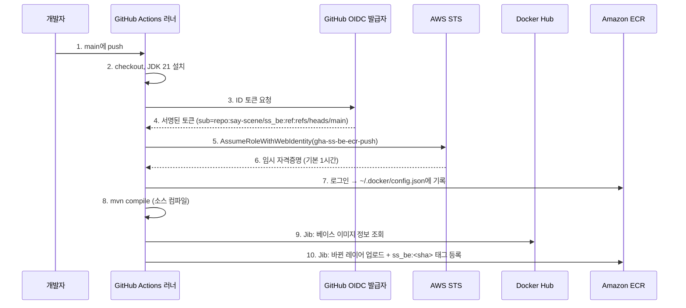

# GitHub Actions + Jib → ECR 이미지 자동 push 매뉴얼

> 상태: **운영 중 (첫 실행 성공)** · 작성일: 2026-10-22
> 근거 문서: [gha-ecr-aws-auth-decision-v1.md](gha-ecr-aws-auth-decision-v1.md) (② GitHub OIDC + IAM Role 채택)

---

## 0. 요약

- `ss_be` 레포의 `main`에 push하면 GitHub Actions가 백엔드 이미지를 빌드해서 ECR에 push한다.
- 이미지 빌드는 **Jib**(Maven 플러그인)이 한다. **Dockerfile과 Docker 데몬이 필요 없다.**
- AWS 인증은 **GitHub OIDC + IAM Role**로 한다. GitHub에 저장하는 AWS 비밀 값은 없다.
- 결과물: `944296702922.dkr.ecr.ap-northeast-2.amazonaws.com/ss_be:<짧은 git SHA 7자리>`

---

## 1. 확정 값

| 항목 | 값 |
|---|---|
| GitHub 레포 | `say-scene/ss_be` |
| 실행 조건 | `main` push, 수동 실행(`workflow_dispatch`) |
| AWS 계정 / 리전 | `944296702922` / `ap-northeast-2` |
| OIDC Provider | `token.actions.githubusercontent.com`, Audience `sts.amazonaws.com` |
| IAM Role | `gha-ss-be-ecr-push` (`arn:aws:iam::944296702922:role/gha-ss-be-ecr-push`) |
| ECR 리포지토리 | `ss_be` (tag mutable) |
| 이미지 태그 | 짧은 git SHA 7자리 |
| CPU 아키텍처 | `amd64` (Jib 기본값) |
| 베이스 이미지 | `eclipse-temurin:21-jre` (Docker Hub) |
| Role ARN 보관 | GitHub Repository Variable `AWS_ROLE_ARN` |
| push 전 테스트 | 실행하지 않음 (추후 결정) |
| `main` 브랜치 보호 | 없음 (미니 프로젝트, 직접 push) |

---

## 2. 전체 흐름



### 2.1 Jib의 역할

- Jib은 별도 서버가 아니라 `pom.xml`에 등록된 **Maven build plugin**이다. GitHub 호스티드 러너(`ubuntu-latest`)에서 `mvn` 명령의 일부로 실행된다.
- 컨테이너 이미지는 **레이어 파일(tar)과 메타데이터(JSON)의 묶음**이다. Jib은 이것을 Java 코드로 직접 만들고, 레지스트리 API로 바로 업로드한다. 그래서 Dockerfile과 Docker 데몬이 필요 없다.
- 만들어진 이미지는 Docker나 Kubernetes가 그대로 실행할 수 있는 표준 이미지(Docker/OCI 형식)다.
- 앱을 아래 세 레이어로 나눈다. 코드만 바뀐 커밋이면 클래스 레이어만 다시 올라간다.
  1. 의존성 JAR
  2. 리소스
  3. 컴파일된 클래스
- ECR에 이미 있는 레이어는 업로드하지 않는다.

### 2.2 Jib 목표별 차이

| 목표 | Docker 데몬 | 용도 |
|---|---|---|
| `jib:build` | 필요 없음 | 레지스트리로 직접 push. **CI에서 쓰는 목표** |
| `jib:dockerBuild` | 필요함 | 로컬 Docker에 이미지 적재 |
| `jib:buildTar` | 필요 없음 | tar 파일로 저장 |

---

## 3. 레포 구성 (`ss_be`)

### 3.1 `pom.xml`의 Jib 설정

```xml
<plugin>
  <groupId>com.google.cloud.tools</groupId>
  <artifactId>jib-maven-plugin</artifactId>
  <version>3.4.5</version>
  <configuration>
    <from><image>eclipse-temurin:21-jre</image></from>
    <container>
      <ports><port>8080</port></ports>
      <user>10001</user>
    </container>
  </configuration>
</plugin>
```

- `<to><image>`(push 대상)는 pom에 적지 않는다. workflow에서 `-Dimage`로 넘긴다.

### 3.2 `.github/workflows/ecr-push.yml`

```yaml
name: ecr-push

on:
  push:
    branches: [main]
  workflow_dispatch:

permissions:
  id-token: write
  contents: read

jobs:
  push:
    runs-on: ubuntu-latest
    steps:
      - uses: actions/checkout@v4
      - uses: actions/setup-java@v4
        with:
          distribution: temurin
          java-version: '21'
          cache: maven
      - uses: aws-actions/configure-aws-credentials@v4
        with:
          role-to-assume: ${{ vars.AWS_ROLE_ARN }}
          aws-region: ap-northeast-2
      - id: ecr
        uses: aws-actions/amazon-ecr-login@v2
      # Jib은 Docker 데몬 없이 ~/.docker/config.json의 ECR 로그인 정보로 직접 push한다.
      - run: mvn -B compile jib:build -Dimage=${{ steps.ecr.outputs.registry }}/ss_be:${GITHUB_SHA::7}
```

| 단계 | 하는 일 |
|---|---|
| `permissions: id-token: write` | OIDC 토큰 발급을 허용한다. 빠지면 인증이 실패한다 |
| `actions/checkout` | 레포 소스를 러너에 내려받는다 |
| `actions/setup-java` | JDK 21을 설치하고 Maven 의존성을 캐시한다 |
| `configure-aws-credentials` | OIDC 토큰을 IAM Role의 임시 자격증명으로 바꾼다 |
| `amazon-ecr-login` | ECR 로그인 정보를 `~/.docker/config.json`에 기록한다. `registry` 출력에 ECR 주소가 담긴다 |
| `mvn compile jib:build` | 컴파일한 뒤 Jib으로 이미지를 만들어 ECR에 push한다. 테스트는 실행하지 않는다 |

- Maven은 `ubuntu-latest` 러너에 기본으로 설치돼 있다. 레포에 Maven Wrapper(`mvnw`)는 없다.

---

## 4. AWS 설정 절차 (계정당 1회)

### 4.1 IAM OIDC Provider 등록

IAM → 자격 증명 공급자 → 공급자 추가

| 항목 | 값 |
|---|---|
| 공급자 유형 | OpenID Connect |
| 공급자 URL | `https://token.actions.githubusercontent.com` |
| 대상 (Audience) | `sts.amazonaws.com` |

- "대상" 칸의 설명은 "앱의 ID 제공업체가 발행한 클라이언트 ID"로 되어 있다. GitHub Actions에는 발급된 클라이언트 ID가 따로 없으므로, 토큰의 `aud` 값인 `sts.amazonaws.com`을 넣는다.

### 4.2 IAM Role 생성

IAM → 역할 → 역할 생성 → **웹 자격 증명**

| 항목 | 값 |
|---|---|
| 자격 증명 공급자 | `token.actions.githubusercontent.com` |
| Audience | `sts.amazonaws.com` |
| GitHub organization | `say-scene` |
| GitHub repository | `ss_be` |
| GitHub branch | `main` |
| 역할 이름 | `gha-ss-be-ecr-push` |
| 설명 | `Allows GitHub Actions to push ss_be images to ECR` |
| 권한 경계 | 사용하지 않음 |

- 권한 정책 선택 화면에서는 관리형 정책을 고르지 않는다. `AmazonEC2ContainerRegistryPowerUser` 같은 관리형 정책은 계정의 모든 ECR 리포지토리에 권한을 준다.
- 권한 경계를 쓰지 않는 이유: 인라인 정책이 이미 최소 권한이고, Role에 IAM 권한이 없어 스스로 권한을 늘릴 수 없다.

#### 신뢰 정책 (최종본)

```json
{
	"Version": "2012-10-17",
	"Statement": [
		{
			"Effect": "Allow",
			"Principal": {
				"Federated": "arn:aws:iam::944296702922:oidc-provider/token.actions.githubusercontent.com"
			},
			"Action": "sts:AssumeRoleWithWebIdentity",
			"Condition": {
				"StringEquals": {
					"token.actions.githubusercontent.com:aud": "sts.amazonaws.com",
					"token.actions.githubusercontent.com:sub": "repo:say-scene@345080911/ss_be@1426408654:ref:refs/heads/main"
				}
			}
		}
	]
}
```

- **`sub`에 숫자 ID가 들어간다.** 이 레포는 GitHub OIDC **immutable subject**(`use_immutable_subject: true`)가 켜져 있어서, `sub`가 `repo:<org>@<org ID>/<repo>@<repo ID>:...` 형식으로 발급된다. 콘솔 마법사가 만든 `repo:say-scene/ss_be:...` 형식으로는 인증이 실패한다(첫 실행 실패 원인).
  - ECR의 tag mutability와는 관계없는 GitHub 쪽 설정이다.
  - 실제 prefix는 아래 명령으로 확인한다.
    ```bash
    gh api repos/say-scene/ss_be/actions/oidc/customization/sub
    ```
- org 이름은 **`say-scene`**(하이픈 포함)이다. 처음에 `sayscene`으로 잘못 입력해서 고쳤다. 틀리면 인증이 실패한다.
- 콘솔 마법사가 `sub` 조건을 `StringLike`로 만들거나 같은 값을 두 번 넣을 수 있다. 와일드카드(`*`)가 없으면 `StringEquals` 하나로 정리한다.
- `sub`에 `*`를 넣으면 다른 브랜치나 레포에서도 이 Role을 쓸 수 있으므로 넣지 않는다.

#### 권한 정책 (인라인)

역할 → 권한 추가 → 인라인 정책 생성 → JSON

```json
{
  "Version": "2012-10-17",
  "Statement": [
    {
      "Effect": "Allow",
      "Action": "ecr:GetAuthorizationToken",
      "Resource": "*"
    },
    {
      "Effect": "Allow",
      "Action": [
        "ecr:BatchCheckLayerAvailability",
        "ecr:InitiateLayerUpload",
        "ecr:UploadLayerPart",
        "ecr:CompleteLayerUpload",
        "ecr:PutImage",
        "ecr:BatchGetImage"
      ],
      "Resource": "arn:aws:ecr:ap-northeast-2:944296702922:repository/ss_be"
    }
  ]
}
```

- `ecr:GetAuthorizationToken`은 리소스 범위를 좁힐 수 없다. 반드시 `"Resource": "*"`로 둔다.

### 4.3 ECR 리포지토리 생성

ECR → 프라이빗 리포지토리 → 생성 (`ap-northeast-2`)

| 항목 | 값 |
|---|---|
| 이름 | `ss_be` |
| 태그 변경 불가능성 | Mutable (같은 SHA로 재실행하면 태그를 덮어쓴다) |

### 4.4 수명 주기 정책 (선택, 첫 이미지 push 후 적용)

최근 이미지 30개만 보관한다.

```json
{"rules":[{"rulePriority":1,"description":"keep last 30","selection":{"tagStatus":"any","countType":"imageCountMoreThan","countNumber":30},"action":{"type":"expire"}}]}
```

---

## 5. GitHub 설정

Role ARN을 Repository Variable로 등록한다. 비밀 값이 아니므로 Secret이 아니라 **Variable**에 넣는다.

```bash
gh variable set AWS_ROLE_ARN --repo say-scene/ss_be --body "arn:aws:iam::944296702922:role/gha-ss-be-ecr-push"
```

- 콘솔에서는 레포 Settings → Secrets and variables → Actions → **Variables** 탭에서 등록한다.
- **Secrets** 탭에 넣으면 workflow의 `vars.AWS_ROLE_ARN`으로 읽을 수 없다.

---

## 6. 실행과 확인

1. 변경 사항을 `main`에 push한다. 수동으로 실행하려면 Actions 탭 → `ecr-push` → Run workflow를 누른다.
2. GitHub Actions 탭에서 `ecr-push` 실행이 성공했는지 확인한다.
3. ECR에 이미지가 올라갔는지 확인한다.

```bash
aws ecr describe-images --repository-name ss_be --region ap-northeast-2 --query 'sort_by(imageDetails,&imagePushedAt)[-1].imageTags'
```

---

## 7. 문제 해결

| 증상 | 원인 후보 | 조치 |
|---|---|---|
| `Not authorized to perform sts:AssumeRoleWithWebIdentity` | 신뢰 정책 `sub` 불일치(immutable subject의 숫자 ID 누락, org·repo·branch 오타), `aud` 불일치 | §4.2의 `gh api` 명령으로 prefix를 확인하고 최종본과 비교한다 |
| `Credentials could not be loaded` | `permissions: id-token: write` 누락 | workflow의 `permissions`를 확인한다 |
| `Input required and not supplied: role-to-assume` | `AWS_ROLE_ARN` Variable 미등록, 또는 Secrets 탭에 등록함 | §5대로 Variables 탭에 등록한다 |
| 수동 실행만 인증 실패 | `main`이 아닌 브랜치에서 실행함 | 신뢰 정책이 `main`만 허용한다. `main`에서 실행한다 |
| ECR push 단계에서 `name unknown` / `repository does not exist` | ECR 리포지토리 이름이나 리전 불일치 | `ss_be` 리포지토리가 `ap-northeast-2`에 있는지 확인한다 |
| ECR push 단계에서 `AccessDenied` | 권한 정책 Resource ARN 불일치 | §4.2 권한 정책의 ARN을 확인한다 |
| 베이스 이미지 조회 중 `429 Too Many Requests` | Docker Hub 익명 pull 횟수 제한 | `<from><image>`를 `public.ecr.aws/docker/library/eclipse-temurin:21-jre`로 바꾼다 |
| Pod가 `exec format error`로 실행되지 않음 | 노드가 ARM(Graviton)인데 이미지가 `amd64` | Jib `<platforms>` 설정에 `arm64`를 추가한다 |

---

## 8. 알려진 제약과 추후 결정 사항

- **Docker Hub 의존**: Jib은 빌드할 때마다 베이스 이미지 정보를 Docker Hub에서 조회한다. GitHub 호스티드 러너는 매번 새로 만들어지므로 Jib 로컬 캐시가 남지 않는다. 레이어 본체는 ECR에 이미 있으면 다운로드를 건너뛰는 것으로 알고 있지만, 실제로 확인하지는 않았다.
- **테스트 미실행**: `mvn compile jib:build`는 테스트를 실행하지 않는다. 테스트를 넣기로 하면 `verify`를 추가한다.
- **브랜치 보호 없음**: `main`에 push할 수 있는 사람은 누구나 ECR에도 push할 수 있다.
- **Maven 버전 미고정**: `mvnw`가 없어서 러너에 설치된 Maven 버전을 쓴다.
- **Action 버전**: `checkout@v4`, `setup-java@v4`, `configure-aws-credentials@v4`, `amazon-ecr-login@v2`로 적었다. 더 최신 메이저 버전이 있을 수 있다.
- **범위 밖**: `k8s-manifests`의 이미지 태그 갱신(GitHub App 토큰 또는 PAT)은 다음 단계로 남긴다.

---

## 9. 검증 상태

- AWS 설정(OIDC Provider, Role 신뢰·권한 정책, ECR 리포지토리)과 GitHub Variable 등록은 끝났다.
- workflow를 `main`에 push했다(`6d33334`).
- 첫 실행은 `sub` 형식 불일치(immutable subject)로 인증 단계에서 실패했다. 신뢰 정책을 고친 뒤 재실행해서 **성공했다** ([run 39712790582](https://github.com/say-scene/ss_be/actions/runs/39712790582)).
- 콘솔 화면의 항목 이름은 AWS UI 변경으로 달라질 수 있다.
