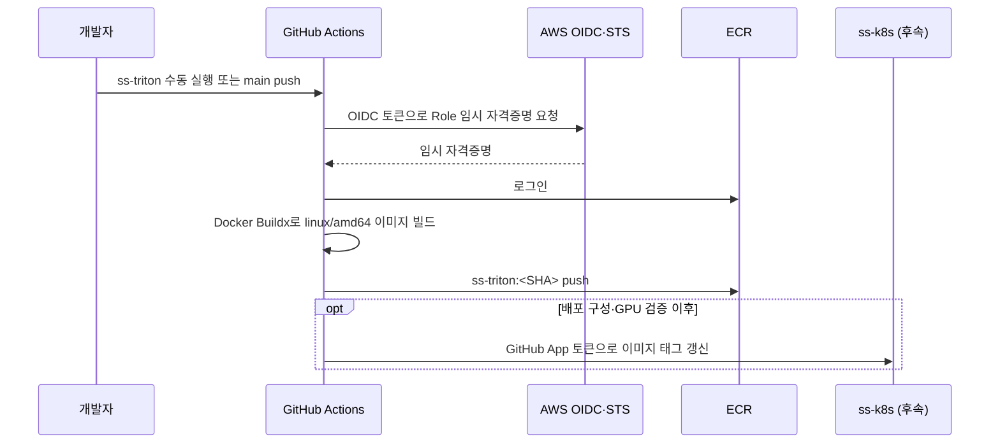

# GitHub Actions + Docker Buildx → Triton 이미지 ECR push 매뉴얼

> 상태: **1차 파일 작성·로컬 정적 검사 완료, 이미지 빌드·GPU 실행 미검증** · 작성일: 2026-10-26
> 기준: [BE ECR push 매뉴얼](gha-ecr-jib-push-manual-v1.md), [AWS 인증 결정](gha-ecr-aws-auth-decision-v1.md), [제품·아키텍처 v1](../../english-speaking-prd-architecture-v1.md) §6.6·§6.10
> 범위: `ss-triton` 이미지의 CI 빌드·ECR push. `ss-k8s` 태그 갱신과 클러스터 배포는 이후 단계로 구분한다.

---

## 0. 요약

- 목표 흐름은 `ss-triton` 소스 → GitHub Actions → Docker Buildx → ECR `ss-triton:<commit SHA>`이다.
- BE에서 쓰는 **GitHub OIDC + 레포 전용 IAM Role**과 ECR 로그인 방식은 재사용한다. BE의 Jib 대신 Dockerfile을 Buildx로 빌드한다.
- 첫 검증은 `workflow_dispatch`로 이미지만 push한다. 이미지가 실제로 빌드되고 ECR에 있는지 확인한 뒤 `main` push 자동 실행을 켠다.
- `ss-k8s` 태그 갱신은 Triton Deployment, GPU AMI의 가중치, 두 모델 readiness 검증이 준비된 후 연결한다. ECR push 성공만으로 서비스 배포 성공을 뜻하지 않는다.
- **현재 파일 상태**: `ss-triton`에 Dockerfile·실행 스크립트·두 모델 설정/코드·readiness 검사·수동 CI workflow를 1차 작성했다. `ss-k8s/apps/ss-triton`에도 Deployment·Service·Kustomize를 작성했다. 베이스는 `26.09`를 첫 시도 버전으로 선택했으나 이미지 빌드·GPU 실행·ECR push는 미검증이며 Deployment는 `replicas: 0`, 이미지 태그는 `pending-ci-build`다.

### BE와 달라지는 점

| 항목 | BE 매뉴얼 | Triton CI 계획 |
|---|---|---|
| 이미지 빌드 | Maven `jib:build`; Dockerfile·Docker 데몬 불필요 | Dockerfile + Buildx; Docker 빌더 필요 |
| 소스 | Java 코드·JAR | Triton 파생 이미지, 진입점, 두 모델 설정·Whisper Python 코드 |
| 빌드 대상 | Java 21 앱 | GPU 노드용 `linux/amd64` 이미지. CI 빌드에 GPU는 불필요하지만 실행 검증에는 GPU가 필요 |
| ECR 이름 | 현재 GitHub workflow는 `ss-be` 사용 | **제안**: `ss-triton` (생성·실제 이름 확인 전) |
| 태그 | BE workflow는 SHA 7자리 | 사용자 결정: SHA 7자리로 통일. `ss-k8s`와 정확히 일치시킬 것 |
| 태그 덮어쓰기 | BE 문서의 ECR은 mutable | 아키텍처 v1대로 immutable 제안. 같은 SHA로 재실행하면 이미 존재하는 태그 때문에 push 실패 가능 |
| K8s 태그 | `apps/ss-be/kustomization.yaml` 갱신 구현됨 | 1차 파일 작성됨. 실제 이미지 태그 갱신 job은 후속 작업 |
| 배포 단위 | BE 이미지 태그 | 이미지 + GPU AMI + Qwen/Whisper 가중치·토크나이저 revision + 설정의 호환 묶음 |

---

## 1. 값과 확인 상태

| 항목 | 값 / 상태 |
|---|---|
| GitHub 레포 | `say-scene/ss-triton` (로컬 `origin` 및 사용자 확인 완료) |
| AWS 계정·리전 | `944296702922` / `ap-northeast-2` (2026-10-26 사용자 확인) |
| OIDC Provider | `token.actions.githubusercontent.com` / Audience `sts.amazonaws.com` (2026-10-26 사용자 확인, 재사용) |
| IAM Role | `gha-ss-triton-ecr-push` (사용자 설정 완료 보고). 인라인 정책 `ss-triton-ecr-push`; 실제 OIDC 인증은 CI 실행 전으로 미검증 |
| ECR 리포지토리 | **제안** `ss-triton`; 생성 여부·immutability 미확인 |
| GitHub Repository Variable | `AWS_ROLE_ARN` 등록 사용자 확인 완료. 실제 workflow 인증은 미검증 |
| 첫 트리거 | 수동 `workflow_dispatch`; 확인 후 `main` push 추가 |
| 이미지 태그 | `${GITHUB_SHA::7}` (사용자 결정: FE·BE·Triton 모두 앞 7자리). Immutable ECR의 동일 태그 재실행 주의 |
| 대상 플랫폼 | `linux/amd64` (PRD의 g6.xlarge/L4 GPU 노드) |
| 베이스 이미지 | `nvcr.io/nvidia/tritonserver:26.09-vllm-python-py3` (CUDA 13.4.1, 첫 시도 버전으로 사용자 선택). 실행 호환성 미검증 |
| 모델 산출물 | 이미지에는 코드·설정, 가중치는 GPU AMI `/opt/models`에 둔다는 PRD 설계 |
| `ss-k8s` 자동 갱신 | 보류: K8s Triton 앱과 GPU 실행 검증 필요 |

`ss_be`/`ss_k8s`는 이전 문서의 레포 이름이다. 현재 로컬 원격은 `ss-be`/`ss-k8s`다. AWS ECR 이름은 GitHub 레포 이름과 별개이므로 콘솔의 실제 이름을 확인한 뒤 workflow·IAM ARN·Kustomize 값을 한 이름으로 맞춘다.

---

### 1.1 시작 전에 확인할 것

GitHub 레포, AWS 계정 `944296702922`·서울 리전 `ap-northeast-2`, 기존 OIDC Provider와 Audience는 2026-10-26 사용자 확인이 끝났다. Triton 전용 IAM Role과 인라인 정책·신뢰 정책 설정까지 사용자 완료 보고를 받았다. 이후 GitHub `AWS_ROLE_ARN` 등록까지 사용자 확인을 받았다. 현재는 **Triton 이미지 빌드 입력과 CI 실행기 설계**를 검토한다. 아래 항목은 사전 확인 기록이다.

1. AWS 콘솔 우측 상단 계정 메뉴에서 계정 ID가 `944296702922`인지 확인한다. 다르면 사용할 실제 계정 ID로 이 문서의 ARN·ECR 주소를 변경한다.
2. ECR을 사용할 리전이 서울 `ap-northeast-2`인지 확인한다. IAM은 글로벌 서비스이므로 IAM 화면의 리전 표시와 ECR 대상 리전을 혼동하지 않는다.
3. IAM → 자격 증명 공급자에서 `token.actions.githubusercontent.com`을 열고, 공급자 유형이 OpenID Connect이고 Audience(클라이언트 ID 목록)에 `sts.amazonaws.com`이 포함되는지 확인한다. 같으면 기존 Provider를 재사용한다.
4. 현재 로그인한 사용자/Role로 IAM Role과 ECR 리포지토리를 생성할 수 있는지 확인한다. 권한을 알 수 없다면 설정 단계에서 확인하며, 필요한 범위를 넘어 미리 권한을 넓히지 않는다.

여기까지 확인되면 §4.2의 Triton 전용 Role과 §4.3의 ECR을 준비한다. Dockerfile·모델 설정·workflow·GitHub App environment는 해당 단계에서 준비한다. GPU 서버 실행 검증은 배포 연동 전에 진행하며 CI 빌드·push 준비와 병행할 수 있다.

---

## 2. 전체 흐름과 순서

1. **이미지 소스 준비**: `ss-triton`에 `Dockerfile`, `entrypoint.sh`, `model_repository/qwen3_8b/`, `model_repository/whisper_stt/`, `.dockerignore`를 둔다. Mac용 `local/whisper_server.py`는 Triton Python backend의 `model.py`를 대신하지 않는다.
2. **기술 스파이크**: 고정한 Triton 베이스 이미지에서 Qwen3 thinking OFF·구조화 출력, Whisper 라이브러리 호환, 9000(LLM)/8000(STT), 순차 로드·두 모델 readiness를 검증한다. PRD §6.6의 가정이며 아직 성공 증거가 없다.
3. **AWS 준비**: 기존 OIDC Provider를 확인하고 `ss-triton` 전용 ECR 리포지토리와 최소 권한 IAM Role을 만든다. AWS 설정 변경은 영향·되돌리는 방법을 확인하고 별도 승인 후 실행한다.
4. **GitHub 준비**: `ss-triton` Repository Variable `AWS_ROLE_ARN`을 등록하고 수동 실행 workflow를 추가한다.
5. **CI 첫 실행**: `workflow_dispatch`로 Buildx 이미지 빌드·ECR push를 수행한다. 이미지 digest·플랫폼·태그를 확인한다. GPU 없이 CI에서 확인하는 것은 **빌드 산출물**까지다.
6. **자동 트리거**: 첫 실행이 성공하면 `main` push를 트리거에 추가한다. 불필요한 큰 이미지 빌드를 줄이려면 `paths` 필터를 검토하되, Dockerfile·모델 코드·workflow 변경이 빠지지 않게 한다.
7. **배포 연동**: `ss-k8s`에 Triton Deployment/Service/Kustomize가 마련되고 GPU AMI·모델 호환성 검증을 통과하면 GitHub App으로 이미지 태그 갱신 job을 추가한다. ArgoCD 적용과 서비스 readiness는 별도 확인한다.



### 2.1 Jib과 Buildx의 차이

- Jib은 Java 프로젝트를 레이어로 나눠 레지스트리에 직접 push한다. Triton은 베이스 이미지에 Python 의존성·모델 설정·진입점을 추가해야 하므로 Dockerfile을 Buildx로 빌드한다.
- `docker buildx build --platform linux/amd64 --push`는 빌드 결과를 ECR에 바로 보낸다. Mac이 ARM이어도 CI 러너에서 목표 아키텍처를 고정한다. [Docker Buildx 명령](https://docs.docker.com/reference/cli/docker/buildx/build/).
- Triton 베이스 이미지가 커서 GitHub 호스티드 러너 디스크가 부족할 수 있다. 첫 빌드에서 이미지 크기·러너 잔여 공간·시간을 측정한 뒤 larger/self-hosted runner를 결정한다. 결과를 미리 성공으로 가정하지 않는다.

---

#### Buildx 소개와 GPU가 필요한 시점

Buildx는 Dockerfile을 읽어 컨테이너 이미지를 만드는 Docker의 빌드 도구이며 내부적으로 BuildKit 엔진을 사용한다. Jib과 이미지 생성·레지스트리 push라는 목적은 같지만, Jib은 Java/Maven 프로젝트에 특화되고 Buildx는 Dockerfile에 적은 다양한 실행 환경·설치·파일 복사를 처리한다. 캐시 재사용, 목표 플랫폼 지정, 빌드 결과 push 등을 지원한다.

현재 Dockerfile의 작업은 공식 Triton 이미지를 가져와 Python 의존성을 설치하고 코드·설정을 복사하는 것이므로 **CPU 빌드 서버에서 수행 가능**하다. 이미지에 GPU용 소프트웨어를 넣는 것과 GPU로 모델을 실행하는 것은 단계가 다르다. Dockerfile의 `RUN`에 GPU 추론 검증을 추가한다면 그 단계에는 GPU가 필요하지만 현재 초안은 그렇게 구성하지 않았다.

```text
CPU 빌드 실행기 → Buildx로 이미지 생성 → ECR push
GPU 추론 서버 → 이미지 다운로드 → 컨테이너 실행 → Qwen·Whisper 로드·추론
```

#### FE·BE·Triton의 SHA 사용 비교

2026-10-26 로컬 레포 workflow를 읽어 확인한 값이다. 원격 main의 최신 실행 결과를 조회한 검증은 아니다.

| 대상 | 사용값 | 저장 용도 | 확인 파일 |
|---|---|---|---|
| FE | `${GITHUB_SHA::7}` 앞 7자리 | S3 객체의 `commit` 메타데이터. Docker 이미지 태그가 아님 | `ss-fe/.github/workflows/build.yml` |
| BE | `${GITHUB_SHA::7}` 앞 7자리 | ECR 이미지 태그·ss-k8s newTag·태그 갱신 커밋 문구 | `ss-be/.github/workflows/ecr-push.yml` |
| Triton 초안 | `${GITHUB_SHA::7}` 앞 7자리 | ECR 이미지 태그. K8s 자동 갱신은 아직 미구현 | `ss-triton/.github/workflows/ecr-push.yml` |

FE의 정적 asset 파일명 해시는 Vite가 파일 내용으로 생성하는 별도 값이며 Git commit SHA 자릿수와 같은 개념이 아니다. 세 레포의 SHA는 각 레포 커밋을 가리킨다. 자릿수는 앞 7자리로 통일하며, 각 산출물·매니페스트가 해당 레포의 동일 태그를 참조해야 한다. 사용자 결정에 따라 FE의 S3 메타데이터와 Triton 이미지 태그를 7자리로 변경했다. BE는 기존 7자리를 유지한다. 전체 Git commit SHA는 원본 식별자로 남고 산출물 표기에만 앞 7자리를 사용한다.

---

### 2.2 빌드 실행기 검토 메모: GitHub-hosted와 EC2 self-hosted

팀 메모의 “Triton 베이스 약 10GB, CI 한 번 약 20분”은 공유받은 참고 수치다. 선택할 베이스 태그·러너에서 직접 측정한 결과는 아니며, 압축 이미지 크기와 압축 해제·빌드 캐시까지 포함한 실제 디스크 사용량을 구분한다.

| 항목 | GitHub-hosted runner | EC2 self-hosted runner |
|---|---|---|
| 실행 장소 | GitHub가 제공하는 VM | 우리가 준비한 EC2에 runner 프로그램을 등록 |
| 수명 | 일반적인 Linux job마다 새 VM | 지속 실행·필요할 때 기동·매번 폐기 중 별도 설계 |
| 캐시 | job 사이 로컬 디스크 유지 안 됨. 외부 캐시를 명시적으로 사용 가능 | 동일 EBS와 BuildKit 캐시를 유지하면 재사용 가능 |
| 관리 | GitHub가 VM 관리 | EC2 비용, OS·Docker·runner 업데이트, 디스크·캐시 정리를 직접 관리 |
| 기존 workflow와 관계 | `runs-on: ubuntu-latest` | 등록한 runner의 labels/groups로 job 배정. 빌드·push의 기본 흐름 재사용 |

EC2도 VM이다. 달라지는 것은 “VM인지 EC2인지”가 아니라 **빌드를 실행할 서버를 누가 제공·관리하는지**다. 빌드 대상은 여전히 컨테이너 이미지이고, ECR은 이미지 저장소, 추론용 GPU EC2는 실행 장소다. 빌드용 CPU EC2와 추론용 GPU EC2를 구분하며, 이미지 조립만으로 GPU가 필요한 것은 아니다.

```text
GitHub Actions workflow
  → 등록된 EC2 runner가 job 실행
  → Docker Buildx로 Triton 이미지 빌드
  → ECR push
  → (후속) ss-k8s 태그 갱신 → ArgoCD → GPU 서버에서 추론
```

**캐시 유지 조건**: EC2를 쓴다는 이유만으로 빨라지는 것은 아니다. Docker/BuildKit 데이터가 있는 디스크와 builder를 유지해야 한다. `docker/setup-buildx-action`이 만드는 builder의 수명·정리 설정도 확인한다. 호스트 Docker에 base image를 한 번 pull한 것만으로 별도 BuildKit builder의 캐시 적중을 보장하지 않는다. EC2 재생성, 볼륨 삭제, cache prune, 베이스·의존성 변경 시 재다운로드·재빌드가 생길 수 있다. 중지 후에도 보존하는 EBS는 비용이 발생한다.

현재는 **실행기 선택 미확정**이다. 기존 OIDC + IAM Role + ECR 흐름은 유지하고, GitHub-hosted에서 캐시를 쓰는 안과 EC2의 지속 BuildKit 캐시를 쓰는 안을 비교한다. EC2 생성·runner 등록은 비용·권한 변경을 수반하므로 설계 검토 후 별도 승인하여 진행한다. 기존 BE나 운영 클러스터 노드를 빌드 서버로 바로 사용하지 않는다. 등록할 경우 신뢰한 `main`/수동 실행만 허용하고 공개 레포의 외부 PR 코드를 지속 runner에서 실행하지 않도록 트리거를 검토한다.

참고: [GitHub-hosted runner](https://docs.github.com/en/actions/concepts/runners/github-hosted-runners), [self-hosted runner 관리](https://docs.github.com/en/actions/how-tos/manage-runners/self-hosted-runners), [Docker의 GitHub Actions 캐시](https://docs.docker.com/build/ci/github-actions/cache/).

### 2.3 S3·init container 메모는 모델 준비 방식

“S3 → init container”가 모델 가중치를 S3에서 받아 공유 볼륨에 준비한 뒤 Triton을 시작한다는 뜻이라면, 이는 **Kubernetes 파드 기동 과정**에 해당한다. 빌드용 EC2 runner 선택과는 독립적이다. 정확한 팀 의도는 아직 확인하지 않았다.

현재 PRD는 **GPU AMI의 `/opt/models`에 가중치를 미리 넣고 hostPath로 연결**하는 설계다. S3 다운로드 방식으로 바꾸면 S3 접근 권한, 대상 볼륨, revision·무결성 확인, 다운로드 실패·재시작·콜드스타트 시간을 추가로 결정해야 한다. 따라서 S3/init container는 대안 메모로 남기며 기존 AMI 설계를 자동으로 교체하지 않는다. 모델 전달 방식을 나중에 바꾸더라도 가중치 경로·revision과 실행 스크립트의 계약은 함께 맞춘다.

---

## 3. 레포 구성과 workflow 초안

### 3.1 `ss-triton`: 빌드 입력

아키텍처 v1이 요구하는 최소 구조:

```text
ss-triton/
  Dockerfile
  .dockerignore
  entrypoint.sh
  model_repository/
    qwen3_8b/config.pbtxt
    qwen3_8b/1/model.json
    whisper_stt/config.pbtxt
    whisper_stt/1/model.py
  .github/workflows/ecr-push.yml
  local/                  # Mac 전용 검증 서버, 이미지 빌드 입력과 분리
```

- 베이스 태그는 실제 제공 여부와 Qwen3/vLLM·Python backend 호환성을 확인해 고정한다. `FROM`에 `latest`를 쓰지 않는다.
- 가중치·토크나이저는 이미지에 넣지 않고 `/opt/models`를 가진 GPU AMI와 함께 검증한다. `.dockerignore`에 `.venv`, 캐시, 로컬 모델 파일 등을 제외한다.
- Dockerfile의 `RUN` 설치·`COPY`와 GPU 호환성은 실제 이미지 빌드에서 확인한다. 1차 작성 파일의 Shell·Python·JSON 문법, Kustomize 렌더링은 확인했다. Dockerfile의 `TRITON_BASE_IMAGE` 기본값은 `nvcr.io/nvidia/tritonserver:26.09-vllm-python-py3`다. build arg로 변경 가능하다. `tritonserver`, `tritonfrontend` 바인딩이 없는 베이스는 빌드 단계에서 실패하도록 해 미지원 구성을 조기에 확인한다.

#### 폴더 이름과 내부 구조의 규칙

Triton의 공통 규칙은 `<저장소 경로>/<모델 이름>/<숫자 버전>/백엔드가 요구하는 파일`이다. 저장소 루트 이름은 `model_repository`로 고정된 예약어가 아니며, 서버 시작 시 `--model-repository`로 지정한 경로와 일치하면 된다. 모델 이름도 정할 수 있지만 API 호출·로드 명령·설정에 쓰는 이름을 함께 맞춰야 한다. `config.pbtxt`에 `name`을 명시한다면 모델 폴더 이름과 같아야 한다. 숫자 `1/`은 Triton 모델 버전이고 Hugging Face 모델 revision이나 이미지 SHA와는 별개다.

공통 계층은 같아도 버전 폴더의 파일까지 모두 같지는 않다. 이 설계에서 Qwen은 `backend: "vllm"`과 `1/model.json`, Whisper는 `backend: "python"`과 `1/model.py`를 사용한다. vLLM 단독 서버는 Triton의 숫자 버전 폴더를 요구하지 않는다. [Triton 저장소 규칙](https://github.com/triton-inference-server/server/blob/main/docs/user_guide/model_repository.md), [vLLM backend 공식 예시](https://github.com/triton-inference-server/vllm_backend).

SayScene 제안 구성은 위 Git 레포의 `model_repository/`를 이미지 안 `/models`로 복사하고, 별도 가중치 경로 `/opt/models`를 연결하는 방식이다.

```text
컨테이너 내부
/models/                         # Git에서 온 코드·Triton 설정
  qwen3_8b/
    config.pbtxt
    1/model.json                 # model: /opt/models/Qwen3-8B-FP8
  whisper_stt/
    config.pbtxt
    1/model.py                   # /opt/models의 Whisper 경로에서 로드
/opt/models/                     # GPU AMI에서 마운트할 가중치·토크나이저
  Qwen3-8B-FP8/                  # 다운로드한 모델의 원래 파일 구성 보존
  faster-whisper-large-v3-turbo/ # 제안 이름, 코드·배포 경로와 맞춰 확정
```

이 구성이면 CI는 Dockerfile·코드·설정을 이미지에 담고, 실행 시 가중치를 연결한다. Qwen과 Whisper의 가중치 내부 파일 구성은 서로 다르며, 각 로더가 요구하는 다운로드 결과를 유지한다. S3/init container를 채택할 경우에도 동일한 `/opt/models` 경로로 가중치를 준비하도록 맞출 수 있다. 실제 이미지 태그·로더 호환성은 별도 검증 대상이다. 위 경로의 코드·설정은 1차 파일로 생성했으며 가중치 자체는 다운로드하거나 배치하지 않았다.

### 3.2 `ss-triton`: `.github/workflows/ecr-push.yml` 예시 (1단계: ECR push만)

아래는 로컬 `ss-triton/.github/workflows/ecr-push.yml`에 1차 작성한 내용이다. 실행은 하지 않았다. 수동 실행 시 고정 태그의 `triton_base_image`를 입력해야 하며 `main`에서만 실행한다. GitHub-hosted는 초기 시험용 구성이고 EC2 runner 전환 여부는 미확정이다.

```yaml
name: ecr-push

# 1차 초안: 수동 실행만 허용. 러너·베이스 이미지 검증 후 main push 연동을 결정한다.
on:
  workflow_dispatch:
    inputs:
      triton_base_image:
        description: 'Triton 베이스 이미지 고정 태그 (초기 선택: 26.09 / CUDA 13.4.1)'
        default: 'nvcr.io/nvidia/tritonserver:26.09-vllm-python-py3'
        required: true
        type: string

permissions:
  contents: read

concurrency:
  group: triton-ecr-push
  cancel-in-progress: false

jobs:
  push:
    if: github.ref == 'refs/heads/main'
    # GitHub-hosted 임시 구성. EC2 runner 전환은 미확정이다.
    runs-on: ubuntu-latest
    permissions:
      contents: read
      id-token: write
    steps:
      - uses: actions/checkout@v4
      - name: Validate base image
        env:
          TRITON_BASE_IMAGE: ${{ inputs.triton_base_image }}
        run: |
          [[ "$TRITON_BASE_IMAGE" =~ ^nvcr.io/nvidia/tritonserver:[0-9]{2}\.[0-9]{2}-vllm-python-py3$ ]]
          bash -n entrypoint.sh
          python3 -m json.tool model_repository/qwen3_8b/1/model.json > /dev/null
      - uses: docker/setup-buildx-action@v3
      - uses: aws-actions/configure-aws-credentials@v4
        with:
          role-to-assume: ${{ vars.AWS_ROLE_ARN }}
          aws-region: ap-northeast-2
      - id: ecr
        uses: aws-actions/amazon-ecr-login@v2
      - name: Build and push Triton image
        env:
          REGISTRY: ${{ steps.ecr.outputs.registry }}
          TRITON_BASE_IMAGE: ${{ inputs.triton_base_image }}
        run: |
          docker buildx build \
            --platform linux/amd64 \
            --build-arg "TRITON_BASE_IMAGE=$TRITON_BASE_IMAGE" \
            --tag "$REGISTRY/ss-triton:${GITHUB_SHA::7}" \
            --push .
```

- **`push` job에는 environment를 두지 않는다.** BE처럼 IAM 신뢰 정책이 브랜치 `sub`를 검사할 경우 environment를 붙이면 `sub`가 달라진다.
- `id-token: write`는 OIDC 발급에 필요하고, ECR 권한은 IAM Role에서 `ss-triton` 리포지토리로 제한한다.
- ECR 태그가 immutable이면 같은 커밋의 수동 재실행은 이미 태그가 있어 실패할 수 있다. 실패 원인을 확인하고 새 커밋 SHA로 빌드하거나, 명시적으로 동일 태그를 건너뛰는 정책을 추가한다. 태그를 덮어쓰기 위해 immutability를 끄지 않는다.
- 이미지 소스와 런타임 검증 전에는 이 workflow만으로 완료 판정하지 않는다.

### 3.3 `ss-k8s` 이미지 태그 갱신 (후속)

- BE는 `update-tag` job에서 `say-scene-ss-k8s-writer` GitHub App 토큰으로 `ss-k8s`를 수정한다. 같은 앱이 `ss-k8s`에 설치되어 있다면 재사용 가능하지만 `ss-triton`의 `ss-k8s-write` environment에 App ID·개인키를 **별도로 등록해야 한다**. 기존 `ss-be` environment 값은 다른 레포에서 자동 공유되지 않는다.
- job은 `needs: push`로 이미지 push 성공 후에만 실행하고, `apps/ss-triton/kustomization.yaml`의 **해당 이미지 항목** `newTag`만 바꾼다. 대상 파일은 1차 작성됐고 태그는 `pending-ci-build`다. 실제 이미지가 생성된 뒤 교체한다. `ss-be`의 `sed`는 이미지 항목이 하나일 때만 안전한 예시이므로 그대로 복사하지 않는다.
- `ss-k8s`는 GitHub App 토큰으로 push해야 한다. 직접 `GITHUB_TOKEN`은 다른 레포 쓰기에 사용할 수 없다. 두 workflow가 같은 `ss-k8s` `main`을 동시에 수정하는 경합은 Triton 자체 concurrency만으로 해결되지 않으므로, 실패 시 최신 상태를 다시 받고 재시도하거나 업데이트 방식을 별도로 설계한다.
- **자동 태그 갱신을 켜기 전에** GPU AMI ID, Qwen·Whisper 가중치/토크나이저 revision, 모델 설정, 이미지 digest의 호환 묶음과 롤백할 이전 묶음을 기록한다. 태그만 되돌려도 AMI의 모델이 바뀌었다면 이전 런타임이 정상 기동하지 않을 수 있다.

---

### 3.4 1차 K8s 파일과 배포 전 확인

현재 `ss-k8s/apps/ss-triton`의 파일은 `01_deployment.yaml`, `02_service.yaml`, `kustomization.yaml`이다. 기존 `apps/ss-be`의 번호 규칙을 따랐다. Deployment는 `replicas: 0`, Recreate 전략, GPU 1개 요청, `/opt/models` 읽기 전용 hostPath, 공유 메모리 볼륨을 둔다. startup/readiness는 두 모델 READY를 검사하며 liveness는 Triton 서버 상태를 검사한다. CPU·메모리·probe 시간은 실측 전 임시값이다.

- 배포 전 `pending-ci-build`를 ECR에 있는 SHA 7자리로 교체하고 AMI 가중치·CUDA·두 모델 로드를 검증한 뒤 `replicas`를 1로 바꾼다.
- GPU 노드 선택은 PRD의 `g6.xlarge`, toleration은 `nvidia.com/gpu`로 초안을 작성했다. 실제 NodePool·taint와 대조한다. namespace는 배포 환경에서 지정하고 BE와 맞춘다.
- Service는 OpenAI `9000`, STT v2 `8000`, metrics `8002`를 ClusterIP로 제공한다. BE 설정은 배포 연동 시 `INFERENCE_BASE_URL=http://ss-triton:9000`, `INFERENCE_MODEL=qwen3_8b`, `STT_BASE_URL=http://ss-triton:8000`으로 맞춘다. 현재 BE 설정 파일은 이 작업에서 수정하지 않았다.
- Whisper 코드는 기존 BE의 base64 `AUDIO` 입력과 `TEXT` 응답을 따른다. 잘못된 입력은 Triton 오류로 반환한다. Triton의 HTTP 오류 상태와 현재 BE의 422/503 분기 대응은 실제 통합 검증이 필요하다.
- Qwen thinking OFF·JSON schema, OpenAI frontend의 Whisper 동적 로드·모델 목록 호환성은 GPU 스파이크에서 확인해야 하며, 파일 작성만으로 완료 처리하지 않는다.

---

### 3.5 ConfigMap·Secret·Ingress를 처음에 만들지 않은 이유

- **ConfigMap**: Kubernetes 환경값을 별도 관리할 때 사용한다. 현재 모델 경로·offline 설정은 Deployment의 `env`에 있고, Triton의 `config.pbtxt`·`model.json`은 이미지에 포함한다. Triton 모델 설정 파일과 K8s ConfigMap은 별개다. 환경별 값이 늘어나면 ConfigMap으로 분리할 수 있다.
- **Secret**: 현재 초안은 AMI의 로컬 가중치를 읽고 BE가 내부 Service로 호출하므로 추가 인증값이 없다. gated 모델 다운로드용 Hugging Face 토큰 등이 필요해지면 그 단계에서 추가한다. S3 init container를 채택하면 접근 권한 방식을 따로 정하고 장기 AWS 키를 YAML에 넣지 않는다.
- **Ingress**: 브라우저는 BE를 호출하고 BE가 ClusterIP `ss-triton`을 호출하므로 Triton의 외부 공개 경로는 현재 필요하지 않다. 동일 namespace가 아니라면 Service 주소를 namespace까지 포함해 조정한다.

ConfigMap을 결정하는 기준은 (1) 환경마다 달라지는 비밀 아닌 값인지, (2) 이미지 재빌드 없이 바꿀 필요가 있는지, (3) 운영자가 설정을 한곳에서 확인할 이점이 있는지다. SayScene은 BE와 같은 운영 패턴을 쓰고 모델 경로·offline 정책을 모아 볼 수 있어 ConfigMap 분리를 권한다. 다만 Qwen 경로는 현재 `model.json`과 진입점에도 고정돼 있으므로 환경변수만 추가해도 자동 반영되는 것으로 오인하지 않는다. 실제 분리 작업에서 사용하는 코드까지 함께 맞춘다. ConfigMap 변경 후 환경변수 반영에는 새 파드 기동이 필요하며, 모델 로딩·GPU 옵션 변경은 재기동·재로드 검증을 수반한다. 파일 구조·모델별 불변 설정은 이미지에 유지할 수 있다.

HF 토큰은 모델을 사용한다는 이유만으로 항상 필요한 것은 아니다. 공개 모델의 익명 다운로드와 gated/private 모델의 인증 다운로드를 구분한다. [Qwen3-8B-FP8 공개 모델](https://huggingface.co/Qwen/Qwen3-8B-FP8), [gated 모델 인증](https://huggingface.co/docs/hub/models-gated). 현재 코드는 AMI에 준비한 가중치와 `HF_HUB_OFFLINE=1`, Whisper `local_files_only=True`를 사용하므로 추론 파드에서 다운로드하지 않는다. AMI 준비 중 인증이 필요하면 그 준비 과정에 토큰을 제공한다. 추론 파드/init container에서 인증 다운로드를 하기로 정할 때 K8s Secret을 연결한다. Secret 예시 파일은 빈 템플릿으로 둘 수 있으나, 빈값 자체는 인증이 되지 않고 사용하지 않는 토큰을 추론 컨테이너에 전달할 필요도 없다.

### 3.6 Triton 베이스 이미지 버전의 의미와 후보

베이스 이미지는 Dockerfile의 `FROM`이 가져오는 NVIDIA 공식 실행 환경이다. BE의 `eclipse-temurin:21-jre`에 해당하며 모델 가중치는 포함하지 않는다. 첫 시도 버전은 `nvcr.io/nvidia/tritonserver:26.09-vllm-python-py3`로 사용자 선택했다. `26.09`는 2026년 9월 릴리스, `vllm-python-py3`는 vLLM·Python backend를 포함한 이미지 종류를 뜻한다.

2026-10-26 확인한 [NVIDIA 호환성 표](https://docs.nvidia.com/deeplearning/triton-inference-server/user-guide/docs/introduction/compatibility.html)는 이 이미지에 vLLM `0.29.0` 계열, CUDA `13.4.1`, Python `3.12.3`, 크기 `10.57 GB`를 명시한다. 이는 공식 표의 값이며 우리 환경에서 측정한 크기·호환성 결과가 아니다. GPU 노드의 NVIDIA 드라이버·CUDA 호환성, 추가 설치할 faster-whisper/CTranslate2·cuDNN 호환, OpenAI frontend 기능을 검증한 뒤 선택한다.

후보로 든 이유는 기존 PRD §6.6와 NVIDIA의 OpenAI frontend 예시가 `26.09-vllm-python-py3`를 제시하고, Qwen(vLLM)과 Whisper(Python)를 한 이미지에서 다루는 설계에 맞는 이미지 종류이기 때문이다. `python`은 이미지에 Python backend가 들어 있다는 뜻이며, 이 문자열 자체가 Python 코드는 아니다. 최신 버전이라는 이유만으로 고른 것은 아니며 비교 실험으로 최적 버전을 선정한 결과도 아니다.

추가 확인 결과 [faster-whisper GPU 설치 안내](https://github.com/SYSTRAN/faster-whisper#gpu)는 CUDA 12용 cuBLAS·cuDNN 9를 요구한다. 따라서 CUDA 13.4 기반 후보에 `faster-whisper`를 pip 설치한 것만으로 GPU 실행 가능하다고 판단할 수 없다. 선택할 CTranslate2 wheel과 필요한 CUDA 라이브러리를 확인하고, CUDA 12 기반 이전 Triton 이미지와 기능·드라이버 호환성을 비교해야 한다. CUDA 버전 번호 차이만으로 절대 실행 불가라고 단정하지도 않는다. 사용자는 이 위험을 확인한 뒤 CUDA 13.4.1로 먼저 시도하고 실패하면 조합을 재검토하기로 했다. 버전 선택은 완료했지만 실행 호환성 검증은 완료하지 않았다.

**첫 시도 버전: 26.09 / CUDA 13.4.1 (사용자 선택).** Dockerfile과 수동 workflow 기본값에 반영했으며, build arg·수동 실행 입력으로 다른 고정 태그를 지정할 수 있다. Whisper GPU 실행 실패 시 CTranslate2의 CUDA 12 라이브러리 요구와 드라이버를 먼저 확인하고, 해결이 어렵다면 CUDA 12 기반 이미지로 전환을 검토한다. Python 버전은 임의 변경하지 않는다. 모델 이름·이미지 버전·가중치 revision·이미지 SHA는 각각 별개다.

---

### 3.7 Python 버전 변경보다 이미지의 전체 조합을 확인

CUDA는 GPU 라이브러리이고 Python은 언어 실행 환경이다. CUDA 13.4에서 특정 Python 버전 하나만 실행되는 관계가 아니다. 공식 이미지에 맞춰 빌드된 Python·PyTorch·vLLM·Triton 바인딩의 조합을 우선 사용하고, Whisper의 CUDA 라이브러리 문제를 해결하려고 Python만 임의 변경하지 않는다.

[Qwen 공식 vLLM 배포 안내](https://qwen.readthedocs.io/en/stable/deployment/vllm.html)는 `vllm>=0.8.5`를 안내하고 `vllm serve Qwen/Qwen3-8B-FP8` 예시를 제공한다. 따라서 Qwen3-8B FP8의 vLLM 지원 자체는 공식 문서로 확인했다. 이는 Triton 경유의 thinking OFF·구조화 출력·Whisper 동시 적재·L4 VRAM 검증까지 완료했다는 뜻은 아니다.

[NVIDIA vLLM 이미지 호환성 표](https://docs.nvidia.com/deeplearning/triton-inference-server/user-guide/docs/introduction/compatibility.html)에서 확인한 비교값:

| 이미지 태그 | Python | 포함된 vLLM | CUDA | 상태 |
|---|---|---|---|---|
| `26.09-vllm-python-py3` | 3.12.3 | 0.29.0 계열 | 13.4.1 | 첫 시도 버전으로 사용자 선택. Whisper GPU 라이브러리 검증 필요 |
| `25.07-vllm-python-py3` | 3.12.3 | NVIDIA 빌드 0.9.0rc1 계열 | 12.9.0 | CUDA 12 기반 비교 후보. 오래된 버전으로 기능·결함·보안·배포 드라이버 검토 필요 |

두 이미지 모두 Python 3.12.3이며, 비교의 핵심은 Python 버전을 바꾸는 것이 아니라 GPU 라이브러리와 포함 런타임의 호환성이다. `25.07`의 포함 vLLM 버전은 모델 지원 범위 검토 근거일 뿐 실제 Qwen 실행 성공 증거는 아니다. 해당 이미지의 OpenAI frontend 경로·explicit load API·KServe frontend 지원도 확인해야 한다. release 브랜치의 해당 소스 조회는 이번 조사에서 실패했으므로 지원 여부를 추측해 확정하지 않는다.

검증 순서: (1) 모델·이미지 공식 지원 표 대조 → (2) 후보 이미지 안의 실제 Python/vLLM/CTranslate2 버전과 필요한 CUDA 라이브러리 확인 → (3) GPU에서 Qwen 단독·Whisper 단독 추론 → (4) 동시 적재·thinking OFF·구조화 출력·포트·readiness 확인. 현재 완료 범위는 (1)의 문서 조사이며 이미지 pull·GPU 실행은 미수행이다.

---

## 4. AWS 설정 절차 (승인 후 계정당/레포당 1회)

### 4.1 기존 OIDC Provider 확인

BE 매뉴얼 §4.1의 Provider는 계정 전체에서 재사용한다. `token.actions.githubusercontent.com` / Audience `sts.amazonaws.com`의 존재와 현재 계정을 확인한다. 중복 생성하지 않는다.

### 4.2 Triton 전용 IAM Role 생성

- **역할 이름**: `gha-ss-triton-ecr-push`.
- **역할 설명**: `Allows GitHub Actions to push ss-triton images to Amazon ECR using OIDC`.
- **인라인 정책 이름**: `ss-triton-ecr-push` (역할 이름과 구별한다).
- 신뢰 정책은 `aud=sts.amazonaws.com`과 **실제 `ss-triton/main` OIDC `sub`의 정확한 값**으로 한정한다. BE 문서의 `ss_be` 숫자 ID나 기존 레포 이름을 복사하지 않는다.
- 먼저 `gh api repos/say-scene/ss-triton/actions/oidc/customization/sub`로 레포의 subject 설정을 확인하고, `gh api repos/say-scene/ss-triton --jq '{id, owner_id: .owner.id, full_name}'`로 ID를 확인한다. [GitHub OIDC subject 형식](https://docs.github.com/en/actions/reference/security/oidc), [설정 조회 API](https://docs.github.com/en/rest/actions/oidc).
- immutable subject를 사용한다면 값은 `repo:say-scene@<org ID>/ss-triton@<repo ID>:ref:refs/heads/main` 형태일 수 있다. 실제 토큰/설정과 비교한 뒤 IAM에 넣는다. `*`로 레포나 브랜치를 넓히지 않는다.
- ECR push 권한은 `ecr:GetAuthorizationToken`에 `Resource: *`, 나머지 업로드·`PutImage`·`BatchGetImage` 등은 `arn:aws:ecr:ap-northeast-2:944296702922:repository/ss-triton`으로 제한한다. 상세 action 목록은 [AWS의 ECR push 최소 권한 예시](https://docs.aws.amazon.com/AmazonECR/latest/userguide/image-push-iam.html)와 BE 문서 §4.2를 따른다.

#### GitHub 조직·레포 ID와 OIDC 접두사 직접 조회

GitHub CLI에 로그인된 터미널에서 아래 명령을 실행한다. 로그인 안내가 나오면 `gh auth login`을 먼저 실행한다.

```bash
gh api repos/say-scene/ss-triton \
  --jq '{repository: .full_name, organization_id: .owner.id, repository_id: .id}'
```

사용자가 직접 확인한 결과:

```json
{
  "organization_id": 345080911,
  "repository": "say-scene/ss-triton",
  "repository_id": 1426409607
}
```

`@` 뒤 숫자는 각각 조직 ID와 레포 ID다. 별도로 OIDC 설정과 실제 접두사를 조회한다.

```bash
gh api repos/say-scene/ss-triton/actions/oidc/customization/sub
```

이 레포에서 API로 확인한 값은 다음과 같다.

```json
{
  "use_default": true,
  "use_immutable_subject": true,
  "sub_claim_prefix": "repo:say-scene@345080911/ss-triton@1426409607"
}
```

environment가 없는 `main` 브랜치 job은 이 접두사 뒤에 `:ref:refs/heads/main`을 붙인다. 조직·레포 ID만 확인하는 것과 OIDC 설정 확인은 별개이며, 이 레포는 위 두 조회 결과를 함께 근거로 삼는다.

#### 확인한 GitHub OIDC 값과 Role 신뢰 정책

2026-10-26 GitHub API의 읽기 전용 조회 결과:

- `use_default: true`, `use_immutable_subject: true`
- `sub_claim_prefix: repo:say-scene@345080911/ss-triton@1426409607`
- 조직 ID `345080911`, 레포 ID `1426409607`

따라서 environment가 없는 `main` 브랜치 job의 신뢰 정책은 아래와 같이 작성한다. 실제 AWS 인증 성공은 첫 CI 실행에서 확인한다.

```json
{
  "Version": "2012-10-17",
  "Statement": [{
    "Effect": "Allow",
    "Principal": {
      "Federated": "arn:aws:iam::944296702922:oidc-provider/token.actions.githubusercontent.com"
    },
    "Action": "sts:AssumeRoleWithWebIdentity",
    "Condition": {
      "StringEquals": {
        "token.actions.githubusercontent.com:aud": "sts.amazonaws.com",
        "token.actions.githubusercontent.com:sub": "repo:say-scene@345080911/ss-triton@1426409607:ref:refs/heads/main"
      }
    }
  }]
}
```

콘솔 순서: IAM → 역할 → 역할 생성 → 웹 자격 증명 → 기존 GitHub Provider와 `sts.amazonaws.com` 선택 → organization `say-scene`, repository `ss-triton`, branch `main` → 관리형 권한 정책 선택 없이 진행 → 역할 이름 `gha-ss-triton-ecr-push`로 생성 → 역할의 신뢰 관계에서 위 정책과 대조·수정. ECR 인라인 권한은 다음 단계에서 추가한다.

#### AWS 생성 화면의 중복 `sub` 수정

역할 생성 화면에서 아래처럼 숫자 ID가 빠진 같은 문자열이 두 번 들어간 `StringLike` 배열이 표시됐다.

```json
"StringLike": {
  "token.actions.githubusercontent.com:sub": [
    "repo:say-scene/ss-triton:ref:refs/heads/main",
    "repo:say-scene/ss-triton:ref:refs/heads/main"
  ]
}
```

중복 두 개는 값 하나와 같은 효과이며, 중복이 생긴 정확한 입력 원인은 확인하지 않았다. 이 레포는 immutable subject를 쓰므로 숫자 ID가 포함된 값으로 수정해야 한다.

**IAM → 역할 → `gha-ss-triton-ecr-push` → 신뢰 관계 → 신뢰 정책 편집**에서 위 `sub` 배열을 아래 단일 문자열로 교체한다. 기존 `aud`, Provider ARN, Action은 유지한다.

```json
"StringLike": {
  "token.actions.githubusercontent.com:sub": "repo:say-scene@345080911/ss-triton@1426409607:ref:refs/heads/main"
}
```

이 값에는 와일드카드가 없어 `StringLike`도 정확히 일치하는 값만 허용한다. 앞의 전체 JSON처럼 `aud`와 `sub`를 모두 `StringEquals`에 넣는 방식도 가능하다. 두 방식을 동시에 중복 등록할 필요는 없다. 저장 후 정책을 다시 열어 `aud=sts.amazonaws.com`과 숫자 ID를 포함한 단일 `sub`가 남아 있는지 확인한다.

#### ECR 인라인 정책 등록

역할의 **권한 → 권한 추가 → 인라인 정책 생성 → JSON**에 아래 정책을 넣고 이름을 `ss-triton-ecr-push`로 저장한다. 권한 목록에서 유형은 **고객 인라인**으로 표시된다. ECR 리포지토리 생성 전에도 ARN을 지정한 정책을 먼저 만들 수 있다.

```json
{
  "Version": "2012-10-17",
  "Statement": [
    {
      "Effect": "Allow",
      "Action": "ecr:GetAuthorizationToken",
      "Resource": "*"
    },
    {
      "Effect": "Allow",
      "Action": [
        "ecr:BatchCheckLayerAvailability",
        "ecr:InitiateLayerUpload",
        "ecr:UploadLayerPart",
        "ecr:CompleteLayerUpload",
        "ecr:PutImage",
        "ecr:BatchGetImage"
      ],
      "Resource": "arn:aws:ecr:ap-northeast-2:944296702922:repository/ss-triton"
    }
  ]
}
```

영향은 새 Role의 신뢰 관계와 이후 추가할 Triton ECR 권한이다. 되돌릴 때는 새 Role을 삭제한다. 기존 BE Role과 공유 OIDC Provider는 유지한다.

### 4.3 ECR 리포지토리

- `ap-northeast-2`에 `ss-triton` 이름을 **제안**한다. 실제 리포지토리 존재·이름은 확인 전이다.
- 아키텍처 v1의 SHA 태그 정책에 맞춰 **tag immutability 활성화**를 제안한다. ECR은 기존 immutable 태그에 push하면 `ImageTagAlreadyExistsException`을 반환한다. [AWS ECR 태그 정책](https://docs.aws.amazon.com/AmazonECR/latest/userguide/image-tag-mutability.html).
- 수명 주기 정책은 GPU 이미지 크기와 롤백에 필요한 태그 수를 파악한 뒤 정한다. BE의 “최근 30개”를 그대로 적용하면 필요한 호환 이미지가 지워질 수 있다.

---

## 5. GitHub 설정

### 5.1 `AWS_ROLE_ARN`

`ss-triton`의 Settings → Secrets and variables → Actions → **Variables**에 새 Role ARN을 `AWS_ROLE_ARN`으로 등록한다. `ss-be` Repository Variable은 다른 레포에 자동으로 넘어오지 않는다. Role ARN은 비밀 값이 아니다.

### 5.2 GitHub App 값 (배포 연동 단계)

`ss-k8s` 태그 자동 갱신을 추가할 때 `ss-triton`에 `ss-k8s-write` environment를 만들고 `main`만 허용한다. Environment Variable `SS_K8S_APP_ID`, Environment Secret `SS_K8S_APP_PRIVATE_KEY`를 등록한다. App 설치 대상·권한은 BE 매뉴얼 §5.2로 확인하되 실제 값과 정책을 재검증한다. 개인키 값은 문서·workflow·로그에 남기지 않는다.

---

## 6. 실행과 확인

1. `ss-triton`의 빌드 입력 파일을 준비하고 `Dockerfile`의 베이스 태그·모델 경로를 검토한다.
2. 승인 후 AWS Role/ECR과 GitHub Variable을 설정한다. 영향 범위는 `ss-triton`의 ECR push 권한과 새 ECR 리포지토리다. 되돌릴 때는 workflow/Variable/Role을 비활성화·삭제하고, ECR 이미지 삭제 여부는 별도로 판단한다.
3. `main`의 workflow를 수동 실행한다. GitHub Actions에서 OIDC 인증 → ECR 로그인 → Buildx 빌드·push 순서와 실패 지점을 확인한다.
4. 태그의 이미지가 ECR에 있는지 확인한다. 예: `aws ecr describe-images --repository-name ss-triton --region ap-northeast-2 --image-ids imageTag=<7자리 SHA>`.
5. digest와 `linux/amd64` 플랫폼을 확인한다. 이미지 pull 또는 `docker buildx imagetools inspect <ECR 이미지 URI:태그>`를 사용한다. GPU 모델 기동은 GPU 서버에서 별도로 검증한다.
6. 첫 실행 결과를 기록하고 `main` push 트리거를 추가한다. 이후 배포 연동은 §3.3의 선행 조건이 충족되면 진행한다.

---

## 7. 문제 해결

| 증상 | 원인 후보 | 확인/조치 |
|---|---|---|
| `AssumeRoleWithWebIdentity` 거절 | `ss-triton` OIDC `sub`와 IAM 신뢰 정책 불일치 | 레포·브랜치·immutable ID와 environment 유무 확인. BE의 ID를 복사하지 않음 |
| `role-to-assume` 누락 | `AWS_ROLE_ARN`이 `ss-triton` Variables에 없음 | Repository Variable 등록 위치 확인 |
| ECR `repository does not exist` / `AccessDenied` | 실제 ECR 이름·리전·Role ARN 불일치 | ECR 목록과 리포지토리 범위 IAM 정책 확인 |
| `ImageTagAlreadyExistsException` | immutable ECR에 같은 SHA로 재실행 | 기존 이미지가 정상인지 확인. 변경된 새 커밋으로 재빌드하거나 중복 처리 정책 적용 |
| 빌드 중 `no space left on device` | Triton 베이스 이미지/빌드 캐시가 러너 디스크 초과 | 실제 사용량 확인 후 불필요한 캐시 정리 또는 larger/self-hosted runner 검토 |
| 베이스 이미지를 가져오지 못함 | NGC 접근·태그·인증 또는 네트워크 문제 | 고정한 베이스 태그와 pull 가능 여부 확인 |
| ECR 이미지는 있으나 파드가 안 뜸 | GPU AMI의 가중치·토크나이저, CUDA 호환, 모델 설정, readiness 문제 | CI 성공과 런타임 성공을 분리해 GPU 스파이크 결과 확인 |
| `ss-k8s` 태그 push가 거절됨 | GitHub App 권한 또는 동시 커밋 | 설치 대상/Contents 권한 확인, 최신 `main`을 다시 받아 재시도 |

---

## 8. 알려진 제약과 후속 결정

- 정확한 Triton 베이스 태그와 포함된 vLLM·Python backend·CUDA/cuDNN 호환성은 미검증이다. §6.6 스파이크 결과로 고정한다.
- CI 빌드는 GPU 없이 가능하나 모델 로드·STT/LLM 호출·VRAM·readiness는 GPU에서 검증해야 한다.
- 대형 이미지의 GitHub 호스티드 러너 디스크·시간 한도는 실측 전이다. runner 증설이나 self-hosted 전환은 비용·운영 범위를 확인하고 결정한다.
- BE 매뉴얼은 이전 GitHub/ECR `ss_be` 이름과 mutable 태그를 설명한다. 현재 BE workflow의 GitHub 원격·ECR 경로는 `ss-be`다. 이 문서의 Triton `ss-triton` ECR 이름·immutable 설정도 **제안**이므로 실제 생성 전 확인한다.
- PRD §6.10의 “`main` push마다 빌드”와 본 문서의 “첫 수동 검증”은 단계가 다르다. 첫 성공 후 자동 트리거를 켜면 최종 흐름과 맞는다.
- `ss-k8s` 태그 갱신과 ArgoCD 배포는 이미지, AMI, 모델 설정의 호환성을 검증한 뒤 연결한다.

---

## 9. 검증 상태

- 로컬 `ss_triton` 원격·파일 목록, 로컬 `ss_be` workflow, `ss_k8s` 앱 목록, 기준 BE 매뉴얼과 PRD를 2026-10-26에 읽었다.
- AWS 계정·리전·OIDC Provider 재사용은 사용자 확인, Triton GitHub OIDC 설정과 조직·레포 ID는 GitHub API 조회로 확인했다.
- 사용자가 조직·레포 ID를 직접 조회해 일치함을 확인했고, IAM Role `gha-ss-triton-ecr-push`, 인라인 정책 `ss-triton-ecr-push`, 신뢰 정책 수정 단계의 완료를 보고했다. AWS 콘솔 상태를 도구로 재조회하거나 실제 OIDC 인증을 실행한 검증은 아니다.
- GitHub Repository Variable `AWS_ROLE_ARN` 등록은 사용자 확인을 받았다. ECR 이름 `ss-triton`, Immutable 태그와 AES-256 암호화를 안내했다. AWS 콘솔의 ECR 생성 결과를 도구로 조회하지는 않았다.
- 1차 코드·설정 파일 12개를 작성했다. Shell·Python·JSON 문법, workflow YAML 파싱·수동 트리거, Kustomize 렌더링을 확인했다. GPU 라이브러리를 대체한 로컬 검사로 base64 입력·TEXT 응답, 잘못된 입력, 두 모델 readiness 분기를 확인했다. 실제 Triton transport·Whisper 추론 검증은 아니다.
- `ss-triton` 이미지 빌드, Actions 실행, GPU 런타임은 **수행하거나 검증하지 않았다**. 빌드용 EC2 runner와 S3/init container는 검토 메모이며 미확정이다.
- 첫 수동 실행 후 Actions run URL, ECR 이미지 URI·digest, 베이스 태그, 빌드 시간·러너 디스크 사용량, GPU 스파이크 결과를 이 절에 기록한다.
