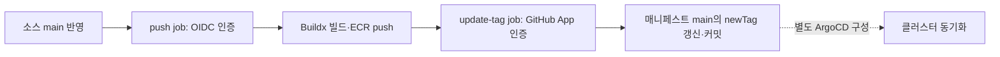

# Triton CI 구축 매뉴얼 — GitHub Actions → ECR → K8s 태그 갱신

> v1 · GitHub-hosted Ubuntu VM / Docker Buildx / AWS OIDC / GitHub App
> SayScene의 레포 구조를 예시로 설명한다. AWS 계정·조직·레포가 다르면 §2의 값을 자신의 환경에 맞게 바꾼다.
> 관련 문서: [BE CI 매뉴얼](gha-ecr-jib-push-manual-v1.md), [AWS 인증 방식](gha-ecr-aws-auth-decision-v1.md)

## 0. 목표와 완료 기준

이 매뉴얼은 Triton 이미지의 CI를 처음 구성하는 사람을 위한 가이드다. 소스 레포와 Kubernetes 매니페스트 레포를 분리하고, 소스의 main에 변경이 반영되면 이미지를 빌드해 ECR에 올린 뒤 매니페스트 태그를 자동 갱신한다.

완료 기준은 다음 세 가지다.

1. GitHub Actions의 `push` job이 성공하고 ECR에 소스 SHA 앞 7자리 태그의 이미지가 있다.
2. `update-tag` job이 성공하고 매니페스트 레포에 봇 커밋이 생성된다.
3. `kustomization.yaml`의 `newTag`가 ECR 이미지 태그와 같다.

구축 순서는 **§2 값 준비 → §3 파일을 로컬에 작성 → §4 AWS 설정 → §5 GitHub 설정 → §6 main 반영·실행 확인**이다. 인증 설정 전에 workflow를 main에 올리면 자동 실행이 실패할 수 있으므로 이 순서를 따른다.

이미지 빌드·태그 갱신에는 GPU가 필요하지 않다. 모델 가중치 준비, GPU 추론, ArgoCD 설치·Application 등록·클러스터 동기화는 별도 단계다. 실행 절차는 §6, 오류 대응은 §7, GPU 배포와의 경계는 §8을 참고한다.

## 1. 먼저 이해할 개념

| 구성요소 | 역할 |
|---|---|
| GitHub Actions workflow | 어떤 이벤트에 어떤 순서로 작업을 실행할지 정의하는 YAML |
| Runner | workflow의 job을 실제 실행하는 컴퓨터. 이 예제는 GitHub 제공 Ubuntu VM 사용 |
| Dockerfile·Buildx | 이미지 구성 설명서와 이를 빌드하는 도구. Buildx는 BuildKit 엔진을 사용 |
| Amazon ECR | 완성한 컨테이너 이미지를 저장하는 AWS 레지스트리 |
| OIDC·IAM Role | GitHub 실행의 신원을 AWS가 확인하고 임시 AWS 자격증명을 발급하는 방식 |
| GitHub App | 다른 GitHub 레포를 수정할 수 있는 설치 토큰을 발급하는 앱 |
| Kustomize `newTag` | Deployment의 이미지 이름에 적용할 태그. 이미지 빌드 기능은 없음 |

BE의 Jib과 Buildx는 모두 이미지를 만들 수 있다. Jib은 Java/Maven 프로젝트에 특화돼 있고 Dockerfile이 필요 없다. Triton은 공식 이미지에 Whisper 의존성·모델 설정·실행 코드를 추가하므로 Dockerfile과 Buildx를 사용한다. 현재 Dockerfile은 GPU 추론을 수행하지 않아 CPU VM에서 빌드할 수 있다. GPU는 이후 컨테이너에서 모델을 로드·실행할 때 필요하다. [Buildx 명령 안내](https://docs.docker.com/reference/cli/docker/buildx/build/).



| job | 필요한 인증 | 성공 시 결과 |
|---|---|---|
| `push` | AWS OIDC + IAM Role | ECR 이미지 |
| `update-tag` | GitHub App ID + PEM 개인키 | 매니페스트 레포의 태그 갱신 커밋 |

`environment: ss-k8s-write`는 `update-tag`에만 지정한다. ECR job에도 Environment를 붙이면 OIDC subject가 브랜치 형식에서 Environment 형식으로 달라져 §4의 IAM 신뢰 정책과 어긋날 수 있다.

## 2. 준비할 값과 레포

Git·GitHub 접근 권한, AWS 콘솔 접근 권한, ID 조회에 사용할 GitHub CLI(`gh`)를 준비한다. CI 자체는 GitHub VM에서 실행하므로 로컬 Docker 설치가 필수는 아니다.

두 GitHub 레포가 필요하다. 소스 레포에는 Dockerfile·모델 실행 코드·workflow를, 매니페스트 레포에는 Deployment·Service·Kustomize 파일을 둔다. GitHub main과 AWS 설정을 변경할 수 있는 권한을 준비하고, 승인 절차가 있는 환경에서는 대상·영향을 확인한 뒤 진행한다.

| 항목 | 이 매뉴얼의 예시 / 입력할 값 |
|---|---|
| GitHub 조직 | `say-scene` |
| 소스 레포 / 브랜치 | `ss-triton` / `main` |
| 매니페스트 레포 / 브랜치 | `ss-k8s` / `main` |
| AWS 계정 ID | `<AWS_ACCOUNT_ID>` — 콘솔에서 확인한 12자리 계정 ID |
| ECR 리전 | 서울 `ap-northeast-2` |
| ECR 리포지토리 | `ss-triton` |
| IAM Role / 인라인 정책 이름 | `gha-ss-triton-ecr-push` / `ss-triton-ecr-push` |
| 이미지 태그 | Triton 소스 commit SHA 앞 7자리 |
| 이미지 플랫폼 / runner | `linux/amd64` / `ubuntu-latest` |
| 베이스 이미지 | 예제 기본값 `nvcr.io/nvidia/tritonserver:26.09-vllm-python-py3` |
| GitHub Environment | `ss-k8s-write` |
| GitHub App 이름 | 예시 `say-scene-ss-k8s-writer` — GitHub 전체에서 고유해야 함 |
| 태그 갱신 파일 | `apps/ss-triton/kustomization.yaml` |

이하 `<...>` 표시는 그대로 저장하지 말고 조회한 실제 값으로 바꾼다. 조직·레포를 바꾸면 IAM subject, workflow의 App owner·checkout 대상, 이미지 경로와 태그 수정 경로도 함께 맞춘다. 로컬 폴더명은 자유지만 명령을 해당 레포 안에서 실행해야 한다.

AWS 인증의 Role ARN과 ECR 리포지토리 ARN·이미지 URI는 서로 다르다.

```text
Role ARN: arn:aws:iam::<AWS_ACCOUNT_ID>:role/gha-ss-triton-ecr-push
ECR ARN:  arn:aws:ecr:ap-northeast-2:<AWS_ACCOUNT_ID>:repository/ss-triton
이미지:   <AWS_ACCOUNT_ID>.dkr.ecr.ap-northeast-2.amazonaws.com/ss-triton:<SHA 7자리>
```

## 3. 레포 파일 구성

```text
ss-triton/
├── Dockerfile
├── .dockerignore
├── entrypoint.sh
├── healthcheck.py
├── model_repository/
│   ├── qwen3_8b/
│   │   ├── config.pbtxt
│   │   └── 1/model.json
│   └── whisper_stt/
│       ├── config.pbtxt
│       └── 1/model.py
├── .github/workflows/ecr-push.yml
└── local/                          # Mac 전용 검증 서버

ss-k8s/apps/ss-triton/
├── 01_deployment.yaml
├── 02_service.yaml
└── kustomization.yaml
```

소스 레포의 모델 설정·실행 코드가 아래 Dockerfile의 COPY 경로에 실제로 있어야 한다. 이 문서는 CI 연결을 다루며 모델 코드 자체는 프로젝트 파일을 사용한다.

매니페스트 레포의 `apps/ss-triton/kustomization.yaml`은 다음처럼 구성한다. Deployment의 `image: ss-triton`과 `images.name`을 맞추고, GPU 준비 전에는 Deployment의 `replicas: 0`을 유지한다. 태그는 workflow가 교체한다.

```yaml
apiVersion: kustomize.config.k8s.io/v1beta1
kind: Kustomization
resources:
  - 01_deployment.yaml
  - 02_service.yaml
images:
  - name: ss-triton
    newName: <AWS_ACCOUNT_ID>.dkr.ecr.ap-northeast-2.amazonaws.com/ss-triton
    newTag: pending-ci-build
```

Triton은 `<모델 이름>/<숫자 버전>/백엔드별 파일` 구조를 사용한다. `config.pbtxt`는 모델 폴더 바로 아래에 둔다. Qwen은 vLLM의 `model.json`, Whisper는 Python backend의 `model.py`를 사용한다. `1/`은 Triton 모델 버전이며 이미지 태그나 Hugging Face revision과는 별개다. [Triton 저장소 규칙](https://github.com/triton-inference-server/server/blob/main/docs/user_guide/model_repository.md).

### 3.1 Dockerfile

다음은 이 구성에 사용하는 Dockerfile 예제다. 가중치는 복사하지 않고, 코드·설정만 이미지에 넣는다. `.dockerignore`는 이 빌드 입력만 허용한다.

```dockerfile
# CUDA 13.4.1 기반 26.09를 예제 기본값으로 사용한다. build arg로 변경 가능하다.
ARG TRITON_BASE_IMAGE=nvcr.io/nvidia/tritonserver:26.09-vllm-python-py3
FROM ${TRITON_BASE_IMAGE}

# Whisper 직접 의존성 버전을 고정한다. CUDA/cuDNN 호환은 GPU에서 검증한다.
RUN python3 -m pip install --no-cache-dir faster-whisper==1.2.1 av==16.0.1
# KServe v2 HTTP와 OpenAI frontend를 함께 사용하기 위한 바인딩이 필요하다.
RUN python3 -c "import tritonserver, tritonfrontend"

COPY model_repository /models
COPY entrypoint.sh /entrypoint.sh
COPY healthcheck.py /healthcheck.py
RUN chmod +x /entrypoint.sh

ENV WHISPER_MODEL_PATH=/opt/models/faster-whisper-large-v3-turbo
EXPOSE 9000 8000 8002
ENTRYPOINT ["/entrypoint.sh"]
```

`ARG`는 베이스 이미지를 바꿀 수 있게 하고, `RUN`은 라이브러리 설치·바인딩 검사를 수행한다. `COPY`는 모델 설정과 실행 파일을 넣고, `ENTRYPOINT`는 컨테이너 시작 명령을 지정한다. `EXPOSE`는 포트를 기록하는 설정으로 외부 공개를 자동 수행하지 않는다.

### 3.2 GitHub Actions workflow

`ss-triton/.github/workflows/ecr-push.yml`에 다음을 작성한다. 별도 조직·레포를 사용한다면 §2의 값에 맞게 수정한다.

```yaml
name: ecr-push

# main 반영 시 자동 빌드하며 수동 실행도 지원한다.
on:
  push:
    branches: [main]
  workflow_dispatch:
    inputs:
      triton_base_image:
        description: 'Triton 베이스 이미지 고정 태그 (초기 선택: 26.09 / CUDA 13.4.1)'
        default: 'nvcr.io/nvidia/tritonserver:26.09-vllm-python-py3'
        required: true
        type: string

permissions:
  contents: read

concurrency:
  group: triton-ecr-push
  cancel-in-progress: false

jobs:
  push:
    if: github.ref == 'refs/heads/main'
    # GitHub 제공 Ubuntu VM 실행기로 빌드한다. GPU는 필요하지 않다.
    runs-on: ubuntu-latest
    permissions:
      contents: read
      id-token: write
    steps:
      - uses: actions/checkout@v4
      - name: Validate base image
        env:
          TRITON_BASE_IMAGE: ${{ inputs.triton_base_image || 'nvcr.io/nvidia/tritonserver:26.09-vllm-python-py3' }}
        run: |
          [[ "$TRITON_BASE_IMAGE" =~ ^nvcr.io/nvidia/tritonserver:[0-9]{2}\.[0-9]{2}-vllm-python-py3$ ]]
          bash -n entrypoint.sh
          python3 -m json.tool model_repository/qwen3_8b/1/model.json > /dev/null
      - uses: docker/setup-buildx-action@v3
      - uses: aws-actions/configure-aws-credentials@v4
        with:
          role-to-assume: ${{ vars.AWS_ROLE_ARN }}
          aws-region: ap-northeast-2
      - id: ecr
        uses: aws-actions/amazon-ecr-login@v2
      - name: Build and push Triton image
        env:
          REGISTRY: ${{ steps.ecr.outputs.registry }}
          TRITON_BASE_IMAGE: ${{ inputs.triton_base_image || 'nvcr.io/nvidia/tritonserver:26.09-vllm-python-py3' }}
        run: |
          docker buildx build \
            --platform linux/amd64 \
            --build-arg "TRITON_BASE_IMAGE=$TRITON_BASE_IMAGE" \
            --tag "$REGISTRY/ss-triton:${GITHUB_SHA::7}" \
            --push .

  # AWS OIDC의 브랜치 sub를 유지하도록 environment는 이 job에만 지정한다.
  update-tag:
    needs: push
    runs-on: ubuntu-latest
    environment: ss-k8s-write
    steps:
      - id: app
        uses: actions/create-github-app-token@v2
        with:
          app-id: ${{ vars.SS_K8S_APP_ID }}
          private-key: ${{ secrets.SS_K8S_APP_PRIVATE_KEY }}
          owner: say-scene
          repositories: ss-k8s
          permission-contents: write
      - uses: actions/checkout@v4
        with:
          repository: say-scene/ss-k8s
          ref: main
          token: ${{ steps.app.outputs.token }}
      - name: Update Triton image tag
        env:
          APP_SLUG: ${{ steps.app.outputs.app-slug }}
        run: |
          python3 - <<'PY'
          import os
          import re
          from pathlib import Path

          path = Path('apps/ss-triton/kustomization.yaml')
          text = path.read_text(encoding='utf-8')
          # 현재는 Triton 이미지 하나만 있는 파일이다. 구조 변경 시 오수정을 막는다.
          if re.findall(r'^  - name: (.+)$', text, re.MULTILINE) != ['ss-triton']:
              raise SystemExit('Triton 이미지 설정 구조를 확인해주세요.')
          tag = os.environ['GITHUB_SHA'][:7]
          if not re.fullmatch(r'[0-9a-f]{7}', tag):
              raise SystemExit('유효하지 않은 commit SHA입니다.')
          text, count = re.subn(r'^(    newTag:).*$',
                                lambda match: f'{match[1]} "{tag}"', text, flags=re.MULTILINE)
          if count != 1:
              raise SystemExit('newTag 항목이 정확히 하나여야 합니다.')
          path.write_text(text, encoding='utf-8')
          PY
          git add -- apps/ss-triton/kustomization.yaml
          if git diff --cached --quiet -- apps/ss-triton/kustomization.yaml; then
            exit 0
          fi
          git config user.name "$APP_SLUG[bot]"
          git config user.email "$APP_SLUG[bot]@users.noreply.github.com"
          git commit -m "ss-triton 이미지 태그 ${GITHUB_SHA::7}로 갱신"
          # BE 태그 갱신 등 다른 파일의 동시 커밋을 받아 재시도한다.
          for attempt in 1 2 3; do
            git pull --rebase origin main
            if git push origin HEAD:main; then
              exit 0
            fi
            sleep 2
          done
          echo "ss-k8s 태그 push에 실패했습니다. 최신 커밋과 권한을 확인해주세요." >&2
          exit 1
```

`update-tag`는 Triton 이미지 항목과 `newTag`가 각각 하나인지 검증하고 태그를 문자열로 기록한다. 변경이 없으면 커밋을 생략한다. BE 등 다른 파일의 동시 커밋은 rebase 후 최대 3회 push를 시도하며, 충돌은 자동으로 덮어쓰지 않는다. `replicas`는 바꾸지 않는다.

## 4. AWS 최초 설정

설정 순서는 계정·OIDC Provider 확인 → ECR 생성 → GitHub ID 조회 → IAM Role·권한 설정이다. 기존 Provider가 있으면 재사용하고 기존 서비스 Role과는 분리한다.

### 4.1 계정·리전·기존 Provider 확인

1. AWS 콘솔에서 사용할 계정 ID를 확인해 §2의 `<AWS_ACCOUNT_ID>`에 기록한다.
2. ECR 리전은 서울 `ap-northeast-2`로 선택한다. IAM은 글로벌 서비스다.
3. IAM → 자격 증명 공급자에서 기존 `token.actions.githubusercontent.com`을 연다. 없다면 공급자 추가 → OpenID Connect → URL `https://token.actions.githubusercontent.com`, Audience `sts.amazonaws.com`으로 생성한다.
4. 유형이 OpenID Connect이고 Audience에 `sts.amazonaws.com`이 있으면 재사용한다.

### 4.2 ECR 리포지토리

ECR → 프라이빗 리포지토리 → 생성에서 아래 값을 사용한다.

| 설정 | 값 |
|---|---|
| 이름 | `ss-triton` |
| 태그 변경 | Immutable |
| 암호화 | AES-256 |

리포지토리 ARN은 아래와 같다. 이미지 URI와 혼동하지 않는다.

```text
arn:aws:ecr:ap-northeast-2:<AWS_ACCOUNT_ID>:repository/ss-triton
```

**ECR Immutable**은 같은 태그의 덮어쓰기를 막는 설정이다. **GitHub OIDC immutable subject**는 인증 식별자에 조직·레포 ID를 포함하는 별개의 설정이다. 인증 오류는 OIDC subject를, 같은 태그 덮어쓰기 오류는 ECR 태그 정책을 확인한다.

### 4.3 GitHub ID 조회와 IAM Role 생성

GitHub CLI에 로그인한 터미널에서 확인한다. 로그인이 필요하면 `gh auth login`을 먼저 실행한다.

```bash
gh api repos/say-scene/ss-triton \
  --jq '{repository: .full_name, organization_id: .owner.id, repository_id: .id}'
gh api repos/say-scene/ss-triton/actions/oidc/customization/sub
```

첫 명령에서 조직 ID와 레포 ID를 확인한다. 두 번째 명령에서 `use_immutable_subject`와 `sub_claim_prefix`를 확인한다. 레포별 설정에 따라 subject 형식이 다르므로 다른 레포의 값을 복사하지 않는다.

| OIDC 형식 | environment 없는 main job의 subject |
|---|---|
| Immutable subject | `repo:<조직>@<조직 ID>/<레포>@<레포 ID>:ref:refs/heads/main` |
| 기존 형식 | `repo:<조직>/<레포>:ref:refs/heads/main` |

`sub_claim_prefix`가 조회되면 그 값 뒤에 `:ref:refs/heads/main`을 붙인다. 별도 subject 템플릿을 쓰는 환경에서는 실제 템플릿·토큰과 대조한다. OIDC 설정 자체를 바꾸는 작업은 이 절차에 포함하지 않는다.

IAM → 역할 → 역할 생성 → **웹 자격 증명**에서 기존 Provider와 `sts.amazonaws.com`을 선택한다. organization `say-scene`, repository `ss-triton`, branch `main`으로 설정하고 관리형 권한 정책을 선택하지 않은 채 진행한다.

- 역할 이름: `gha-ss-triton-ecr-push`
- 설명: `Allows GitHub Actions to push ss-triton images to Amazon ECR using OIDC`

생성 후 **신뢰 관계 → 신뢰 정책 편집**에서 아래 정책과 맞춘다. 생성 화면이 숫자 ID 없는 문자열이나 같은 `sub`를 두 번 만들었다면 수정한다. 중복 자체는 값 하나와 같은 효과지만, immutable subject를 쓰는 레포에서는 숫자 ID가 빠진 값이 실제 subject와 다르다.

```json
{
  "Version": "2012-10-17",
  "Statement": [
    {
      "Effect": "Allow",
      "Principal": {
        "Federated": "arn:aws:iam::<AWS_ACCOUNT_ID>:oidc-provider/token.actions.githubusercontent.com"
      },
      "Action": "sts:AssumeRoleWithWebIdentity",
      "Condition": {
        "StringEquals": {
          "token.actions.githubusercontent.com:aud": "sts.amazonaws.com",
          "token.actions.githubusercontent.com:sub": "<조회한 sub_claim_prefix>:ref:refs/heads/main"
        }
      }
    }
  ]
}
```

기존 정책의 `StringLike`를 유지해 `sub`만 위의 단일 문자열로 바꿔도 와일드카드가 없으면 같은 값에 일치한다. 이 매뉴얼은 두 조건을 `StringEquals`로 모은 형태를 사용한다. [GitHub OIDC subject 안내](https://docs.github.com/en/actions/reference/security/oidc).

### 4.4 ECR 인라인 권한 정책

역할 → 권한 → 권한 추가 → **인라인 정책 생성 → JSON**에 아래를 넣고 이름을 `ss-triton-ecr-push`로 저장한다. 목록의 유형은 **고객 인라인**이다.

```json
{
  "Version": "2012-10-17",
  "Statement": [
    {
      "Effect": "Allow",
      "Action": "ecr:GetAuthorizationToken",
      "Resource": "*"
    },
    {
      "Effect": "Allow",
      "Action": [
        "ecr:BatchCheckLayerAvailability",
        "ecr:InitiateLayerUpload",
        "ecr:UploadLayerPart",
        "ecr:CompleteLayerUpload",
        "ecr:PutImage",
        "ecr:BatchGetImage"
      ],
      "Resource": "arn:aws:ecr:ap-northeast-2:<AWS_ACCOUNT_ID>:repository/ss-triton"
    }
  ]
}
```

`GetAuthorizationToken`은 로그인용으로 `Resource: "*"`가 필요하다. 업로드 권한은 `ss-triton` ARN에 제한한다. 리포지토리 생성 전에도 예상 ARN으로 정책을 만들 수 있지만 실제 ECR 이름과 일치해야 한다. [AWS ECR push 권한](https://docs.aws.amazon.com/AmazonECR/latest/userguide/image-push-iam.html).

이 설정의 영향은 새 Triton Role과 ECR이다. 되돌릴 때는 해당 workflow·Role을 비활성화하거나 삭제하고 이미지 보관·삭제를 별도로 판단한다. BE Role과 공유 OIDC Provider는 함께 지우지 않는다.

## 5. GitHub 최초 설정

### 5.1 AWS Role ARN 등록

소스 레포 `ss-triton` → Settings → Secrets and variables → Actions → **Variables → New repository variable**에서 등록한다.

| Name | Value |
|---|---|
| `AWS_ROLE_ARN` | `arn:aws:iam::<AWS_ACCOUNT_ID>:role/gha-ss-triton-ecr-push` |

Role ARN은 비밀값이 아니므로 Secret 대신 Variable을 사용한다. AWS Access Key Secret은 필요하지 않다. OIDC로 임시 자격증명을 받는다.

### 5.2 GitHub App 생성 또는 재사용

기존 App이 매니페스트 레포의 Contents 쓰기 권한을 갖고 있다면 재사용할 수 있다. 없다면 조직 Settings → Developer settings → GitHub Apps에서 새 App을 만든다.

| 설정 | 값 |
|---|---|
| App 소유자 | 조직 `say-scene` |
| App 이름 | 예시 `say-scene-ss-k8s-writer`, 사용 가능한 고유 이름 |
| Homepage URL | 조직 또는 프로젝트 URL |
| Webhook | 사용하지 않으므로 Active 해제 |
| Repository permissions → Contents | Read and write |
| 설치 가능 범위 | 해당 조직에 한정 |

App 생성 후 **Install App → 조직 → Only select repositories → `ss-k8s`**에 설치한다. 기존 App의 권한을 변경했다면 설치에서 변경된 권한도 승인한다. `ss-triton`을 설치 대상에 추가하는 것이 아니라, Triton workflow가 매니페스트 레포용 설치 토큰을 발급받는 구조다.

App 설정에서 숫자 **App ID**를 확인한다. Client ID·Client secret과 구분한다. 새 App을 만들 때는 org 소유인지 확인한다. 개인 계정 소유로 만들면 설치 범위가 달라질 수 있다.

### 5.3 개인키 발급과 복사

기존 App 개인키 PEM 파일이 있으면 사용할 수 있다. 파일이 없다면 같은 App에 새 키를 추가한다. 저장된 GitHub Secret은 다시 읽어 복사할 수 없다.

1. 조직 Settings → Developer settings → GitHub Apps → 해당 App **Edit**.
2. **Credentials → Key pairs → New key**로 `.pem` 파일을 받는다.
3. 다른 workflow가 사용하는 기존 키는 삭제하지 않는다.
4. Mac 터미널에서 `pbcopy < `를 입력하고 PEM 파일을 드래그한 뒤 Enter를 눌러 내용을 복사한다. 다른 OS에서는 파일을 편집기로 열어 전체 내용을 복사한다.

Secret에 넣을 것은 파일 경로·이름이 아니라 **시작·끝 줄과 줄바꿈을 포함한 개인키 내용**이다. 개인키를 Git·문서·채팅·로그에 넣지 않는다. [GitHub 개인키 관리 안내](https://docs.github.com/en/apps/creating-github-apps/authenticating-with-a-github-app/managing-private-keys-for-github-apps).

### 5.4 Environment와 Variable·Secret 등록

소스 레포 `ss-triton` → Settings → Environments에서 **`ss-k8s-write`**를 만든다. Deployment branches and tags는 **Selected branches and tags → `main`**으로 제한한다. Required reviewers를 지정하면 update-tag 실행에 승인이 필요하므로 운영 정책에 따라 선택한다.

같은 화면에서 각각 생성한다.

| 등록 위치 | Name | Value / Secret |
|---|---|---|
| Environment variables | `SS_K8S_APP_ID` | §5.2의 숫자 App ID |
| Environment secrets | `SS_K8S_APP_PRIVATE_KEY` | §5.3의 PEM 개인키 전체 내용 |

다른 레포에도 같은 Environment 이름을 써도 된다. 레포별로 독립적이므로 값은 자동 공유되지 않으며, workflow의 `environment:` 이름과 정확히 일치해야 한다.

| 값의 종류 | 제공 위치 |
|---|---|
| `vars.AWS_ROLE_ARN` | Repository Variable |
| `vars.SS_K8S_APP_ID`, `secrets.SS_K8S_APP_PRIVATE_KEY` | update-tag의 Environment |
| `inputs.triton_base_image` | Run workflow의 입력. 자동 실행 시 expression의 기본값 사용 |
| `steps.ecr.outputs.registry` | ECR 로그인 단계에서 자동 생성 |
| `GITHUB_SHA` | workflow를 시작한 소스 commit으로 GitHub가 제공 |

## 6. 실행과 확인

### 6.1 평소 자동 실행

1. 커밋 전에 현재 브랜치를 확인한다. `main`이면 먼저 작업 브랜치로 이동한 뒤 변경을 커밋·push한다.
2. `ss-triton`의 `main`에 merge하거나 push한다.
3. GitHub → Actions → `ecr-push` → 해당 실행을 연다.
4. **`push`와 `update-tag`가 모두 초록색인지** 확인한다.
5. AWS ECR → 서울 → `ss-triton`에서 해당 소스 SHA 앞 7자리 태그와 digest를 확인한다.
6. `ss-k8s` main에서 봇 커밋과 `apps/ss-triton/kustomization.yaml`의 같은 `newTag`를 확인한다.

예를 들어 소스 SHA가 `abc1234...`면 ECR 이미지 태그와 `newTag`는 모두 `abc1234`다. checkout 대상이 `ss-k8s`여도 workflow의 `GITHUB_SHA`는 실행을 시작한 **Triton 소스 commit**을 가리킨다.

이미지 주소 확인은 로컬에서 다음처럼 할 수 있다. 이 명령은 클러스터에 적용하지 않는다.

```bash
cd /path/to/ss-k8s
kubectl kustomize apps/ss-triton
```

### 6.2 수동 실행

1. GitHub → `ss-triton` → Actions → `ecr-push` → **Run workflow**.
2. Branch는 **`main`**을 선택한다.
3. `triton_base_image`는 기본값 `nvcr.io/nvidia/tritonserver:26.09-vllm-python-py3`를 사용한다.
4. Run workflow를 누르고 §6.1의 성공 기준을 확인한다.

수동 실행도 GitHub VM에서 수행한다. PC의 Docker·GPU는 필요하지 않다. 이미 ECR에 같은 SHA 태그가 있으면 Immutable 정책 때문에 다시 push할 때 실패할 수 있다. 특히 **빌드는 성공했고 update-tag만 실패했다면**, 원인을 고친 후 가능한 경우 실패한 job만 다시 실행해 이미지 재업로드를 피한다. 새 이미지 빌드는 새 소스 commit으로 진행한다.

### 6.3 성공 판단 범위

`Cleaning up orphan processes`는 종료 정리 메시지이고 Node.js deprecation 경고도 성공 판정 기준이 아니다. 실행 결과와 두 job을 확인한다. Node.js 런타임 deprecation 경고가 나오면 해당 Action의 지원 버전·변경 사항을 확인해 업그레이드를 검토한다.

CI 성공은 이미지 빌드·ECR 업로드·매니페스트 태그 갱신까지다. ArgoCD 동기화, GPU 모델 로드, STT/LLM 추론은 별도로 확인해야 한다. `replicas: 0`이면 태그를 갱신해도 GPU 파드는 생성되지 않는다.

## 7. 문제 해결

| 증상 | 확인할 것 | 조치 |
|---|---|---|
| `This workflow has no runs yet` | 원격 main의 자동 트리거·이벤트 발생 여부 | 로컬 수정만으로는 실행되지 않는다. main에 반영하거나 Run workflow로 수동 실행한다. |
| `AssumeRoleWithWebIdentity` 거절 | 조직·레포 ID, main subject, aud, push job의 environment 유무 | §4.3 신뢰 정책과 실제 GitHub subject를 비교한다. |
| `role-to-assume` 누락 | `AWS_ROLE_ARN` 위치 | Repository Variables에 등록했는지 확인한다. |
| ECR `AccessDenied` / 리포지토리 없음 | 이름·리전·IAM Resource ARN | `ss-triton`, 서울 리전, §4.4 업로드 권한을 확인한다. |
| `ImageTagAlreadyExistsException` | 같은 SHA 태그가 이미 존재 | 실패 job만 재실행할 수 있는지 확인하거나 새 commit으로 빌드한다. Immutable을 임의 해제하지 않는다. |
| `no space left on device` | 빌드 중 디스크 사용량 | 베이스·캐시 크기를 측정하고 정리·runner 대안을 검토한다. |
| App ID·개인키 입력 누락 | Environment 이름과 Variable/Secret 위치 | §5.4처럼 ss-triton의 ss-k8s-write에 실제 값을 등록한다. |
| App 토큰 발급·ss-k8s push 실패 | App ID, PEM 내용, 설치 대상, Contents 권한, main 쓰기 규칙 | §5.2~§5.4와 레포 규칙을 확인한다. Secret 내용을 로그에 출력하지 않는다. |
| 태그 갱신 구조 검사 실패 | Triton kustomization의 이미지 항목·newTag 수 | ss-triton 이미지 하나와 newTag 하나인지 확인한다. 구조를 바꿨다면 치환 코드도 수정한다. |
| 이미지가 있는데 모델 실행 실패 | GPU·가중치·드라이버·CUDA·readiness | CI 성공과 별도로 §8 실행 환경을 점검한다. |

## 8. CI와 실제 GPU 배포의 경계

### 8.1 실행 환경과 가중치

이 예제의 배포 파일은 GPU 1개, g6.xlarge 노드 선택, `/opt/models` 읽기 전용 hostPath와 공유 메모리를 사용한다. 실제 NodePool 라벨·taint·NVIDIA 드라이버·가중치 revision과 맞추고 CPU·메모리·probe 시간을 실측한다. startup/readiness는 두 모델 READY, liveness는 Triton 서버 상태를 검사한다.

```text
/opt/models/
├── Qwen3-8B-FP8/
└── faster-whisper-large-v3-turbo/
```

이 예제는 가중치를 이미지에 넣지 않고 GPU AMI에 준비해 hostPath로 연결한다. S3/init container 다운로드를 선택할 수도 있지만 CI runner 선택과는 별개의 설계다. 변경 시 S3 권한·볼륨·revision·무결성·실패 처리를 별도로 정해야 한다.

BE와 같은 namespace에 배포할 때 호출할 주소는 LLM `http://ss-triton:9000`, 모델 이름 `qwen3_8b`, STT `http://ss-triton:8000`이다. 다른 namespace라면 Service DNS에 namespace를 포함한다. BE의 실제 환경변수·ArgoCD Application과 sync를 이 배포 경로에 맞춰 연결한다. 이 검증은 CI 완료 기준과 별도로 수행한다.

가중치·GPU·이미지 호환성 준비 후 실제 ECR 태그를 확인하고 `replicas: 1`로 바꾼다. YAML 로컬 저장만으로는 배포되지 않으며 매니페스트 반영과 ArgoCD 동기화가 필요하다. GPU 노드가 없는 상태에서 replicas를 늘리면 Pending 또는 노드 생성 요청으로 이어질 수 있다.

### 8.2 버전과 호환성

예제 기본값은 **Triton 26.09 / CUDA 13.4.1**이다. NVIDIA 공식 OpenAI frontend 예시와 같은 이미지 종류를 사용하며 vLLM·Python backend가 포함돼 있다. 모든 환경에 최적인 버전을 선정했다는 뜻은 아니다. NVIDIA 공식 표의 Python은 3.12.3, vLLM은 0.29.0 계열이다. Qwen 공식 문서에는 Qwen3-8B FP8의 vLLM 실행 예시가 있지만, Triton 경유의 모든 기능과 Whisper 동시 실행 성공을 보장하는 것은 아니다.

Whisper의 CTranslate2 배포 패키지와 CUDA 라이브러리 호환성을 GPU에서 확인해야 한다. 이미지 빌드·Python import 성공만으로 GPU 추론 성공을 판정하지 않는다. 실패하면 필요한 CUDA 12용 라이브러리와 wheel·드라이버를 먼저 확인하고, 필요할 때 CUDA 12 기반 Triton 이미지로 전환을 검토한다. Python 버전만 임의 변경하지 않는다.

GPU 검증 순서는 Qwen 단독 → Whisper 단독 → 동시 적재·VRAM·지연 → thinking OFF·구조화 출력·순차 로드·readiness다. OpenAI frontend의 Whisper 동적 로드·모델 목록 호환성과 Triton 오류 상태의 BE 매핑도 확인한다. 롤백용으로 이미지 digest·AMI ID·모델/토크나이저 revision·설정의 호환 묶음을 기록한다.

근거: [Triton 호환성 표](https://docs.nvidia.com/deeplearning/triton-inference-server/user-guide/docs/introduction/compatibility.html), [Qwen vLLM 안내](https://qwen.readthedocs.io/en/stable/deployment/vllm.html), [faster-whisper GPU 요구사항](https://github.com/SYSTRAN/faster-whisper#gpu).

### 8.3 ConfigMap·Secret·Ingress 판단

| 항목 | 예제 구성과 추가 기준 |
|---|---|
| ConfigMap | 예제에서는 Deployment의 env를 사용한다. 환경별 모델 경로·offline 설정을 한곳에 모으는 방향을 권한다. 코드·실행 스크립트가 그 값을 실제로 읽도록 함께 맞춰야 하며 환경변수 반영에는 파드 재기동이 필요하다. |
| K8s Secret | 예제는 로컬 가중치·offline 실행이므로 HF 토큰을 연결하지 않는다. gated/private 모델을 다운로드하는 AMI 준비 과정 또는 init container 등 실제 인증이 필요한 위치에만 제공한다. 빈값은 인증이 아니다. |
| Ingress | BE가 ClusterIP Service를 호출하는 구성에서는 필요하지 않다. |

Triton의 `config.pbtxt`는 모델 설정이며 K8s ConfigMap과 별개다. GitHub Environment의 App 개인키 Secret도 K8s Secret과 별개다.

## 9. 구축 완료 체크리스트

| 확인 항목 | 확인 방법 |
|---|---|
| AWS 인증 | push job의 configure-aws-credentials 성공 |
| 이미지 생성·업로드 | push job 성공 + ECR의 SHA 7자리 태그·digest 확인 |
| App 인증 | update-tag job의 설치 토큰 발급·매니페스트 checkout 성공 |
| 태그 갱신 | 매니페스트 main의 봇 커밋과 동일 newTag 확인 |
| 대상 파일 범위 | Triton kustomization만 변경됐는지 diff 확인 |
| GPU 배포 전 상태 | 자동으로 파드를 띄우지 않을 경우 replicas 0 유지 |

기록할 운영 정보는 Actions run URL, 소스 전체 SHA, 이미지 태그·digest, 매니페스트 commit이다. 자동 실행과 수동 실행 중 어떤 경로를 검증했는지도 함께 남긴다. 실제 모델 실행을 검증했다면 GPU·드라이버·이미지·가중치 revision과 결과를 별도로 기록한다. CI 초록색만으로 GPU 추론이나 클러스터 배포까지 성공했다고 판단하지 않는다.
