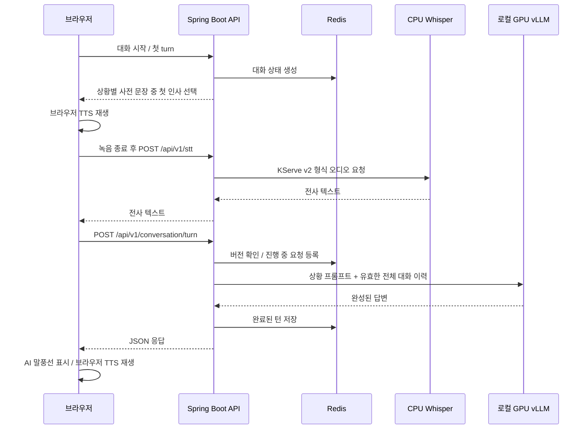
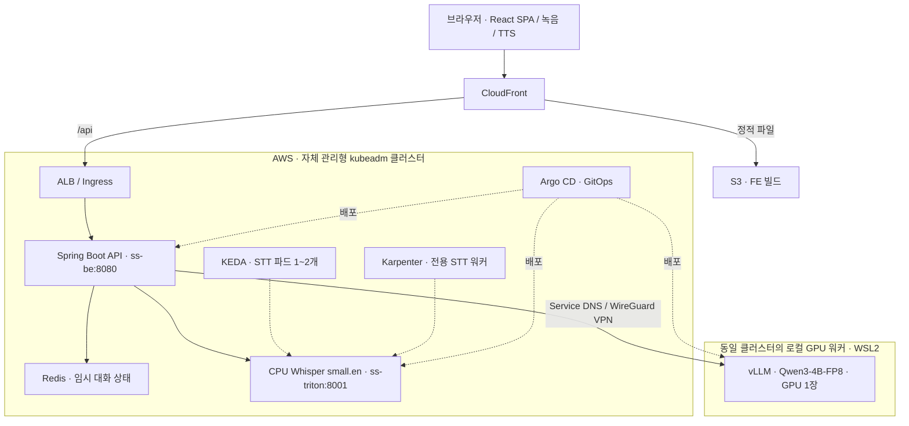
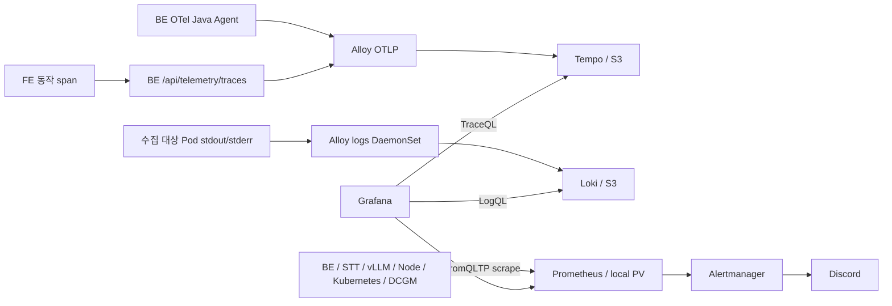

# SayScene — 제품 명세 & 운영 아키텍처

> 갱신: 2026-11-03 · 현재 FE·BE·Kubernetes·STT 구현 기준.
> 기존 링크를 유지하기 위해 파일명의 `v1`은 유지한다. 설치·장애·성능 실험은 별도 매뉴얼에 남기고, 이 문서는 현재 서비스의 동작과 구성을 설명한다.

SayScene은 상황을 골라 AI와 영어로 대화하고, 표현을 단어장에 저장하며, 종료 후 한국어 교정 리포트를 받는 웹 앱이다. **AWS에서는 웹 API와 CPU Whisper STT를, 로컬 GPU에서는 vLLM의 Qwen3-4B-FP8을 실행**한다. GPU Triton·Qwen3-8B는 현재 구성에 포함하지 않는다.

## 1. 제품과 사용자 흐름

한국어 화자 영어 학습자를 대상으로 한다. 카페·레스토랑·옷가게·지하철역·길거리·호텔·마트·약국·전화 예약·인프라 면접의 **10개 고정 상황**을 제공한다. 상황 목록은 FE에, 상황별 프롬프트와 첫 인사 후보는 BE에 있다.



첫 인사는 LLM을 호출하지 않고 상황별 후보 10개 중 세션 ID를 기준으로 안정적으로 선택한다. 이후 발화는 **STT와 대화 생성이라는 별도 API 요청**으로 이어진다. 답변은 완성된 JSON으로 전달하며 SSE·토큰 스트리밍 UI·서버 TTS는 사용하지 않는다.

| 기능 | 현재 동작 |
|---|---|
| 시작·이어하기 | 진행 중 대화 한 건을 유지한다. 새 대화는 기존 대화 교체를 확인하며, 재방문 시 서버 상태와 로컬 스냅샷을 동기화한다 |
| 음성 입력 | 브라우저 `MediaRecorder` 사용. 최대 30초·2 MiB, 500 ms 미만은 거부한다. 마이크 권한이 필요하며 텍스트 입력 폴백은 제공하지 않는다 |
| 말풍선 | AI 원문은 기본 숨김 후 클릭으로 공개한다. 양쪽 발화의 다시 듣기·한국어 번역을 제공하며, 다시 듣기는 녹음이 아닌 텍스트 TTS다 |
| 발화 수정 | 마지막 사용자 발화만 수정한다. revision을 올리고 해당 답변을 재생성하며, 다음 녹음이 시작되면 이전 발화 수정은 잠긴다 |
| 답변 추천 | 한 번 생성한 결과의 키워드를 먼저, 다시 누르면 같은 영어 예문을 공개한다. 추천은 사용자 발화로 자동 제출되지 않는다 |
| 단어장 | 선택 표현과 당시 예문을 저장한다. 뜻·품사·예문 번역, 알파벳순·최신순, 삭제, 공백·대소문자 정규화 중복 방지를 제공한다 |
| 종료·리포트 | 종료 직전 스냅샷으로 한국어 총평 2~3개와 사용자 발화별 교정·개선 표현을 생성한다. AI 발화는 문맥일 뿐 평가 대상이 아니다 |
| 리포트 저장 | 사용자가 저장해야 브라우저에 남는다. 목록 조회·제목 변경·삭제와 중복 제목 방지를 제공한다. 생성 실패를 저장 성공으로 표시하지 않는다 |
| 여러 탭 | Web Locks·BroadcastChannel·storage 이벤트로 동기화한다. 입력 가능한 탭은 하나이며 사용권 이전 시 이전 탭의 마이크·TTS·요청을 정리한다 |

로그인·영구 서버 대화 저장·발음/유창성 채점·오프라인 서비스는 제공하지 않는다. TTS와 녹음 형식은 브라우저 기능에 의존한다.

## 2. 데이터와 대화 일관성

| 위치 | 데이터와 수명 |
|---|---|
| 브라우저 `localStorage` | `sayscene:v1:activeConversation`, `sayscene:v1:reports`, `sayscene:v1:vocabulary`. 진행 중 대화와 사용자가 저장한 리포트·표현을 보관한다 |
| Redis | 소유자별 진행 중 대화, 버전·진행 중 요청·종료 ID를 보관한다. 키는 `sayscene:conversation:<owner UUID>`, TTL 기본 86,400초이며 성공한 상태 쓰기 때 갱신한다 |
| 오디오 | 브라우저에서 업로드하고 STT 처리 후 결과를 반환한다. 녹음 파일을 브라우저 영구 저장소나 서버 파일로 보관하지 않는다 |
| 모델·GPU 캐시 | STT 모델은 이미지에, vLLM Hugging Face 캐시는 로컬 GPU 워커의 PV에 둔다. GPU KV 캐시는 Redis의 대화 원문과 별개다 |

- 소유자 쿠키 `sayscene_session`은 서버 발급 UUID이며 `HttpOnly; Secure; SameSite=Lax; Path=/api/v1/conversation`을 사용한다. 요청의 임의 사용자 ID로 소유자를 정하지 않는다.
- `expectedVersion`과 Redis Lua compare-and-set으로 오래된 쓰기를 막는다. pending lease/token으로 중복 진행·늦은 결과를 차단하고, 마지막 완료 요청과 동일한 `requestId`는 현재 결과를 재사용한다.
- 복원 시 서버의 진행 중 대화가 우선한다. 서버 상태가 없고 종료된 세션이 아닐 때만 로컬의 완료된 이력을 `/restore`로 복원한다.
- **종료는 Redis 키 전체 삭제가 아니다.** 진행 중 대화 텍스트를 비우고 종료 ID를 남겨 오래된 탭이 같은 대화를 되살리지 못하게 한다.
- Redis는 단일 파드이며 RDB/AOF·영속 볼륨을 사용하지 않는다. Redis 장애 시 대화 API는 `503 CONVERSATION_STORE_UNAVAILABLE`을 반환한다. 브라우저 스냅샷은 영구 서버 백업이 아니다.
- 같은 브라우저 프로필을 사용하는 사람은 저장된 리포트·단어장을 볼 수 있다. 저장 오류가 나더라도 기존 목록을 임의로 지우지 않는다.

## 3. 현재 API

업무 API는 Spring Boot MVC의 `/api/v1` 아래에 있다. 상황 목록은 FE 정적 데이터이며 별도 `/presets` API는 없다.

| 메서드·경로 | 역할 |
|---|---|
| `GET /api/v1/conversation` | 현재 대화 조회·동기화, 소유자 쿠키 발급 |
| `POST /api/v1/conversation/start` | 기존 대화 상태를 확인하고 새 세션 생성 |
| `POST /api/v1/conversation/restore` | 로컬 스냅샷을 검증해 서버에 복원 |
| `POST /api/v1/conversation/turn` | 첫 인사 또는 사용자 발화·수정에 대한 답변 |
| `POST /api/v1/conversation/end` | 대화 종료와 stale restore 방지 |
| `POST /api/v1/stt` | multipart `audio` → 전사 `text`, `requestId` |
| `POST /api/v1/demo/cafe/suggestion` | 현재 UI의 상황별 추천 예문·키워드 생성 |
| `POST /api/v1/translate` | 발화 번역과 `sessionId/messageId/revision` 대조 |
| `POST /api/v1/lookup` | 선택 표현의 뜻·품사·예문 번역 |
| `POST /api/v1/report` | 최종 대화 스냅샷의 사용자 발화 교정 |
| `POST /api/telemetry/traces` | 브라우저 OTLP/JSON relay. `/api/v1` 접두사 아님 |
| `GET /actuator/health`, `GET /actuator/prometheus` | 클러스터 내부 상태·메트릭 조회 |

`/demo/cafe`, `/demo/cafe/reply`, `/demo/echo`는 기존 연결 확인·호환 경로다. 정식 대화 상태는 `/conversation` 계열이 관리한다. API 구현과 로컬 실행은 [ss-be README](https://github.com/say-scene/ss-be#readme)를 따른다.

## 4. 하이브리드 아키텍처



AWS GPU를 확보하지 못해 **로컬 RTX 4060 8 GB·WSL2 워커**를 클러스터에 연결했다. AWS와 로컬 워커는 WireGuard VPN을 사용한다. VPN·Pod 라우팅의 상세 구축 절차는 이 문서 범위에서 제외한다.

| 계층 | 현재 구성 |
|---|---|
| FE | React 19·TypeScript·Vite SPA, S3 정적 배포, CloudFront 제공 |
| API | Java 21·Spring Boot 3.5.7, 단일 BE 파드, Redis 7.4 단일 파드. namespace `sayscene` |
| AWS 노드 | 자체 제작 AL2023 AMI·kubeadm·containerd, VPC CNI와 AWS 컨트롤러. 기본 노드는 control-plane과 일반 워크로드를 겸한다 |
| STT 워커 | Karpenter `stt` 풀의 on-demand `t3.xlarge`, `sayscene.io/workload=stt` 라벨·taint. STT 파드당 CPU 3400m·메모리 2 GiB |
| 일반 확장 풀 | `general`의 on-demand `t3.large`. 현재 NodePool 제한과 AMI 선택은 Git의 설정을 따른다 |
| 로컬 GPU | 외부 NVIDIA 라벨·전용 taint의 `sayscene-gpu-wsl`. namespace `vllm`에 GPU 1개를 사용하는 단일 파드 |
| 관측 스택 | namespace `monitoring`. Prometheus·Grafana·Alertmanager·Alloy·Loki·Tempo, 외부 GPU의 DCGM Exporter |

`/api` Ingress는 CloudFront origin-facing prefix list로 ALB 직접 접근을 제한하고 BE readiness를 확인한다. `/grafana`도 같은 ALB 그룹의 별도 Ingress를 사용한다. `/actuator`는 이 업무 Ingress로 공개하지 않는다. CloudFront·S3·IAM·Secret 등 콘솔에서 관리하는 설정 전체가 Kubernetes 저장소에 선언된 것은 아니다.

## 5. AI 서빙과 확장

### CPU Whisper STT

`ss-triton`이라는 저장소·ECR·Service 이름은 기존 연결을 유지하기 위한 것이다. 실제 서버는 **Python 표준 HTTP 서버 + faster-whisper 1.2.1, CPU/int8**이며 Triton 런타임을 사용하지 않는다.

- `python:3.12-slim` 이미지에 `small.en`을 빌드 시 `/models/small.en`으로 포함한다. 기본 기동은 HF 다운로드가 필요 없다. 모델 이름으로 환경변수를 바꾼 경우에는 다운로드할 수 있다.
- BE는 `http://ss-triton:8001/v2/models/whisper_stt/infer`를 호출한다. KServe v2 JSON 형식의 `AUDIO/BYTES/[1]` base64 입력과 `TEXT/BYTES/[1]` 출력을 맞춘 어댑터다.
- 영어 전사, VAD, temperature 0, 이전 텍스트 conditioning 비활성, beam size 1을 사용한다. 디코딩 후 0.5~31초·원본 2 MiB를 검증한다. FE의 녹음 제한은 30초다.
- 스레드 2·동시 추론 1·슬롯 대기 10초가 현재 설정이다. 슬롯을 얻지 못하면 `503 STT_BUSY`, 잘못된 오디오는 `422`를 반환한다. BE는 빈 전사를 `NO_SPEECH`로 구분한다.
- KEDA는 처리·대기시간 rate 합계 임계값 `0.8`과 busy 비율 `0.05`를 사용해 **1~2 파드**로 확장한다. 축소 안정화는 300초이며 새 파드의 자원 수요에 따라 Karpenter가 워커를 만든다. 노드 기동 지연이 있으므로 즉시 용량이 늘어나는 것은 아니다.

구현은 [ss-triton](https://github.com/say-scene/ss-triton#readme), 실측 과정은 [CPU STT 매뉴얼](manual/stt-cpu-whisper-setup-v1.md)을 참고한다. 매뉴얼의 과거 인스턴스 사양·CPU LLM 경로보다 현재 매니페스트를 우선한다.

### 로컬 GPU vLLM

| 항목 | 현재 매니페스트 |
|---|---|
| 위치 | `ss-k8s/apps/ss-vllm`, namespace `vllm`, Deployment `vllm-qwen` |
| 이미지·모델 | `vllm/vllm-openai:v0.32.0-cu129`, `Qwen/Qwen3-4B-FP8`의 고정 revision |
| BE 접속 | `http://vllm-qwen.vllm.svc.cluster.local:8000`, 모델 이름 `qwen3-4b-fp8` |
| 실행 설정 | `dtype=half`, context 4096, `max-num-seqs=1`(동시성 비교 실험 설정), batched tokens 512, GPU 사용 예산 0.80, chunked prefill·eager |
| 캐시·교체 | WSL 워커의 `/var/lib/sayscene-gpu/huggingface` local PV 30 GiB, Retain. 단일 파드 `Recreate` |

BE는 HTTP/1.1 OpenAI 호환 `/v1/chat/completions`에 `stream:false`로 요청한다. 서버의 상황 프롬프트와 **전체 유효 대화 이력**을 보내며 자동 요약·토큰 절단은 구현하지 않는다. 출력 상한은 대화 128·추천 256·lookup 512·번역 2048·리포트 4096이다. **출력 상한은 실제 생성 길이나 입력 여유를 보장하지 않으며, 입력+출력은 모델 context 제한을 함께 받는다.**

추천·번역·lookup·리포트는 JSON mode를 사용하고 BE에서 필드를 검증한다. 단일 로컬 GPU의 가용성·VPN 연결은 서비스의 LLM 가용성에 직접 영향을 준다. `apps/llm`의 CPU LLM은 replicas 0인 이전 대안이며 현재 서빙 경로가 아니다.

[vLLM 부하테스트 기록](loadtest/vllm-concurrency-loadtest-v1.md)은 직접 vLLM을 스트리밍 호출한 별도 실험이다. TTFT·토큰 처리량은 서비스의 비스트리밍 응답시간이나 STT·TTS를 포함한 턴 지연과 다르다. slot 1~32를 측정했으며 적정 slot 결론은 보류 중이다. 슬롯은 실험에 따라 변경하므로 각 측정 조건과 현재 매니페스트를 구분한다. [부하 분석·알림 설계 기록](monitoring/vllm-load-analysis-v1.md)도 함께 참고한다.

## 6. 관측성

**2026-11-03 운영 확인:** Grafana 대시보드·패널, FE→BE의 Tempo trace 조회, Loki 로그 조회, Alloy의 로그·OTel 수집, Alertmanager의 Discord 알림 수신을 사용자 확인으로 반영했다. 아래 설정값은 현재 `ss-k8s` 소스에 근거한다.

### 6.1 수집·저장·조회 경로



| 도구 | 이 서비스에서 확인하는 것 |
|---|---|
| Prometheus·Micrometer | API별 요청 수·오류·평균/p95 지연, STT 대기·처리·음성 길이, vLLM 큐·토큰·KV 캐시, 노드·Pod·GPU 자원 |
| Grafana | 메트릭 대시보드·패널과 Loki·Tempo Explore 조회. 대시보드는 UI에서 관리하며 전부 Git의 JSON으로 선언된 것은 아니다 |
| 로그 Alloy·Loki | 수집 대상 노드의 Pod stdout/stderr를 Kubernetes API로 읽고 `namespace/pod/container` 라벨을 붙여 검색 |
| OTel·OTLP Alloy·Tempo | 브라우저 사용자 동작과 BE HTTP·Redis·추론 HTTP 호출을 연결해 지연 구간 확인 |
| Alertmanager·Discord | 디스크 포화·vLLM 첫 토큰 지연 등 경고를 묶어 발화·해소 알림 전달 |

### 6.2 메트릭과 성능 해석

- **BE:** ServiceMonitor가 `/actuator/prometheus`를 수집한다. 현재 ConfigMap은 `http.server.requests` histogram을 활성화해 URI별 p95를 계산한다. Java agent의 메트릭·로그 exporter는 `none`으로 두고 trace만 전송한다.
- **STT:** `stt_requests_total{result}`, `stt_queue_wait_seconds`, `stt_inference_seconds`, `stt_audio_seconds`를 API와 같은 8001 포트의 `/metrics`에서 수집한다. 처리시간뿐 아니라 대기·busy 비율을 함께 본다.
- **vLLM:** ServiceMonitor가 `/metrics`의 TTFT·출력 토큰·실행/대기 수·KV 캐시·preemption을 수집한다. 비스트리밍 서비스도 vLLM 내부 TTFT와 전체 API 완료 시간을 분리해 해석한다.
- **인프라:** node-exporter·kube-state-metrics와 외부 GPU의 DCGM Exporter를 사용한다. WSL에서 제공되는 GPU 지표 범위와 수집 간격은 실제 노출값을 따른다. kubeadm의 일부 control-plane loopback endpoint 수집은 꺼져 있다.

API 지연 조회 예시(초 단위):

```promql
histogram_quantile(0.95,
  sum by (le, uri) (rate(http_server_requests_seconds_bucket[5m]))
)
```

STT 대기시간 p95와 vLLM 평균 TTFT는 별도로 조회한다.

```promql
histogram_quantile(0.95, sum by (le) (rate(stt_queue_wait_seconds_bucket[5m])))
```

```promql
rate(vllm:time_to_first_token_seconds_sum[5m])
/ rate(vllm:time_to_first_token_seconds_count[5m])
```

### 6.3 FE→BE 사용자 동작 추적

`ss-fe`는 전역 fetch를 패치하지 않고 허용된 same-origin API만 명시적 `TraceAction`으로 계측한다. 각 요청의 CLIENT span이 `traceparent`를 전달하면 `ss-be` Java agent의 SERVER·Redis·추론 HTTP CLIENT span이 같은 trace에 이어진다.

```text
speech.turn (FE)
├─ POST /api/v1/stt (FE CLIENT → BE SERVER → STT HTTP CLIENT)
└─ POST /api/v1/conversation/turn (FE CLIENT → BE SERVER → Redis / vLLM HTTP CLIENT)
```

- `speech.turn`은 **STT 요청 직전부터 대화 응답 처리까지**다. 녹음 시간·첫 TTS 음성·TTS 재생 완료를 측정한 지표가 아니다. FE CLIENT 시간은 응답 헤더 수신까지다.
- 번역·추천·lookup·리포트는 별도 동작 trace다. 자동 동기화·재시도는 기존 동작 context를 유지하고 나중의 수동 재시도는 새 동작이다.
- FE span의 `session.id`는 페이지 메모리의 익명 UUID다. 같은 페이지의 여러 trace를 찾는 용도이며 새로고침하면 바뀐다. 실제 대화 ID·소유자 쿠키·업무 requestId와 연결하지 않는다.
- 브라우저는 OTLP/JSON을 BE relay로만 전송한다. BE가 허용 필드로 재구성해 `alloy-otlp.monitoring.svc.cluster.local:4318/v1/traces`로 전달하며 Collector를 브라우저에 공개하지 않는다.
- relay 제한은 요청당 128 KiB·128 spans, BE 인스턴스당 분당 60회·동시 4회·upstream 대기 2초다. 수집 주소 미설정은 `204`, 잘못된 설정은 `503`이다. 이는 사용자 인증이나 서비스 전체 quota가 아니다.
- 수집은 best effort이며 실패가 업무 요청을 막지 않는다. 발화·오디오·body·query·쿠키·인증 헤더·실제 대화 식별자·예외 원문을 FE span에 넣지 않는다. 추론 서버 내부 연산 span은 추가하지 않고 메트릭으로 관측한다.

Tempo 조회 예시:

```traceql
{ resource.service.name = "ss-fe" && span:name = "speech.turn" }
```

```traceql
{ resource.service.name = "ss-fe" && span.session.id = "관측용-UUID" }
```

### 6.4 로그·저장·알림

- 로그 Alloy는 **자신이 배치된 노드**의 Pod를 발견해 Kubernetes API로 읽는다. 현재 values의 toleration은 control-plane용이며 STT·GPU 전용 taint 노드까지 모두 수집한다고 가정하지 않는다. BE 로그를 JSON 구조화 로그라고 전제하거나 trace↔log 자동 링크가 설정됐다고 설명하지 않는다.
- Loki는 Monolithic 1개·TSDB v13·S3, Tempo trace block도 S3를 사용한다. 두 서비스의 WAL·작업 파일은 임시 로컬 저장이며 미전송 데이터는 파드 교체 시 유실될 수 있다. Git values에는 두 저장소의 명시적 retention이 없으므로 보관 일수를 임의로 정하지 않는다.
- Prometheus는 기본 노드 local PV 5 GiB와 **7일 / TSDB 블록 1 GiB** 보존 설정을 사용한다. WAL까지 포함한 정확한 디스크 하드 캡은 아니다. Grafana는 local PV 2 GiB를 사용한다. 단일 노드 저장을 HA·백업으로 간주하지 않는다.
- Tempo metrics-generator의 `local-blocks`로 TraceQL `rate()`, 평균·분위수 집계를 구성한다. Prometheus HTTP histogram과 trace 기반 통계는 별도이며 샘플링·계측 범위에 따라 모수가 다르다.
- `NodeDiskFillingUp`: 루트 디스크 사용률 **85% 초과가 10분** 지속되면 경고한다.
- `VllmTtftHigh`: **5분 평균 TTFT가 1.2초를 초과한 상태가 2분** 지속되면 경고한다. 실행·대기 수, KV 캐시, preemption, 토큰 처리량 정보를 함께 담는다. p95 경고가 아니다.
- Discord webhook은 Secret으로 관리한다. 발화·해소를 보내며 **평일 09:00~19:00 한국 시간**, group wait 30초·group interval 5분·repeat 4시간이다. `vllm` namespace의 경고는 Pod까지 그룹 기준에 포함하고, 상시 발화하는 Watchdog는 제외한다.

상세 설정은 [ss-k8s 관측 스택](https://github.com/say-scene/ss-k8s/tree/main/platform), 구축 이력은 [관측성 매뉴얼](monitoring/sayscene-observability-manual-v1.md), FE 추적 구현은 [사용자 동작 tracing](user-action-tracing.md)에 있다.

## 7. 배포·운영 경계

| 저장소 | 산출물과 반영 경로 |
|---|---|
| [ss-fe](https://github.com/say-scene/ss-fe) | Node 22.12+에서 테스트·TypeScript 검사·Vite 빌드 → main의 GitHub Actions가 OIDC로 S3 배포. assets 장기 캐시·HTML no-cache |
| [ss-be](https://github.com/say-scene/ss-be) | Java 21·Jib 이미지 → ECR `ss-be:<SHA7>` → ss-k8s BE 이미지 태그 갱신. 현재 이미지 CI에는 별도 테스트 실행 단계가 없다 |
| [ss-triton](https://github.com/say-scene/ss-triton) | Python 구문 검사·Docker Buildx linux/amd64 → ECR `ss-triton:<SHA7>` → ss-k8s STT 이미지 태그 갱신 |
| [ss-k8s](https://github.com/say-scene/ss-k8s) | 앱 매니페스트·Helm values·Argo CD 설정. BE·STT 이미지, 외부 vLLM, Karpenter·KEDA·관측 스택 관리 |
| [ss-docs](README.md) | 현재 제품·아키텍처 명세, 설치·운영·장애·성능 실험 기록 |

- Git 변경·이미지 push와 클러스터 반영은 별도다. 수동 sync인 Argo CD App은 Sync와 새 파드 rollout을 확인한다. 일부 App만 auto-sync이므로 전체가 자동 배포된다고 가정하지 않는다.
- `envFrom` ConfigMap 변경만으로 기존 BE 프로세스의 환경변수가 바뀌지 않는다. 필요한 rollout과 readiness 확인을 함께 수행한다. BE readiness는 Redis를 포함하고 liveness는 JVM 상태를 확인한다.
- `ss-k8s` 루트에는 Helm values·수동 bootstrap·이전 대안이 섞여 있다. 루트 전체를 일괄 `kubectl apply`하지 않고 현재 App 경로별로 검토한다.
- AWS 인증은 GitHub OIDC·노드 역할을 사용하고 API key·webhook·관리자 비밀번호·join token은 공개 Git에 넣지 않는다. Ingress의 origin 제한은 로그인이나 사용자별 권한 시스템을 대신하지 않는다.
- 서비스는 단일 BE·Redis·로컬 GPU와 기본 control-plane에 의존한다. 고가용성이나 무손실 저장을 제공하는 구성은 아니다.

## 8. 이전 설계 요약

초기에는 AWS GPU 한 장에서 Triton으로 Qwen3-8B FP8과 Whisper GPU를 함께 실행하는 구성을 검토했다. GPU 확보 제약으로 STT를 AWS CPU 서버로 분리했고, LLM의 CPU 대안을 거쳐 로컬 GPU 워커의 Qwen3-4B-FP8·vLLM으로 전환했다. 이전 GPU Triton 원본은 `ss-triton`의 `triton-gpu-v1` 태그, CPU LLM 대안은 `ss-k8s/apps/llm`과 Git 이력에 남아 있다. 과거 가정·1주차 체크리스트·PoC 수용 기준은 현재 동작 명세에서 제거했다.
