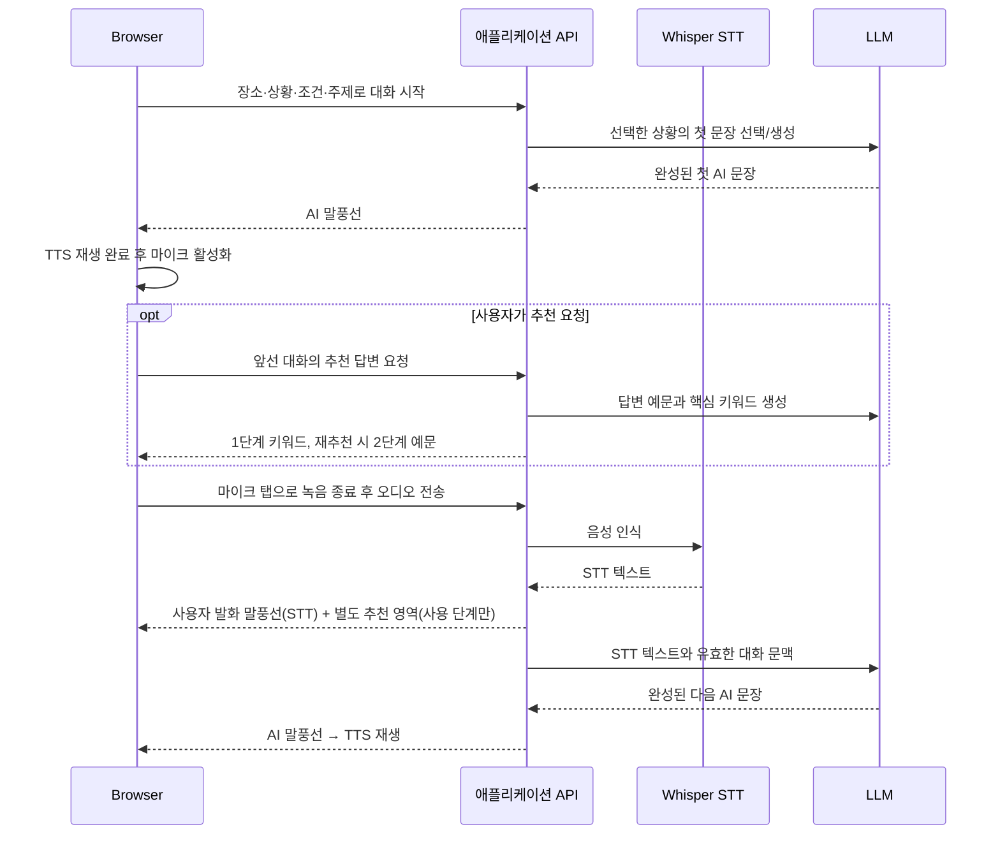
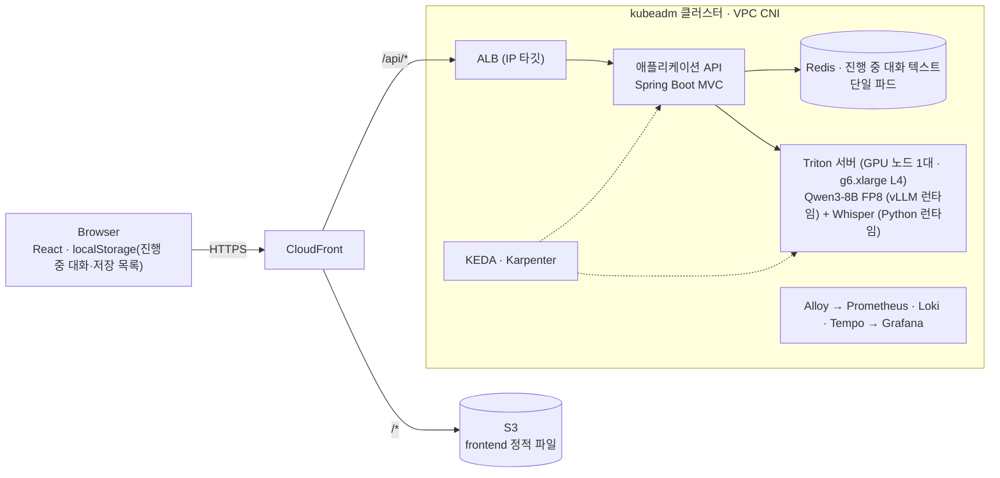

# 영어 회화 연습 앱 — PRD & AWS 아키텍처 (PoC)

> 버전 v1 · 2026-10-21 · 상태: §9 후속 논의 확정 사항 통합 / 초기 전체 이력 전송 / 모델 한도 처리 추후 결정
> 목적: 제품 경험·AI 서빙·인프라 운영을 입증하는 포트폴리오/PoC. 진행 중 대화·리포트·단어장은 브라우저에 저장하고, Redis는 진행 중 대화의 서버 측 임시 상태로 쓴다. 로그인·영구 서버 저장·SLO·HA는 제외한다.

---

## 0. 회의 결정 요약

이 문서에서 **확정**은 사용자가 Day046 문서와 추가 메모에서 명시한 동작을 뜻한다. 충돌하거나 구현 방법이 정해지지 않은 부분은 §9에 남긴다. 아래 인프라 구성 중 Redis 추가는 설계 변경이며, 실제 클러스터 배포·권한 설정은 별도 승인 대상이다.

| 항목 | 반영할 결정 | 상태/영향 |
|---|---|---|
| 시작 화면 | 장소·상황을 각각 가로 스크롤 카드에서 선택하고 시작 | 자유 프롬프트 입력은 제외; 진행 중 대화가 있으면 `이어서하기` 노출 |
| 대화 시작 | 준비된 상황 10개 중 선택, 단일 난이도, 해당 상황의 첫 문장 후보에서 무작위 선택 | 랜덤 주제 없음; 첫 문장 후보 수·부족 시 처리 미결 |
| 대화 화면 | 메신저형 누적 대화, AI 발화가 끝난 뒤 마이크 활성화, 탭으로 녹음 시작·종료 | 확정 |
| 답변 추천 | 사용자 차례에 키워드 공개 → 재추천 시 생성된 예문 공개 → 실제 음성 입력 후 다음 턴 | 확정; 추천 예문과 STT 결과 함께 표시 |
| 말풍선 | AI 원문 블러·해제, 다시 듣기, 한국어 번역; 사용자 발화 다시 듣기·번역·수정 | 확정; 드래그/더블클릭 단어 선택 후 저장 |
| 리포트 | 사용자 입력 교정·총평 생성, 저장·재열람 | 제목 장소·상황·날짜·시간 포함; 생성 실패 시 안내 후 첫 화면 이동 |
| 단어장 | 길이 제한 없이 표현 저장·삭제, 알파벳순/최신순 선택 | 공백·대소문자 정규화 후 중복 추가 방지; 기존 뜻·예문 유지 |
| 저장 | 진행 중 대화·리포트·단어장은 `localStorage`에 저장; Redis는 서버의 진행 중 문맥을 보관 | 로그인·영구 서버 저장 없음; Redis 단일 파드 |
| 응답 재생 | LLM 답변 문장을 완성한 뒤 JSON 응답으로 전달하고 TTS로 재생 | 확정; SSE 제외 |
| 서버 | Spring Boot MVC 단일 애플리케이션 API + Triton 추론 서버 | FastAPI 제외; Redis 사용 |
| 로그인 | MVP에서 제외 | 서버 발급 세션 쿠키로 브라우저별 대화 구분 |
| 탭·마이크 | 같은 브라우저 로컬 세션의 대화 상태 동기화, 입력 가능한 탭은 하나 | 마이크 사용권을 현재 탭으로 이전 가능 |
| LLM 문맥 | 초기 구현은 설정 프롬프트와 Redis의 전체 유효 대화 이력을 매 요청 전송 | 요약·모델 한도 처리의 구체 정책과 구현은 추후 결정 |
| 기존 PoC 인프라 | CloudFront/S3/ALB, kubeadm, Triton, Karpenter/KEDA, 관측성 | Redis 단일 파드 추가; 용량·복원·장애 처리 검증 필요 |

---

## 1. 제품 개요

- **한 줄 정의**: 장소와 상황을 골라 AI와 영어 음성 대화를 하고, 필요한 표현을 단어장에 저장하며 종료 후 교정 리포트를 보관하는 웹 앱.
- **대상**: 한국어 화자 영어 학습자(초~중급). 설명과 번역은 한국어.
- **MVP 범위**: 장소·상황 선택, 단일 진행 중 대화의 이어하기, 음성 대화, 단계별 추천, 블러/번역/다시 듣기, 마지막 사용자 발화 수정, 단어장, 저장·재열람 가능한 리포트.
- **MVP 제외**: 로그인, 영구 서버 저장, 발음(음소) 평가, 다국어 UI, PWA 설치/오프라인, HA, 백업. 진행 중 대화는 브라우저 `localStorage`와 서버의 임시 Redis 세션에 보관한다.

### 1.1 대화 한 턴의 흐름



상태: `장소·상황 선택 → 시작 → AI 문장 완성·재생 → 사용자 차례(추천 선택 가능) → 녹음 → STT → 사용자 말풍선 → AI 문장 완성·재생 → …`. 실제 오디오는 저장하지 않는다. 추천을 열어도 음성 입력 전에는 다음 턴으로 진행하지 않는다.

---

## 2. 기능 요구사항

### F1. 첫 화면과 대화 설정
- 상단에 `Report 다시보기`, `단어장` 버튼을 둔다. 장소와 상황은 각각 가로 스크롤 카드에서 선택하고 최하단에 `시작` 버튼을 둔다.
- 선택 가능한 상황은 총 10개이고 난이도는 하나로 고정한다. 장소·상황에 맞는 프롬프트 템플릿을 서버에 두며 사용자의 자유 프롬프트 입력과 랜덤 주제 생성은 제공하지 않는다.
- 선택한 상황에 맞는 첫 AI 문장 후보 중 하나를 무작위로 고른다. 후보의 개수·관리 위치·반복 방지 규칙은 §9에서 검토한다.
- 진행 중 대화가 있으면 `이어서하기`를 노출한다. `시작`으로 새 대화를 선택하면 기존 진행 중 대화가 삭제된다는 사실을 알리고, 확인 후 로컬 대화와 Redis 세션을 지운 다음 새 대화를 연다. 동시에 진행 가능한 대화는 하나다.

### F2. 대화 화면과 음성 루프
- 상단에 선택한 장소와 상황, 우측 상단에 메뉴 버튼을 표시한다. 대화는 중앙의 세로 스크롤 메신저 말풍선에 누적한다.
- AI 음성 재생이 끝나면 하단 마이크를 활성화한다. 첫 탭은 녹음 시작과 회색 `입력 중` 상태, 두 번째 탭은 종료다. Whisper STT 완료 후 사용자 텍스트를 말풍선에 표시한다.
- STT 결과를 유효한 사용자 발화로 삼아 다음 LLM 답변을 생성한다. **LLM 문장이 완성된 뒤** AI 말풍선을 표시하고 TTS로 읽는다. TTS 전송/재생 실패 시 텍스트는 남기고 다시 듣기를 허용한다.
- 마이크 권한 거부 시 대화를 시작하거나 이어갈 수 없음을 알린다. 무음·짧은 발화와 STT 실패는 오류를 알리고 재녹음을 유도한다. 네트워크 단절 시 진행 중 대화를 보존하고 연결 후 재시도한다. 텍스트 입력 폴백은 제공하지 않는다.
- 각 말풍선에 안정적인 `messageId`를 부여하고 사용자 발화 수정에는 `sessionId + turnId + revision`을 사용한다. 수정 전 revision의 AI 답변·TTS·번역·추천·리포트 파생 결과를 반영하지 않는다.
- 사용자의 **마지막 발화**에만 `수정` 버튼을 제공한다. 수정 내용을 확정하면 해당 턴의 AI 답변을 재생성하며 이전 revision의 늦은 응답은 폐기한다. 후속 사용자 턴이 시작되면 그 발화는 수정할 수 없다.

### F2.1 여러 탭과 마이크
- 같은 브라우저 프로필의 로컬 세션은 진행 중 대화 하나를 공유한다. 시작·발화·수정·종료·새 대화 상태를 탭 사이에 동기화한다.
- 마이크와 발화 입력은 한 탭만 사용한다. 다른 탭에는 `다른 탭에서 대화 중입니다`와 `이 탭에서 이어하기`를 표시한다. 사용권 이전 시 기존 탭의 입력을 해제한 뒤 현재 탭을 활성화한다. 기존 창으로 강제 이동하는 동작을 필수로 요구하지 않는다.
- 한 탭에서 종료하면 다른 탭도 녹음·재생을 중단하고 첫 화면으로 이동해 종료 사실을 알린다. 리포트는 종료를 요청한 탭에서 한 번만 생성한다. 새 대화 시작도 모든 탭에 반영한다.
- 탭 종료·새로고침 중의 사용권 해제와 동시에 이어하기를 누른 경우의 충돌 방지는 구현 시 검증한다. 상태 동기화는 SSE 없이 브라우저 탭 간 통신으로 처리한다.

### F3. 말풍선과 보조 동작
- AI 말풍선 원문은 처음에 블러 처리한다. 말풍선을 누르면 해제되어 원문이 보인다. 블러 해제 전에는 단어 선택을 막는다.
- AI 말풍선 하단에는 `다시 듣기`를, 블러 해제 후에는 `한글 번역`을 제공한다.
- 사용자 말풍선 하단에는 `다시 듣기`·`한글 번역`을, 마지막 사용자 발화에만 `수정하기`를 제공한다. 다시 듣기는 표시된 텍스트를 TTS로 읽으며 녹음 파일을 저장하지 않는다.
- AI·사용자 말풍선에서 드래그 또는 더블클릭으로 선택한 단어·표현을 길이 제한 없이 저장할 수 있다. 모바일은 길게 누른 뒤 선택 영역을 조절한다. 저장 문자열은 앞뒤 공백을 제거하고 구두점은 보존한다. 최대 요청 크기는 §9에서 검토한다.
- 번역은 필요할 때 생성하고 세션 내 캐시한다. 별도 문법 검사 버튼과 전체 블러 토글은 MVP에서 제외한다.

### F4. 단계별 답변 추천
- 사용자 차례에 아직 사용자 말풍선이 나타나기 전, 그 위치에 `추천` 버튼을 둔다. 추천을 사용하지 않고 마이크로 바로 답할 수 있다.
- 추천 요청 시 앞선 AI 발화와 유효한 대화 문맥에 맞는 **영어 답변 예문 하나**와 핵심 단어·표현을 생성한다. 1단계에서는 키워드만 보여 주고, `재추천` 시 2단계로 원래 생성된 예문을 공개한다. 재추천 시 새 문장을 생성하지 않는다.
- 어느 단계에서든 사용자는 마이크로 답할 수 있다. 2단계 공개 뒤에도 음성 입력을 거쳐야 다음 AI 턴으로 진행한다. **사용자 발화 말풍선에는 STT 텍스트를, 추천 카드에는 사용자가 실제로 본 키워드·예문을 별도로 표시한다.** 색·라벨·배치를 구별해 추천 문구를 발화로 오인하지 않게 한다. 다음 LLM 대화의 사용자 발화에는 **STT 텍스트만** 사용한다.
- 1단계에서 답했다면 키워드만, 2단계까지 열었다면 예문까지 표시한다. 추천 없이 답한 경우 추천 카드를 표시하지 않는다. 리포트에서도 추천은 참고 정보로만 구분한다.

### F5. 종료와 리포트
- 메뉴의 `대화 종료`를 누르면 대화를 종료하고 리포트 생성으로 이동한다. 종료하지 않은 대화는 계속 `진행 중`이며 새로고침·브라우저 재방문 후 `이어서하기`로 복원한다.
- 리포트 상단에는 장소·상황·대화 흐름의 적합성, 문법, 더 나은 표현을 다룬 **2~3줄 핵심 총평**을 표시한다. **교정 대상인 유효한 발화는 최종 revision의 사용자 STT 입력만**이다. 장소·상황과 AI 발화는 판단에 필요한 문맥으로 제공하되 AI 문장이나 추천 예문을 사용자 발화로 평가하지 않는다.
- `리포트 저장`과 `나가기` 버튼을 제공한다. 저장 전 이탈하면 저장하지 않는다. 생성 실패 시 `리포트를 생성하지 못했습니다. 이번 대화는 저장되지 않았습니다.`라고 알리고 첫 화면으로 이동한다. 재시도·실패 대화 복구 기능은 제공하지 않으며 종료된 대화는 이어하기에 남기지 않는다. 서버에는 요청 ID와 실패 원인만 기록하고 발화 내용은 남기지 않는다. 요청 ID는 사용자 화면에 표시하지 않는다. 저장된 리포트는 다시보기 목록에서 삭제할 수 있다.
- 저장 제목은 원본 대화의 `장소 · 상황 · 날짜 · 시간`으로 자동 생성한다(예: `식당 · 주문 · 2026-10-21 · 14:30:05`). 생성 시각은 별도 데이터로도 보관하며 제목 변경으로 바뀌지 않는다. 제목은 `Report 다시보기` 화면에서만 수정한다. 동일 리포트의 반복 저장과 동일 제목의 중복 저장을 방지한다. 시간까지 같은 제목이 충돌하면 기존 항목을 덮어쓰지 않고 중복을 알린다.
- 첫 화면의 `Report 다시보기`는 저장된 리포트를 최신순으로 보여 준다. 목록에는 제목 아래 시각을 구분해 표시하고, 항목을 누르면 해당 리포트를 연다. 최신순은 `createdAt` 기준이며 제목 수정은 정렬에 영향을 주지 않는다.
- 리포트는 구조화 JSON으로 저장·렌더링하며 최종 사용자 발화 revision과 그 문맥만 포함한다. 종료 시 Redis의 해당 세션을 삭제한다. 음성 파일은 보관하지 않는다.

```jsonc
{
  "schemaVersion": 2, "id": "uuid", "createdAt": "ISO-8601",
  "displayTitle": "식당 · 주문 · 2026-10-21 · 14:30:05", "createdTime": "14:30:05",
  "meta": { "placeId": "restaurant", "situationId": "order", "topic": "..." },
  "turns": [{ "messageId": "uuid", "turnId": "uuid", "revision": 1,
              "role": "user", "text": "사용자 STT 최종 입력", "contextAiMessageId": "uuid", "ko": null,
              "suggestion": { "stageUsed": 2, "visibleExampleEn": "...", "visibleKeywords": ["..."] },
              "correction": { "explanationKo": "...", "betterExpressionEn": "..." } }],
  "overallReviewKo": "..."
}
```

### F6. 단어장
- AI 또는 사용자 말풍선에서 선택한 단어·표현을 개수 제한 없이 저장한다. 문맥에 맞는 뜻·품사·예문을 생성하는 기존 lookup 원칙은 유지하되 입력 크기와 모델 토큰 상한은 검증한다.
- 저장 목록은 알파벳순/최신순을 선택해 볼 수 있고 삭제할 수 있다. 검색·편집은 MVP에서 제외한다.
- 중복 판단 키는 선택 표현의 앞뒤 공백 제거, 연속 공백 정리, 대소문자 무시로 만든다. 처음이면 저장하고 `저장했습니다`, 이미 있으면 추가하지 않고 `이미 저장된 표현입니다`라고 표시한다. 기존 뜻·예문·저장 시각을 유지하고 예문 누적·병합이나 기본형 추론은 하지 않는다. `run`과 `running`은 별개다. 저장 당시 예문은 원래 대화의 수정·종료로 자동 변경하거나 삭제하지 않는다.

### F7. 반응형 UI
- 모바일 우선 채팅 화면을 구성한다. 첫 화면과 대화 화면의 메뉴 구조는 위 기능 정의를 따른다.
- `100dvh`, safe-area, 가상 키보드·스크롤 대응. 단어장과 리포트는 같은 SPA의 라우트/패널로 제공한다.
- 지원 후보: iOS Safari 16.4+, Android Chrome, 데스크톱 Chrome/Edge/Safari. 음성 형식과 TTS 자동재생은 실기기 검증이 필요하다.

### F8. 클라이언트 저장
- 저장된 리포트·단어장과 **진행 중 대화 한 건**을 `localStorage`에 저장한다. 임의의 쿠키 JSON 값에 목록을 넣지 않는다. 키 이름 후보는 기존 `ep:v2:reports`, `ep:v2:vocab`와 새 `ep:v2:activeConversation`이다. 실제 스키마가 달라지면 기존 값을 덮어쓰기 전에 호환성을 확인한다.
- 새로고침·이전 화면 이동·브라우저 재방문 시 진행 중 대화를 복원한다. 첫 화면에는 `이어서하기`를 표시한다. `대화 종료` 또는 확인된 새 대화 시작 시 진행 중 대화의 로컬 저장을 삭제한다. 저장 버튼을 누르기 전 리포트는 저장된 것으로 표시하지 않는다.
- `Repository` 인터페이스로 저장을 격리하고 엔티티에는 UUID·`schemaVersion`·`createdAt`을 둔다. 복잡한 데이터 이관·내보내기·전체 삭제 UI는 MVP에서 제외한다. 쓰기 실패·용량 초과·파싱 오류가 발생하면 저장 실패를 알리고 기존 목록을 임의로 삭제하지 않는다.
- 인증 없이 같은 브라우저 프로필을 사용하는 사람은 로컬 리포트·단어장을 볼 수 있다. 민감한 발화 텍스트를 저장하는 데 대한 안내·삭제 범위는 §9에서 정한다.
- Spring Boot는 Redis에 진행 중 대화의 전체 원문 이력을 세션별로 누적한다. Redis의 대화 텍스트와 vLLM의 GPU KV cache는 별개다. 새로고침 후 Redis 상태가 없으면 로컬 대화 스냅샷으로 복구하되 서버는 입력 길이·형식·revision을 검증한다. 복구 실패 시 사용자가 이어갈 수 없는 상태를 명확히 알린다.

---

## 3. 비기능 요구사항

- **SLO**: 추후 결정. 단, 지표는 처음부터 계측: STT 지연, LLM 완료 시간, 턴 지연(말 끝남 → 완성 문장 첫 음성), 429 비율.
- **TPS 정의**
  - 정적(CloudFront+S3): 문제없음.
  - backend(AI는 mock): **1000 RPS 부하테스트**(k6)로 검증.
  - AI(STT+LLM): TPS가 아니라 "GPU 노드당 동시 세션 + p95 지연"으로 정의(벤치마크 후 결정).
- **개인정보**: 음성 미저장, 로그/트레이스에 발화 텍스트 미기록.
- **접근 범위**: 사용자가 적용했다고 밝힌 단일 허용 IP 제한을 PoC 운영 전제로 둔다. 제한 위치와 적용 상태는 이번 문서 작업에서 검증하지 않았다. 세션 쿠키는 같은 IP 안의 브라우저별 대화를 구분한다(§6.9).
- **STT 주의**: Whisper의 문법 자동 교정, 무음 환청 → `vad_filter`, temperature 0, `condition_on_previous_text=false`, 클라이언트 최소 발화 길이.

---

## 4. API 초안 (Spring Boot, `/api/v1`)

| Endpoint | 방식 | 역할 |
|---|---|---|
| `GET /presets` | JSON | 장소·상황 카드와 준비된 상황 10개의 식별자/라벨 제공 |
| `POST /conversation/start` | JSON | 기존 진행 중 대화를 확인 후 삭제하고 새 세션 생성; 첫 AI 문장 후보 중 하나 선택 |
| `POST /conversation/resume` | JSON | 로컬 스냅샷과 서버 세션을 대조하고, Redis 상태가 없으면 검증 후 복구 |
| `POST /conversation/end` | JSON | 리포트 생성에 쓸 최종 대화 스냅샷 확정 후 Redis 세션 삭제 |
| `POST /stt` | multipart | 발화 오디오(기존 상한 ≤30s, ≤2MB는 검증 필요) → `{text}` |
| `POST /chat` | JSON | 마지막 사용자 STT 텍스트를 Redis 이력에 누적하고, 문맥을 구성해 완성된 AI 문장 반환 |
| `POST /suggest` | JSON | 직전 맥락 → `{exampleEn, keywords[]}`; 1/2단계 공개는 클라이언트 상태 |
| `POST /translate` | JSON | 영→한 번역 |
| `POST /lookup` | JSON | 단어장용 표제어·품사·뜻·예문 번역 |
| `POST /report` | JSON | 최종 사용자 입력을 교정 대상으로 하고 AI 발화를 문맥으로 제공해 총평과 발화별 보충 생성 |

- 경로와 필드 이름은 **계약 초안**이다. 단일 대화의 시작·복원·종료와 Redis 삭제의 원자성, 실패 응답은 구현 전에 확정한다.
- 기존 `/coach`(발화 후 비동기 “!” 추천)와 `/grammar` 버튼 계약은 새 추천·리포트 흐름과 다르므로 그대로 재사용하지 않는다. 문법 검사는 리포트 교정에 포함한다.
- 모든 대화·추천·번역·리포트 요청에는 `sessionId`, `turnId`, `revision` 또는 명확한 `messageId`를 연결한다. 마지막 사용자 발화 수정 시 이전 revision의 Redis 이력과 파생 결과를 교체하고 늦은 응답을 폐기한다.
- Spring Boot가 추측하기 어려운 불투명 세션 식별자를 발급하고 `HttpOnly; Secure; SameSite=Lax; Path=/` 쿠키로 전달한다. 쿠키에는 식별자만 저장하고 요청 시 브라우저가 자동 전송한다. 서버는 이 식별자의 세션을 확인하며 임의의 요청 `userId`를 세션 접근 근거로 쓰지 않는다. 쿠키·Redis가 만료되면 새 세션을 발급하고 남은 로컬 대화로 복구할 수 있다. 구체 만료 시간은 구현 시 정한다.
- Chrome/Android의 webm/opus와 Safari의 mp4/aac를 STT가 디코딩해야 한다. Safari 실기기 테스트가 필요하다.
- `/chat`은 완성된 AI 문장을 일반 JSON 응답으로 반환한다. SSE는 사용하지 않으며, 클라이언트는 응답을 받은 뒤 TTS로 읽는다.

---

## 5. LLM 설계 지침 (Qwen3-8B FP8)

- **필수 동작은 thinking OFF**다(지연·토큰 낭비 방지). vLLM의 `chat_template_kwargs: {"enable_thinking": false}`가 Triton OpenAI 프런트엔드를 그대로 통과한다고 가정하지 않는다. 확인한 upstream 소스에는 해당 요청 필드/템플릿 인수 전달이 없으므로 고정 이미지의 지원 경로를 §6.6 스파이크 1번에서 검증한다(§9.2 근거).
- 대화: temperature 0.7 / top_p 0.8 / top_k 20, `max_tokens` ≈ 120. 1~3문장, 마크다운·이모지 금지(TTS가 읽음), 가능하면 질문으로 끝내 턴 유도, 난이도별 어휘 제한.
- 추천/리포트/번역/lookup: temperature 0.2, JSON Schema에 맞는 구조화 출력을 요구한다. vLLM 네이티브 파라미터나 `response_format`의 단순 전달을 가정하지 않는다. 확인한 Triton 소스의 tool schema 경로를 후보로 검증하되 고정 이미지·Qwen3 조합에서 입증해야 한다(§9.2).
- 추천은 사용자가 버튼을 누른 시점에 요청하며 AI 대화 응답과 병렬 자동 호출하지 않는다. 리포트는 대화 종료 후 유효한 대화 전체를 대상으로 생성한다.
- **초기 구현**: Spring Boot는 Redis에 누적된 전체 유효 대화 원문(최종 revision의 사용자 발화와 AI 응답)을 설정 프롬프트와 함께 매 LLM 요청에 전송한다. 초기에는 자동 요약·압축·최근 N턴 절삭을 적용하지 않는다.
- **추후 원칙**: 긴 대화는 오래된 부분을 요약하고 최근 원문을 유지하되, 리포트용 사용자 발화 원문은 보존한다. 요약 시작 토큰 수·요약 길이·품질 기준·실패 처리와 모델 context 한도 초과 대응은 추후 결정한다. 기존 `max_model_len`은 런타임 설정 예시이며, 전체 이력을 무제한 전송할 수 있다는 뜻은 아니다. 초기 단계에서는 모델 한도 대응이 미구현 상태임을 기록한다.
- vLLM의 GPU KV cache/automatic prefix caching은 **추론 계산 재사용** 용도다. Redis의 대화 텍스트와 별개이며 세션 원문 저장·복원 수단이 아니다. 동일한 토큰 접두사가 입력되면 캐시가 재사용될 수 있지만 캐시 적중·존속은 보장하지 않는다. 고정 Triton/vLLM 이미지에서 동작을 확인한다. [vLLM 공식 설명](https://docs.vllm.ai/en/latest/design/prefix_caching/).

---

## 6. 아키텍처

### 6.1 구성도



### 6.2 기술 스택

| 계층 | 선택 |
|---|---|
| frontend | Vite, React, TypeScript, Zustand, React Router, (옵션) `@ricky0123/vad-web` |
| 애플리케이션 API | Spring Boot(Java) MVC 단일 서비스. WebFlux·FastAPI 제외. Triton 호출 클라이언트는 구현 시 검증 |
| 대화 세션 | Redis 단일 파드(`replicas: 1`), 진행 중 대화 텍스트·revision 임시 보관. 브라우저 `localStorage`는 이어하기용 스냅샷 |
| AI 서빙 | Triton Inference Server (`tritonserver:<YY.MM>-vllm-python-py3` 기반 파생 이미지 + `faster-whisper`), 베이스 태그 고정 · 이미지 태그 = git SHA |
| 인프라 | AWS, kubeadm, CCM, AWS Load Balancer Controller, VPC CNI, Karpenter, KEDA, Redis |

직접 빌드하는 이미지는 **backend**(Jib)와 **Triton 파생 이미지**(Dockerfile) 2개다. Redis는 버전을 고정한 공식 이미지를 사용하고 `k8s-manifests`에서 배포 설정을 관리한다. frontend는 정적 파일(S3)이다.

#### 진행 중 대화의 저장·복원 경계

- 브라우저 `localStorage`는 이어하기 화면에 필요한 **한 건의 대화 스냅샷**을 저장한다. Redis는 Spring Boot가 LLM 문맥을 만들기 위한 **세션별 대화 원문**을 저장한다. 두 저장소는 역할이 다르므로 턴 완료 시 동일한 `sessionId`·`revision`으로 동기화하고 불일치 시 임의로 병합하지 않는다.
- 새로고침 또는 뒤로 가기 뒤에는 로컬 스냅샷으로 UI를 복원하고 서버 세션을 확인한다. Redis에 처리 완료된 이력이 있으면 이를 기준으로 로컬 기록을 갱신한다. Redis 이력이 없으면 로컬 스냅샷을 검증해 복구한다. 오래된 로컬 기록으로 최신 Redis 기록을 덮어쓰지 않는다. Redis 만료만으로 로컬 대화를 삭제하지 않는다. [Redis 영속성 옵션](https://redis.io/docs/latest/management/persistence/).
- 서버는 턴 처리 결과를 Redis에 기록한 뒤 완료 응답을 보내고, 브라우저는 완료 응답을 로컬 스냅샷에 반영한다. 아직 전송 중인 발화는 완료 이력과 구분한다. 재전송에는 같은 `requestId`를 사용해 이력·응답이 중복 생성되지 않도록 한다. 종료·수정 뒤 늦게 도착한 응답은 현재 대화 ID와 revision을 확인해 폐기한다.
- 초기에는 Spring Boot가 Redis의 전체 유효 이력을 읽어 설정 프롬프트와 함께 LLM에 전송한다. 요약·절삭은 초기 구현에 포함하지 않는다. 추후 요약을 적용하더라도 리포트용 사용자 발화 원문은 보존하며, 기준과 한도 초과 정책은 §9에 보류한다.
- `대화 종료` 또는 확인된 새 대화 시작 시 해당 Redis 세션과 로컬 진행 중 대화를 삭제한다. 리포트 생성에는 삭제 전에 확정한 최종 대화 스냅샷을 사용한다. Redis는 장기 보관소가 아니며, 복원 가능한 로컬 스냅샷이 없는 경우 이전 대화를 되살릴 수 없다.
- **영향 범위/롤백**: Redis 단일 파드·서비스·네트워크 정책·모니터링과 Spring Boot 세션 저장 코드가 추가된다. 배포 후 장애가 나면 새 대화 생성을 중지하고 로컬 스냅샷을 보존한 채 이전의 요청별 history 전달 방식으로 되돌리는 별도 배포가 필요하다. 실제 배포와 권한 변경 전에는 영향·복구 절차를 재검토하고 승인을 받는다.

### 6.3 엣지: CloudFront + S3 + ALB

- Behavior: `/*` → S3(OAC), `/api/*` → ALB(HTTP origin, 캐시 비활성, origin 응답 타임아웃 60s).
- **SPA 라우팅**: 배포 전체에 적용되는 "사용자 지정 오류 응답(403/404→index.html)"은 API의 404까지 바꾸므로 사용 금지. S3 behavior에만 **CloudFront Function(viewer-request)** 으로 확장자 없는 경로를 `/index.html`로 재작성.
- same-origin이므로 CORS 불필요. 개발 중에는 Vite dev proxy 사용.
- ALB: idle timeout 120s, SG 인바운드는 CloudFront origin-facing prefix list로 제한, 커스텀 헤더(`X-Origin-Verify`) 불일치 시 403 고정 응답.
- 대화 API: 완성된 문장을 JSON으로 반환하고 캐시를 비활성화한다(`Cache-Control: no-store`). LLM 완료 시간에 맞는 ALB·CloudFront·클라이언트 타임아웃을 검증한다.
- 요금: 종량제 + 상시 무료 티어(월 1TB / 1천만 요청)를 사용. AWS 오리진→CloudFront 전송은 무료. 주요 비용은 GPU 노드, ALB 및 공인 IPv4 등이며 현재 구성에는 NAT Gateway를 사용하지 않음. (본인 계정 가격 페이지에서 최종 확인)

### 6.4 클러스터 (kubeadm + VPC CNI + CCM)

- **네트워크**: 현재 private subnet 없이 public subnet 사용. 기본 EC2에는 EIP를 연결하고 확장 워커는 같은 public subnet에서 자동 할당 공인 IPv4로 인터넷에 접근. NAT Gateway는 사용하지 않음. 모든 노드는 사설 IP도 가지며 노드·Pod 간 통신과 워커 가입·Karpenter의 API 접근은 사설 IP 사용. EIP:6443은 외부 kubectl용이고 관리자 공인 IP/32로 SG 허용. API 인증서 SAN에도 EIP 포함.
- **기본 CPU 노드**: 단일 EC2(t3.large 이상, 고정 사설 IP)가 컨트롤 플레인과 일반 CPU 워커를 겸함. kubeadm의 control-plane NoSchedule taint를 해당 노드에서 해제하고 앱 배치를 허용. CCM, Karpenter, AWS LBC 등 컨트롤러는 control-plane 라벨로 이 노드에 고정. 기본 노드는 Karpenter 관리 대상에 넣지 않음.
- **CPU 확장 조건**: 기본 노드와 general 워커에 공통 앱 라벨을 사용. 파드의 requests·배치 조건이 기존 용량을 넘어서 Pending이 되면 Karpenter가 워커를 추가. 실제 CPU 사용률만으로 확장하지 않으며 부하 기반 파드 증가는 HPA/KEDA로 별도 구성. 기본 노드 선호는 soft affinity로 표현하고 관리 프로세스용 자원을 확보.
- **CCM**: kubelet `cloud-provider=external`, `providerID` 설정, 인스턴스 소멸 시 Node 정리. route controller 비활성.
- **VPC CNI 필수/추가 체크리스트**
  1. aws-node 권한: `AmazonEKS_CNI_Policy`를 **노드 인스턴스 프로파일**에 부착(IRSA webhook 닭-달걀 문제 회피). IRSA를 쓰면 webhook에 의존하지 말고 projected token을 DaemonSet에 직접 지정.
  2. SG: 컨트롤 플레인과 Karpenter 노드가 **같은 SG** 공유, `karpenter.sh/discovery` 태그, **자기 참조 allow-all**(노드↔노드, 파드 트래픽이 노드 SG를 탐).
  3. `--max-pods`: Custom AMI라 userData에서 직접 설정. `ENI수 × (ENI당 IPv4 − 1) + 2`, 또는 prefix delegation 사용.
  4. 서브넷: 파드가 VPC IP 소모 → 넉넉한 CIDR. CPU 확장용 검색 태그는 `karpenter.sh/discovery=<name>`. `kubernetes.io/role/elb` 등은 이후 LBC의 서브넷 발견 구성에 맞춰 별도 설정. EC2의 `kubernetes.io/cluster/<name>=owned` 소속 태그와 구분.
  5. kubeadm: `--pod-network-cidr` 불필요.
  6. ECR: AMI에 `ecr-credential-provider` + kubelet 설정, 노드 롤에 ECR 읽기 권한.
  7. IP warm pool(`WARM_IP_TARGET` 등) 튜닝.
  8. LBC: `target-type: ip`, SG 규칙 관리 활성화(또는 ALB SG → 노드 SG 인바운드 수동 허용).
- 노드 조인: `kubeadm token create --ttl 0`(PoC), SSM Parameter Store에 token은 SecureString, endpoint·CA 해시는 String으로 저장하고 userData가 부팅 시 조회. 파라미터 이름 `/클러스터/kubeadm/*`로 조회·권한을 연결하며 SSM 태그는 필수가 아님. 실행 절차는 [콘솔 중심 CPU 클러스터 가이드](./al2023-cpu-cluster-karpenter-guide.md) 참고.

### 6.5 노드 풀 & AMI

| NodePool | 인스턴스 | 용도 | 비고 |
|---|---|---|---|
| `general` | c/m 계열 소형 | 기본 CPU 노드 용량을 초과하는 일반 앱 파드 | 첫 검증은 on-demand, 이후 스팟 허용; Redis 재시작 시 로컬 스냅샷에서 복구 |
| `gpu` | g6.xlarge (L4) | Triton (LLM+STT) | on-demand, taint, **limits: GPU 2**, requirement로 L4 고정 |
| `gpu-train` (Future) | L4급 | Kubeflow 학습 | 스팟 허용 |

- FP8은 Ada(L4) 이상에서만 네이티브 지원 → GPU 풀은 T4가 걸리지 않게 GPU 종류를 L4로 반드시 고정.
- 파드는 `nvidia.com/gpu: 1`만 요청 → 노드당 파드 1개가 자연스럽게 보장. time-slicing/NodeOverlay 없음.
- **EC2NodeClass**: `amiFamily: Custom`, subnet/SG 디스커버리 태그, userData(`kubeadm join`, max-pods, 필요 시 provider-id).
- **AMI(Packer/Image Builder)**: general AMI(경량), GPU AMI(NVIDIA 드라이버, nvidia-container-toolkit, containerd, kubelet/kubeadm 고정 버전, ecr-credential-provider, **ECR의 Triton 이미지 pre-pull(레이어 캐시), 모델 가중치 `/opt/models`** hostPath 마운트).
- **이미지 pre-pull의 의미**: 노드는 런타임에 ECR(`triton:<sha>`)만 사용하고 nvcr.io에는 접근하지 않는다. ECR 이미지에는 베이스에서 상속한 큰 레이어가 이미 모두 들어 있으므로 별도의 베이스 이미지를 받을 필요가 없다. AMI에 미리 pull해 두면 레이어가 containerd에 캐시되어, 이후 새 SHA를 배포할 때는 바뀐 레이어(faster-whisper, COPY 등)만 받는다. AMI 재베이킹 여부는 베이스 태그뿐 아니라 AMI에 포함된 모델 가중치·토크나이저·드라이버·런타임 변경에도 영향을 받는다. 배포마다 이미지와 AMI의 호환성을 확인한다.
- AMI 스냅샷은 lazy loading이라 첫 부팅의 모델 읽기가 느릴 수 있음. FSR은 비용이 커서 PoC에선 비추천 → 부팅 시 pre-read 또는 S3→instance store 복사로 대응.

### 6.6 AI 서빙 (Triton 단일 서버, 한 노드·GPU 1장)

- **구조**: 파드 1개(Triton) = `nvidia.com/gpu: 1`. 한 서버 프로세스가 두 모델을 함께 서빙한다. time-slicing/NodeOverlay가 필요 없고 Karpenter 계산도 정확하다(GPU 1개 요청 = GPU 1개 노드).
- **스케일 단위 = 노드 1대(LLM+STT 세트)**: 한쪽만 병목이어도 함께 늘어난다(PoC에서 수용). Future에 모델별로 분리한다(같은 모델 리포지토리 재사용).

#### 모델 리포지토리

```
model_repository/
  qwen3_8b/
    config.pbtxt   # backend: "vllm"
    1/model.json   # → Qwen3-8B-FP8 (코드 작성 없음)
  whisper_stt/
    config.pbtxt   # backend: "python"
    1/model.py     # → faster-whisper (직접 작성)
```

- ※ `config.pbtxt`의 `backend:`는 Triton이 모델을 실행할 런타임을 지정하는 값이며, 앱 `backend`와는 무관하다.
- 숫자 디렉터리(`1/`)는 같은 모델의 *버전*이다. 모델이 둘이면 최상위 디렉터리가 둘이어야 한다.
- **vLLM 런타임**(`model.json`): `gpu_memory_utilization` 0.60~0.65(Whisper 몫을 남김), `max_model_len` 4096, `enable_prefix_caching`, 필요 시 fp8 KV.
- **Whisper(Python 런타임)**: `model.py`에서 faster-whisper(large-v3-turbo, fp16, 약 3GB)를 로드한다. webm/mp4 디코딩은 PyAV로 `model.py` 안에서 처리하므로 애플리케이션 API는 오디오 바이트(base64 BYTES)만 전달한다. `language=en`, `vad_filter`, temperature 0.

#### 파생 이미지 (확정)

공식 Triton vLLM 이미지에 `faster-whisper`를 얹고, 모델 설정·코드(`config.pbtxt`, `model.json`, `model.py`)와 진입점 스크립트를 함께 담는다. 가중치는 이미지가 아니라 AMI(`/opt/models`)에 두고 hostPath로 마운트한다.

```dockerfile
FROM nvcr.io/nvidia/tritonserver:<tag>-vllm-python-py3
RUN pip install --no-cache-dir faster-whisper
COPY model_repository /models
COPY entrypoint.sh /entrypoint.sh
ENTRYPOINT ["/entrypoint.sh"]
```

- **이미지와 폴더의 관계**: Triton **이미지는 서버 프로그램**(웹서버에 해당)이고, `model_repository` **폴더는 그 서버가 서빙할 대상**(배포할 앱에 해당)이다. 서버는 `--model-repository=/models`로 폴더를 가리켜야 동작하므로 둘 다 필요하다. 폴더를 이미지에 `COPY`해 두면 `model.py`와 설정이 SHA 태그 하나로 함께 버전 관리된다.
- **Qwen은 이미지를 만들 필요가 없는데 Whisper는 필요한 이유**
  - Qwen3는 이미지에 이미 들어 있는 **vLLM 런타임**이 로드한다. 필요한 것은 설정(`model.json`)과 가중치뿐이라 새로 설치할 라이브러리가 없다.
  - Triton에는 Whisper 전용 런타임이 없다. 그래서 **Python 런타임의 `model.py`로 직접 감싸야** 하는데, 이 코드가 import하는 `faster-whisper`(ctranslate2, PyAV)가 공식 이미지에 들어 있지 않다. 이 라이브러리가 없으면 `model.py`가 로드되지 않으므로 이미지에 추가해야 한다.
  - 정리하면 Qwen은 "이미지에 있는 엔진 + 설정", Whisper는 "이미지에 없는 라이브러리 + 직접 작성한 코드"다.
- **태그**: 베이스(`FROM`) 태그는 출시 2주 이상 된 것으로 고정하고, 포함된 vLLM 버전이 Qwen3를 지원하는지 확인한다(공식 문서 예시 태그는 `26.09-vllm-python-py3`). 이미지가 매우 크므로 AMI에 pre-pull한다(§6.5).

#### 기동과 호출

Triton 공식 문서 기준으로 OpenAI 호환 API는 `tritonserver`가 아니라 별도 진입점(`openai_frontend/main.py`)이 제공한다. 따라서 `entrypoint.sh`는 다음을 실행한다.

```
cd /opt/tritonserver/python/openai
python3 openai_frontend/main.py \
  --model-repository /models \
  --tokenizer /opt/models/Qwen3-8B-FP8 \
  --model-control-mode explicit \
  --load-model qwen3_8b \
  --enable-kserve-frontends
```

- `--tokenizer`: 채팅 템플릿 처리에 필요(Qwen3 토크나이저).
- `--enable-kserve-frontends`: 이 옵션의 "KServe"는 쿠버네티스 KServe(Future)가 아니라 **KServe Predict v2 프로토콜**, 즉 Triton의 기본 HTTP/gRPC API(`/v2/models/.../infer`)를 뜻한다. OpenAI 호환 API(9000)에는 음성 인식 엔드포인트가 없어서 Whisper는 v2 `infer`(8000)로 호출해야 하고, 같은 서버 프로세스에서 두 API를 함께 열기 위해 필요하다.
- **순차 로드**: 시작 시에는 `qwen3_8b`만 로드한다. `entrypoint.sh`가 서버 준비를 기다린 뒤 로드 API(`POST /v1/models/whisper_stt/load`, 완료까지 블로킹)로 Whisper를 올린다. 두 모델이 모두 READY일 때만 파드 readiness를 통과시킨다.
- **호출**: LLM은 9000(OpenAI 호환, 채팅 템플릿 처리), STT는 8000(v2 infer, `/v2/models/whisper_stt/infer`), 메트릭은 `:8002`.

#### 빌드부터 서빙까지

1. (빌드) `triton` 레포의 GitHub Actions가 Dockerfile로 이미지를 만든다(공식 Triton 이미지 + `faster-whisper` + `/models`·`entrypoint.sh` 복사) → ECR `triton:<sha>`. 베이스 레이어를 포함한 이미지 전체가 ECR에 올라간다.
2. (AMI) GPU AMI 베이킹 때 ECR 이미지를 pre-pull하고 가중치를 `/opt/models`에 저장한다.
3. (기동) 파드가 hostPath로 `/opt/models`를 마운트하고, `entrypoint.sh`가 OpenAI 프런트엔드를 띄워 `qwen3_8b`를 먼저 로드한다.
4. (로드) `entrypoint.sh`가 로드 API로 `whisper_stt`를 이어서 로드한다. `qwen3_8b`는 vLLM 런타임이 `1/model.json`을 읽어 `/opt/models/Qwen3-8B-FP8`을 GPU에 올리고, `whisper_stt`는 Python 런타임이 `1/model.py`를 실행해 `/opt/models/` 아래 Whisper 가중치를 올린다.
5. (서빙) 두 모델이 READY가 되면 애플리케이션 API의 확정된 담당 서비스가 9000(LLM)과 8000(STT)으로 호출한다.

#### 스파이크

**PoC D1~D2에 단독 g6.xlarge(EC2에서 `docker run`)로 먼저 검증한다**(쿼터는 D0에 신청). 결과가 아키텍처 폴백 여부를 좌우하기 때문이다.

1. Triton 경유에서 thinking OFF와 JSON Schema 강제를 구현할 수 있는가. 확인한 소스에서는 `chat_template_kwargs` 직접 전달과 `response_format` 전달이 지원 경로가 아니므로 템플릿 설정 및 tool schema 경로를 고정 이미지에서 검증한다. `/no_think`는 soft switch이고 후처리는 생성 시 스키마 제약과 다르므로 동등한 성공으로 처리하지 않는다. 미지원이면 차이와 대안을 사용자에게 제시한다.
2. Qwen3-8B-FP8 + Whisper 동시 적재 후 VRAM/지연 (ctranslate2의 CUDA/cuDNN 요구사항이 이미지와 맞는지 포함).
3. vLLM 지표가 Triton 메트릭(`:8002`)으로 노출되는가 (KEDA 지표 확정).
4. 한 컨테이너에서 OpenAI 프런트엔드(9000)와 v2 infer(8000)가 함께 뜨는가: `tritonfrontend` 설치 여부(없으면 Dockerfile에서 `/opt/tritonserver/python/`의 wheel 설치), Python 런타임 모델(`whisper_stt`)이 OpenAI 프런트엔드의 모델 목록에서 문제를 일으키지 않는지, `--tokenizer`에 로컬 경로를 쓸 수 있는지, 8000/8002 포트 노출 여부.
5. 로드 API를 이용한 순차 로드와 readiness(두 모델 READY) 처리.

- **대안 후보(자동 전환 금지)**: 한 파드 안 2컨테이너 또는 GPU 2노드 분리. GPU 할당 우회는 승인된 구현 방식이 아니다. 지원 여부·격리·자원 배분·비용을 검증하고 사용자에게 비교안을 제시한 후 결정한다.

#### 용량·성능

- **VRAM (L4 22.5GiB)**: vLLM 0.60~0.65 ≈ 13.5~14.6GiB(가중치 약 7.7 + 오버헤드, KV 약 4GiB ≈ 3만 토큰, FP8 KV면 약 2배) + Whisper 약 3GiB + CUDA 컨텍스트 약 1.5GiB ≈ 19~20GiB. Future 서버 TTS(약 1GiB)까지는 여유가 빠듯하다.
- **처리량(추정)**: 대역폭 300GB/s → 단일 스트림 20대 후반 tok/s. 한 GPU에서 두 모델의 CUDA 컨텍스트가 번갈아 실행되므로(Triton도 동일) STT 구간에 LLM이 잠깐 느려질 수 있다. `vllm bench`/k6로 실측한다.
- **호스트**: g6.xlarge(4 vCPU/16GiB)에 vLLM + Whisper + DaemonSet이 함께 올라가 빡빡하다. CPU 병목이 실측되면 g6.2xlarge(8 vCPU/32GiB)의 성능·비용 비교안을 제시하고 사용자 승인 후 변경한다.
- **TTS**: 브라우저 `speechSynthesis`. 완성된 LLM 문장 단위로 재생, 첫 발화는 사용자 제스처 이후, 보이스 선택 로직(en-US 우선). 서버 TTS는 `TtsProvider` 인터페이스 뒤에 숨겨 두었다가 Future에 Kokoro/Piper(CPU 우선 검토)로 교체한다.

### 6.7 스케일링 & 비용 가드레일

- **KEDA(Prometheus scaler)**: backend = 동시 요청/RPS·CPU, Triton = 대기 요청 수(`nv_inference_pending_request_count`)와 vLLM 대기열/KV 지표(`:8002` 노출 여부·이름 확인).
- Redis는 `replicas: 1`로 고정하고 KEDA의 스케일 대상에 포함하지 않는다. 세션 수·이력 길이·메모리 사용량과 재시작 후 복원 성공률을 관측한다.
- 스케일 인: `terminationGracePeriodSeconds` + preStop으로 진행 중 요청 처리. GPU 풀 consolidation은 `WhenEmpty`.
- GPU 콜드스타트는 노드 기동 + 이미지/모델 로딩으로 수 분 → 데모 시간대에는 `minReplicas: 1`, 야간에는 0.
- 가드레일: NodePool `limits`, KEDA `maxReplicaCount`, AWS Budgets 알림, 쿼터("Running On-Demand G and VT instances" vCPU 16 이상 신청).
- 비용 큰 항목: GPU 노드(시간당 약 1달러대 ×1, 스케일아웃 시 추가), ALB 상시 요금, 공인 IPv4 등. 현재 PoC는 public subnet + 기본 노드 EIP + 워커 자동 할당 공인 IPv4를 사용하며 NAT Gateway 없음.

### 6.8 관측성

- Spring Boot backend: OTel Java agent → Alloy(OTLP) → Tempo. 스팬: `stt` → Redis 이력 조회/갱신 → `llm` → 문장 완료 → TTS 시작/완료. 커스텀 메트릭: `turn_latency_seconds{stage}`, `sessions_started_total{preset}`, `rate_limited_total`, Redis 저장·복원 실패 횟수.
- 메트릭: Prometheus(kube-prometheus-stack)가 backend, Triton `:8002`(vLLM 지표 포함 여부 확인), DCGM exporter, kube-state-metrics, node-exporter 수집.
- 로그: Alloy DaemonSet → Loki(JSON 구조화, **발화 텍스트 제외**). Loki/Tempo 저장소 S3, 짧은 retention.
- (옵션) 브라우저 에러/성능: Alloy Faro receiver.
- 대시보드: 턴 지연 분해, vLLM 대기열/KV, GPU 사용률/메모리, 429/에러율.

### 6.9 보안/남용 방어 (WAF 없음)

- 단일 허용 IP 제한을 운영 전제로 두고 추가 남용 방어 기능은 초기 범위를 최소화한다. 기존 IP별 rate limit(Bucket4j) 등은 초기 필수 기능에서 제외한다. 오디오 형식·요청 스키마와 중복 요청·revision 검증, 다운스트림 자원 상한은 정상 동작을 위해 유지한다. 모델 context 한도 대응 정책은 추후 결정한다.
- Redis는 클러스터 내부에서 접근하고 세션 식별자·발화 텍스트를 로그에 남기지 않는다. 브라우저별 세션 식별은 서버 발급 쿠키(`HttpOnly`, `Secure`, `SameSite=Lax`)로 처리한다. 같은 IP를 사용자 식별자로 사용하지 않는다.
- 파드별 카운터는 스케일아웃·재시작을 통틀어 예산을 합산/보존하는 계약이 아니다. 서비스 전체 하드 캡이 필요하면 공유 상태 또는 별도 차단 방식을 사용자 결정 후 추가한다. Budgets 알림과 NodePool 상한도 총 지출의 하드 캡으로 표현하지 않는다.
- ALB는 CloudFront prefix list + 커스텀 헤더 검증. 컨트롤러 IAM 최소화.
- 노드는 인바운드 전부 SG 내부/ALB만 허용.

### 6.10 CI/CD

**레포 구성**

| 레포 | 내용 |
|---|---|
| `frontend` | Vite + React 앱 |
| `backend` | Spring Boot 앱 (Dockerfile 없음, Jib으로 빌드) |
| `triton` | Triton 파생 이미지 `Dockerfile` + `entrypoint.sh` + `model_repository/` |
| `k8s-manifests` | ArgoCD가 바라보는 매니페스트(플랫폼 + 앱) |

Redis 매니페스트는 `k8s-manifests`에 두며 공식 이미지 버전을 고정한다. 애플리케이션 이미지 빌드 레포는 추가하지 않는다.

**파이프라인** (GitHub Actions, AWS OIDC 롤로 인증 — 장기 액세스 키 없음)

| 대상 | 트리거 | 빌드 | 산출물 | 배포 |
|---|---|---|---|---|
| frontend | `frontend` main push | `npm ci` → `vite build` | S3 (`s3 sync`, index.html no-cache, 해시 asset immutable) | CloudFront invalidation(`/index.html`) |
| backend | `backend` main push | Jib `build` (Docker 데몬 불필요) | ECR `backend:<sha>` | `k8s-manifests` 이미지 태그 갱신 → ArgoCD sync |
| triton | `triton` main push | `docker buildx build` (레포 루트 컨텍스트) | ECR `triton:<sha>` | 동일 |

**이미지 태그 정책 (backend·triton 공통)**
- 태그는 **git commit SHA**로 고정한다(`${GITHUB_SHA}` 전체 또는 앞 12자리). 매니페스트에서 `latest`는 사용하지 않는다.
- ECR 리포지토리의 **tag immutability를 활성화**해 같은 태그를 덮어쓸 수 없게 한다(SHA 태그의 의미 보장).
- **앱 이미지 배포/롤백** = `k8s-manifests`의 이미지 태그 변경/복귀 커밋. 단, Triton 배포는 `이미지 SHA/digest + AMI ID + 모델/토크나이저 revision + 모델 설정`의 호환 가능한 묶음으로 기록한다.
- 가중치·토크나이저·런타임이 바뀌면 새 AMI 필요 여부와 기존 이미지의 호환성을 확인한다. 롤백도 이전 묶음의 가중치 접근과 두 모델 readiness를 검증한다. 이미지 SHA 복귀만으로 항상 복구된다고 가정하지 않는다.
- 태그 갱신: Actions가 `k8s-manifests`에 직접 커밋한다(`kustomize edit set image` 또는 `yq`, GitHub App 토큰/PAT 사용). `k8s-manifests` 변경은 앱 빌드를 트리거하지 않게 해 루프를 막는다.
- (선택) 태그 대신 digest(`@sha256:…`)로 고정하면 더 엄격하지만, PoC는 SHA 태그 + immutability로 충분하다.

**Triton 이미지 빌드 주의**
- Dockerfile의 `FROM` 태그를 고정한다(출시 2주 이상 된 것).
- 베이스 이미지가 매우 커서 GitHub 호스티드 러너의 디스크가 부족할 수 있다. 먼저 이미지 크기를 확인하고, 빌드 전에 불필요한 SDK를 삭제해 공간을 확보하며, 그래도 부족하면 larger/self-hosted runner를 쓴다.
- 모델 설정·`model.py`·Dockerfile이 바뀔 때만 빌드된다(별도 레포라 경로 필터가 필요 없다). 첫 push는 베이스 레이어까지 올라가 오래 걸리고, 이후에는 추가 레이어만 올라간다.

**배포 연동**
- ArgoCD(app-of-apps)가 `k8s-manifests`를 바라본다: 플랫폼(VPC CNI·CCM·LBC·Karpenter·KEDA·device-plugin·DCGM·관측성) / 앱 분리.
- **부트스트랩 순서**(ArgoCD가 CNI 위에서 돌므로): kubeadm init → VPC CNI → CCM → (ArgoCD) → 나머지 전부 ArgoCD.

---

## 7. PoC 1주차 체크리스트 (Karpenter on kubeadm 리스크 제거)

통과 기준 5개:
1. Custom AMI 노드가 `kubeadm join` 후 Ready.
2. NodeClaim ↔ Node 매칭(Registered/Initialized, providerID 정상).
3. Pending 파드 → 노드 생성 → 스케줄 → 유휴 시 consolidation 삭제.
4. GPU 노드: device plugin이 `nvidia.com/gpu: 1` 광고, Triton 파드 기동 및 두 모델 로딩 시간·VRAM 측정.
5. LBC가 IP 타깃으로 ALB에 파드 등록.

일정 가이드: D0 GPU 쿼터 신청 → D1 VPC/SG/IAM + control plane + VPC CNI + CCM (병행: 단독 g6.xlarge에서 Triton 스파이크, §6.6) → D2 AMI 베이킹 + 수동 워커 조인 → D3 Karpenter(CPU 풀) 통과 기준 1~3번 → D4 GPU 풀 + Triton 파드(4번) → D5 KEDA, LBC(5번), CloudFront.
**D3에서 2일 이상 막히면 실패 증거와 Cluster Autoscaler(ASG + 같은 AMI/userData) 대안을 사용자에게 제시한다. 승인 전 자동 전환하지 않는다.** 대안 검토에는 KEDA 유지 가능성과 기존 성공 기준의 충족 여부를 포함한다.

---

## 8. Future

- **긴 대화 문맥 처리**: 오래된 내용 요약·최근 원문 유지·리포트 원문 보존 원칙만 확정한다. 초기에는 전체 이력을 전송하며 모델 한도 대응과 요약의 구체 정책은 추후 결정한다.

- **서버 TTS**: CPU 경량 모델 우선 검토, 일관된 음질 확보.
- **SLO/알림 확정**, 스트리밍 STT, 발음 평가.


---

## 9. 가정 & 미결 사항

- Triton Dockerfile과 `model_repository`는 별도 `triton` 레포에 둔다(변경 주기·SHA 태그 의미·소유 범위를 backend와 분리). -보류
- aws-node 권한은 **인스턴스 프로파일** 기본안 — IRSA로 변경 가능. - 보류
- Triton 진입점은 OpenAI 프런트엔드(`openai_frontend/main.py`) + `--enable-kserve-frontends`(KServe Predict v2 프로토콜, 쿠버네티스 KServe와 무관)로 가정 — §6.6 스파이크 4번에서 검증. -보류
- Karpenter 버전, vLLM 메트릭 이름, Triton 이미지 태그는 구현 시점에 확인·고정. - 보류


### 9.0 후속 논의에서 확정한 사항

| 항목 | 확정 내용 |
|---|---|
| 리포트 제목 | 장소·상황·날짜·시간을 제목에 포함한다. 원본 생성 시각은 별도 필드로 보관한다. |
| 복원 순서 | Redis에 처리 완료된 이력이 있으면 이를 기준으로 복원하고, 없으면 로컬 스냅샷을 검증해 복구한다. 전송 중 발화는 별도 상태이며 재전송의 요청 ID를 유지한다. |
| 여러 탭 | 같은 브라우저의 대화 상태를 동기화한다. 마이크·입력은 한 로컬 세션에서 한 탭만 사용하며 현재 탭으로 사용권을 이전할 수 있다. 종료 시 다른 탭도 종료하고 리포트는 한 번 생성한다. |
| 세션 식별 | 서버 발급 식별자를 `HttpOnly; Secure; SameSite=Lax` 쿠키로 보관·전달한다. 로그인은 없으며 단일 허용 IP 운영 전제로 추가 보안 기능은 최소화한다. |
| 단어장 중복 | 앞뒤·연속 공백과 대소문자를 정리한 키로 중복을 판단한다. 중복이면 추가하지 않고 기존 뜻·예문을 유지하며 `이미 저장된 표현입니다`라고 알린다. |
| 리포트 실패 | 저장 실패 안내 후 첫 화면으로 이동한다. 재시도·실패 기록 복구는 없고, 서버에 요청 ID와 실패 원인만 기록한다. 사용자 화면의 요청 ID 표시는 생략한다. |
| 초기 LLM 문맥 | 설정 프롬프트와 Redis의 전체 유효 대화 이력을 매 요청 전송한다. 자동 요약·압축·최근 대화만 남기는 처리는 초기 구현에 넣지 않는다. |
| 추후 문맥 원칙 | 오래된 부분을 요약하고 최근 원문을 유지한다. 리포트용 사용자 발화 원문은 보존한다. 구체적인 모델 한도 처리는 지금 확정하지 않는다. |

### 9.0.1 보류 사항과 구현 시 검토할 항목

| 항목 | 상태 및 검토할 내용 |
|---|---|
| 모델 한도·요약 | **추후 결정**: 요약 시작 임계값·요약 길이·품질·실패 대응, 입력/출력 토큰 예산, context 한도 초과 처리. 초기 전체 이력 전송 구현의 착수 조건으로 요구하지 않는다. |
| 첫 문장 후보 | 상황 10개와 상황별 첫 문장 후보 수는 구별한다. 후보 수·부족·반복 처리는 아직 미결이다. |
| 세션 수명 | 쿠키·Redis TTL의 구체 시간과 Redis RDB/AOF 사용 여부. 만료 후 새 세션 및 로컬 기록 복구 원칙은 확정이다. |
| 탭·요청 경합 | 마이크 사용권 이전·탭 비정상 종료, 동시에 시작/종료/수정하는 요청, 같은 요청 ID의 결과 재사용을 검증한다. 종료한 대화가 다른 탭의 오래된 스냅샷으로 부활하지 않게 한다. |
| 로컬 저장 실패 | 복잡한 용량 관리·이관 기능은 제외하되 쓰기 실패 안내와 기존 기록 보존을 검증한다. |
| 단어 선택 | 선택한 구두점은 보존하고 공백을 정리한다. 긴 표현의 lookup 요청 크기·모델 한도 대응은 구현 검토 대상으로 남긴다. |

### 9.1 구현·검증 단계별 확인 항목

미결 사항을 임의의 수치나 검증되지 않은 확정 문장으로 채우지 않는다. 초기 구현은 확정된 전체 이력 전송으로 시작한다. 모델 한도·요약 정책은 추후 정하며, 해당 기능을 구현·검증하기 전에는 완료로 표시하지 않는다.

| 항목 | 필요한 결정/증거 | 완료 판정 |
|---|---|---|
| 성능·부하 | 목표 동시 세션, 음성 길이·턴 간격·대화/추천/리포트 혼합 부하, STT·LLM 완료·첫 음성 p95와 오류율, 측정 시간·환경 | 사용자 수용 기준과 실측 보고서 모두 필요. backend mock 1000 RPS만으로 AI 성능 성공 처리 금지 |
| history/요약 | 초기: 전체 유효 이력 전송. 추후: 요약·토큰 예산·모델 한도 처리 | 초기에는 원문 전체·현재 revision 전달을 확인. 긴 대화 한도 대응 검증은 후속 작업으로 남김 |
| 리포트 교정 | 전체 대화·발화별 교정의 스키마, 문법·문맥 판단 기준, 오류가 없는 발화 표시법, 입력 길이 한도 | 총평 2~3줄과 발화별 보충이 실제 대화에 대응하고 추측을 사실처럼 표시하지 않음 |
| 종료/취소 | 리포트 실패 안내·복구 없음, 여러 탭의 종료 전파, 늦은 응답·TTS 처리 | 종료한 대화가 다시 나타나지 않고 리포트 요청이 중복 생성되지 않음 |
| GPU 스케일 0 | 데모 시작 전 워밍업 주체·트리거, 양 모델 readiness, 준비 실패 UI, 야간 요청 정책 | 준비되지 않은 GPU로 요청을 보내지 않음; 스케줄/메트릭 부재에서 재기동 가능성 검증 |
| AI 런타임 | 정확한 이미지·라이브러리 버전, 로드 API/포트, thinking OFF·JSON schema 지원, VRAM·CPU 실측 | §6.6 스파이크 결과를 기록; 예시 명령을 검증 완료로 오인하지 않음 |
| 비용·운영 | 예산·운영 시간·리전·쿼터·최대 GPU 수, 수동 정지 절차, 하드 캡 필요 여부 | 추정 비용과 실제 가드레일의 보장 범위를 명시; 비용 증가 변경은 사용자 결정 |
| 전체 API | 각 요청·JSON 응답·오류 스키마, 입력 한도, revision, 시작·복원·종료의 세션 삭제 순서 | F1~F8 시나리오와 추적 가능; 표의 응답 개요만으로 계약 완료 처리 금지 |

### 9.2 기술 근거의 상태

기존 문서에서 2026-10-16에 확인한 공식 자료/소스(이번 개정에서 재검증하지 않았고 컨테이너 실행 검증도 아님):
- [Triton OpenAI 프런트엔드 공식 안내](https://docs.nvidia.com/deeplearning/triton-inference-server/user-guide/docs/client_guide/openai_readme.html#model-management): explicit 로드, `/v1/models/{name}/load`, `--enable-kserve-frontends` 경로는 문서와 일치한다. 특정 이미지의 설치·호환성은 별도 검증한다.
- Triton upstream 고정 커밋 `57b3eba6b5ac9b493747bec0eb8c69f0a0cee7a4`의 [요청 스키마](https://github.com/triton-inference-server/server/blob/57b3eba6b5ac9b493747bec0eb8c69f0a0cee7a4/python/openai/openai_frontend/schemas/openai.py#L830-L926)와 [템플릿 적용](https://github.com/triton-inference-server/server/blob/57b3eba6b5ac9b493747bec0eb8c69f0a0cee7a4/python/openai/openai_frontend/engine/triton_engine.py#L228-L234): `chat_template_kwargs` 필드와 `enable_thinking` 전달을 확인할 수 없다.
- 같은 커밋의 [sampling 변환](https://github.com/triton-inference-server/server/blob/57b3eba6b5ac9b493747bec0eb8c69f0a0cee7a4/python/openai/openai_frontend/engine/utils/triton.py#L78-L160) 및 [tool schema 추출](https://github.com/triton-inference-server/server/blob/57b3eba6b5ac9b493747bec0eb8c69f0a0cee7a4/python/openai/openai_frontend/engine/utils/triton.py#L597-L617): `response_format`은 전달 대상에서 제외되며, named/required tool choice의 스키마 변환 경로가 있다. 구조화 출력 전체가 불가능하다는 의미는 아니다.
- [Qwen3 공식 설명](https://qwen.readthedocs.io/en/v3.0/getting_started/quickstart.html): `enable_thinking=False`와 `/no_think`의 hard/soft switch를 구분한다.
- [Zustand persist 공식 안내](https://zustand.docs.pmnd.rs/reference/integrations/persisting-store-data): localStorage 등 사용자 정의 동기/비동기 storage·version/migrate 지원. 서버 인증·소유권·충돌 처리는 프로젝트의 별도 계약이다.

위 소스 커밋과 예시 `26.09` 이미지의 동일성은 확인하지 않았다. 이미지 선정 시 실제 포함 소스/버전을 다시 대조한다.


기존 문서의 AWS 가격/무료 티어, GPU 메모리·처리량 추정, 이미지 태그와 CLI/API 예시는 **실행 환경에서 검증한 결과가 아니다**. 구현 시 공식 자료의 버전/확인일과 스파이크 증거를 남긴다.

---

## 10. 전체 PoC 수용 기준

아래 수용 기준은 미결 사항을 닫은 뒤 최종화한다. 세 영역 모두 통과해야 전체 성공이다. 기능 축소나 아키텍처 대안의 채택은 §9의 미결 사항을 먼저 결정한 뒤 문서를 개정한다. 아래 표는 기본 설계 기준이다. 대안을 승인할 때는 NodeClaim 등 해당 기술에 종속된 검증 항목도 동등한 대안 기준으로 함께 승인·개정한다. 제품·AI·운영의 세 목표를 삭제하거나 검증을 생략하지 않는다.

| 영역 | 필수 증거 |
|---|---|
| 제품 | F1~F8 추적표와 실제 브라우저 데모: 상황 선택 → 무작위 첫 문장 → 음성 대화 → 단계별 추천 → 마지막 발화 수정·블러·번역·다시 듣기 → 종료·리포트 저장·재열람 → 단어장 정렬·삭제. 마이크 거부·STT 실패의 안내와 Safari 오디오 확인 |
| 대화 일관성 | 한 건의 진행 중 대화와 한 탭의 마이크, 탭 간 상태 동기화·종료 전파, Redis 완료 이력 우선 복원·없으면 로컬 복구, 같은 요청 ID 중복 처리 방지, 마지막 발화 수정·이전 revision 폐기, 리포트에서 사용자 입력만 평가 |
| AI 서빙 | 기본 Triton 구성의 두 모델 READY, thinking OFF·구조화 출력·STT 디코딩 검증, 대표 혼합 부하의 VRAM·지연·오류율 실측 및 §9.1 성능 기준 충족 |
| 인프라 | §7의 5개 기준, KEDA 부하 기반 스케일아웃/인, 워밍업/준비 실패 처리, 관측성, 호환 배포 묶음의 롤백 증거 |
| 개인정보·저장 | 음성 및 발화 텍스트의 로그/트레이스 미기록 확인; `localStorage` 대화 복원·용량 초과 안내·종료 삭제, Redis 세션 생성·복구·삭제, 공유 브라우저 노출 안내 검증; 실제 서버 영구 저장 미도입 |
| 후속 문맥 처리 | 모델 한도·요약 정책은 보류 상태로 기록. 초기 전체 이력 전송 검증과 추후 긴 대화 처리 완료를 구분 |

측정 기준이 미정이거나 스파이크가 실패하면 해당 항목은 **미완료/미검증**이다. 문서 정비 완료와 제품·인프라 구현 완료를 구별한다.
