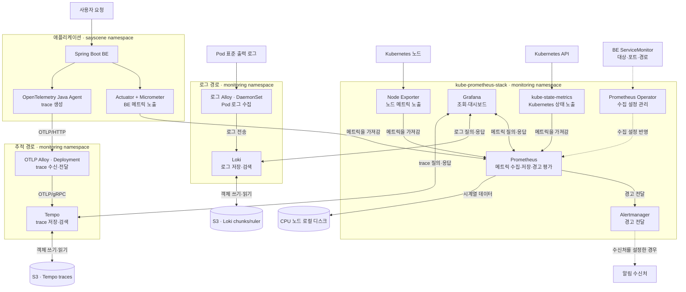

# SayScene 관측성 설치·운영 매뉴얼

> v1 · 통합 갱신: 2026-10-29 · 대상: AWS EC2의 자체 관리형 Kubernetes, Argo CD, `ss-be`
> BE 연결, ① 담당자의 설치 인수인계, 통합 검토의 결정과 실제 설치·장애 대응 과정을 통합했다.
> 파일 설정은 로컬 저장소와 대조했다. 클러스터를 직접 조회한 결과와 사용자의 실행 보고를 구분하며, `Synced`만으로 수집 성공을 판단하지 않는다.

## 0. 범위와 읽는 순서

이 문서는 **AWS 저장소 준비 → Helm 설정 검증 → Argo CD 로그·추적 App 생성 → BE 연결 → Grafana 조회**를 재현하는 절차다. Prometheus·Grafana·Alertmanager 설치 자체는 [① 설치 문서](kube-prometheus-stack-install-v1.md)를 따른다. DCGM Exporter 설치는 범위 밖이다.

| 경로 | 데이터 흐름 | 확인할 결과 |
|---|---|---|
| 로그 | Pod stdout/stderr → 로그 Alloy → Loki gateway → Loki → S3 | Grafana에서 새 로그 검색 |
| 메트릭 | Prometheus → BE Service → `/actuator/prometheus` | BE Target `UP`, JVM·HTTP 메트릭 조회 |
| 추적 | BE Java Agent → Alloy OTLP/HTTP → Tempo OTLP/gRPC → S3 | Grafana에서 `ss-be` trace 상세 조회 |
| 추적 그래프 | Tempo metrics-generator `local-blocks` → TraceQL metrics | Tempo 데이터소스의 `rate()` 등 시계열 조회 |

Grafana는 S3를 직접 조회하지 않는다. Loki·Tempo의 조회 API에 접속한다. ServiceMonitor는 메트릭 수집 정의이며 trace를 활성화하지 않는다.

### 각 도구가 맡는 일

| 도구 | 이 프로젝트에서 하는 일 | 확인할 때 쓰는 곳 |
|---|---|---|
| 로그 Alloy | 각 노드의 Pod 로그를 읽고 `namespace`·`pod`·`container` 정보를 붙여 Loki로 보낸다 | Loki에서 로그가 안 보일 때 수집·전송 상태 확인 |
| OTLP Alloy | BE Java Agent의 trace를 받아 Tempo로 전달한다 | trace가 안 보일 때 수신·전송 상태 확인 |
| Loki | 로그를 S3에 저장하고 검색 요청에 응답한다 | 오류 메시지와 발생 시점 검색 |
| Tempo | trace를 S3에 저장하고 요청 안의 작업(span)과 걸린 시간을 보여준다 | 느린 호출·실패한 구간 확인 |
| Prometheus | BE·Exporter에서 메트릭을 주기적으로 가져와 저장하고 경고 규칙을 평가한다 | 요청량·오류율·노드 자원 추이 확인 |
| Grafana | Prometheus·Loki·Tempo에 질의해 메트릭·로그·trace를 한 화면에서 보여준다 | Explore와 대시보드 |
| Alertmanager | Prometheus가 보낸 경고를 묶고 중복을 억제해 설정된 수신처에 전달한다 | 경고 전달 상태 확인 |

`kube-prometheus-stack`은 Prometheus·Grafana·Alertmanager와 Prometheus Operator, Node Exporter, kube-state-metrics를 함께 설치하는 Helm 차트다. **Operator**는 ServiceMonitor 같은 수집 설정을 Prometheus에 반영한다. **Node Exporter**는 노드의 CPU·메모리·디스크 메트릭을, **kube-state-metrics**는 Kubernetes 객체 상태 메트릭을 노출한다. Prometheus가 이 메트릭을 가져간다.



로그는 **무슨 메시지가 남았는지**, 메트릭은 **얼마나 자주·얼마나 많이 발생했는지**, trace는 **한 요청이 어떤 구간을 거쳐 얼마나 걸렸는지**를 알려준다. 예를 들어 `LLM 요청 실패: timeout` 로그가 있다면 Loki에서 발생 시점을 찾고, Prometheus에서 같은 시각의 오류율을 보고, Tempo에서 해당 요청의 HTTP 호출 시간을 확인한다. Tempo가 보여주는 범위는 실제 계측된 span까지이며, LLM 서버 내부가 별도로 계측되지 않았다면 내부 연산은 보이지 않는다.

Grafana는 데이터를 장기 보관하는 서버가 아니라 조회 화면이다. 이 구성에서 Loki·Tempo는 S3를 사용하고, Prometheus는 CPU 노드의 로컬 저장소를 사용한다. Alloy는 수집·전달 역할이며 장기 저장소가 아니다.

### 기존 작업 번호

앞으로 진행 상태를 점검할 때도 아래 번호와 이름을 유지한다. 실제 실행 절차는 뒤의 절을 따른다.

1. 실행 상태 확인
2. 네임스페이스 확정
3. BE 수집 소유권
4. 배포 가능한 용량
5. 로그 경로
6. Grafana 로그 데이터소스
7. BE 메트릭 활성화
8. 추적 경로
9. Grafana 추적 데이터소스와 문서 갱신

## 1. 확정한 구성과 담당 경계

| 항목 | 결정 | 이유·영향 |
|---|---|---|
| 관측 namespace | `monitoring` | 기존 Prometheus·Grafana와 공유. namespace만으로 CPU·메모리가 격리되지는 않음 |
| BE namespace | `sayscene` | 관측 스택과 구분. 클러스터 이름 `sayscene`과 namespace는 별도 개념 |
| BE ServiceMonitor 소유권 | `apps/ss-be/07_servicemonitor.yaml` | 앱이 대상 Service 라벨·포트·경로를 관리. 플랫폼은 발견 조건을 관리 |
| values 위치 | 기존 위치 유지 | Loki·Tempo 하위 폴더를 추가하지 않고 Git source의 `directory.include`로 배포 대상 제한 |
| 로그 App | `observability-logs` | Loki + 로그 Alloy + Loki 데이터소스를 함께 관리 |
| 추적 App | `observability-traces` | Tempo + OTLP Alloy + Tempo 데이터소스를 함께 관리 |
| Alloy 분리 | 로그 DaemonSet / OTLP Deployment 1개 | 노드별 로그 발견과 BE가 접속할 안정적인 OTLP Service를 분리 |
| Loki | `Monolithic`, `singleBinary.replicas: 1` | 이전 `SingleBinary`와 같은 단일 프로세스 배포 방식. 현재 차트의 설정 키는 `singleBinary` 유지 |
| 장기 저장 | Loki chunks/ruler 버킷 분리, Tempo traces 별도 S3 | FE 버킷과 데이터·권한·보관 정책 분리 |
| 로컬 저장 | Loki·Tempo PVC 비활성 | WAL·작업 파일은 여전히 노드 디스크 사용. 미전송 데이터는 Pod 교체 시 유실 가능 |
| AWS 자격 증명 | CPU EC2 인스턴스 역할의 임시 자격 증명 | 액세스 키를 Git에 저장하지 않음. Pod별 권한 격리는 제공하지 않음 |
| 배치 | Loki·gateway·Tempo·OTLP Alloy는 control-plane 라벨 노드 | 현재 CPU 노드에서 시연. toleration은 taint 허용이며 배치 강제는 nodeSelector가 담당 |
| requests | 낮은 시연 예산을 기준으로 검토, 파일 적용 보류 | §3 참조. 제안값과 실제 예약량을 구분 |

로그 Alloy는 각 Pod의 `spec.nodeName`을 기준으로 자기 노드의 Pod를 발견하고 Kubernetes API로 로그를 읽는다. 현재 namespace 필터는 없으므로 해당 노드의 여러 namespace 로그가 대상이다. DaemonSet은 **배치 조건을 만족하는 노드마다** 실행되며, GPU 노드의 taint·통신·RBAC도 따로 확인한다. Alloy를 노드에 `apt install`하는 구성은 아니다.

### ① handover A~E 처리 결과

| 원래 항목 | 통합한 결정·조치 | 남은 검증 |
|---|---|---|
| A. 데이터소스 ConfigMap | Loki·Tempo 폴더에 `datasource.yaml` 작성, `monitoring`, `grafana_datasource: "1"` | Loki 실제 로그 조회. Tempo trace 목록은 사용자 확인 |
| B. values 폴더 규칙 | 기존 구조 유지, Git source에 `directory.include: datasource.yaml` | App 소스 설정과 렌더 결과 확인 |
| C. requests 미지정 | §3의 시연 시작값 채택, 안정적 검증 예산은 참고로 보존 | 명시적 requests/limits 반영과 실측은 미완료 |
| D. Tempo 로컬 trace 저장 | trace backend를 S3로 변경. EBS 60GiB 확장은 사용자 보고 | 파일시스템 확장·잔여량, WAL·generator 임시 파일 감시 |
| E. S3 접근 | 전용 버킷과 노드 역할 정책 생성은 사용자 보고 | Pod의 실제 S3 읽기·쓰기·보관 및 삭제 정책 검증 |

설치 전 인수인계와 통합 검토의 A~E 조치·1~9번 결정은 위 표와 §12에 통합했다. BE ServiceMonitor 중복 제거의 기록은 `ss-k8s` 커밋 `21f55fa`, main 병합 `8bd5da8`이다. 과거 논의의 전체 내용은 Git 이력에서 확인할 수 있다.

## 2. 파일·버전·연결 주소

```text
ss-k8s/
├─ platform/
│  ├─ loki/
│  │  ├─ values.yaml
│  │  └─ datasource.yaml
│  ├─ tempo/
│  │  ├─ values.yaml
│  │  └─ datasource.yaml
│  └─ alloy/
│     ├─ logs/values.yaml
│     └─ otlp/values.yaml
└─ apps/ss-be/
   ├─ 04_deployment.yaml
   ├─ 05_service.yaml
   └─ 07_servicemonitor.yaml
```

| 차트 | Helm 저장소 URL | 고정 차트 버전 | release 이름 |
|---|---|---|---|
| Loki | `https://grafana-community.github.io/helm-charts` | `20.0.2` | `loki` |
| Tempo | 위와 동일 | `2.4.0` (앱 Tempo `2.10.8`) | `tempo` |
| Alloy 로그 | `https://grafana.github.io/helm-charts` | `1.14.3` | `alloy-logs` |
| Alloy OTLP | 위와 동일 | `1.14.3` | `alloy-otlp` |

차트 버전과 컨테이너 앱 버전은 다르다. 최신 문서가 다른 주 버전의 구조를 설명할 수 있으므로 위 차트의 values와 렌더 결과를 기준으로 한다.

| 사용 주체 → 대상 | 주소 | 프로토콜·용도 |
|---|---|---|
| 로그 Alloy → Loki | `http://loki-gateway.monitoring.svc.cluster.local:80/loki/api/v1/push` | 로그 쓰기 HTTP |
| Grafana → Loki | `http://loki-gateway.monitoring.svc.cluster.local:80` | 로그 조회 HTTP |
| BE → OTLP Alloy | `http://alloy-otlp.monitoring.svc.cluster.local:4318` | OTLP `http/protobuf` 기본 주소 |
| OTLP Alloy → Tempo | `tempo.monitoring.svc.cluster.local:4317` | OTLP gRPC, 클러스터 내부 TLS 미사용 |
| Grafana → Tempo | `http://tempo.monitoring.svc.cluster.local:3200` | trace·TraceQL 조회 HTTP |

이 주소는 release 이름과 DNS 도메인 `cluster.local`을 전제로 한다. 설치 후 `kubectl -n monitoring get svc`로 확인한다. Grafana 데이터소스에 `localhost`, OTLP 포트, S3 버킷 주소를 넣지 않는다.

## 3. 실행 전 확인과 용량

EC2에서 실행한다. 조회 명령은 리소스를 변경하지 않는다.

```bash
kubectl get nodes -o wide
kubectl describe node <CPU_NODE_NAME>
kubectl get pods -A -o wide
kubectl get daemonsets -A
kubectl get svc -A
kubectl get crd servicemonitors.monitoring.coreos.com
kubectl -n monitoring get prometheus -o yaml
df -h /
free -h
```

`<CPU_NODE_NAME>`은 `kubectl get nodes` 결과로 대체한다. describe의 **Allocatable / Allocated resources / Taints**, 각 Pod의 requests와 실제 디스크 여유를 본다. `kubectl top`의 `Metrics API not available`은 metrics-server 부재일 수 있으며 Prometheus 미설치와 같은 뜻이 아니다.

### 현재 기준과 시연 예산

CPU EC2는 4 vCPU·16GiB·x86_64다. EBS는 기존 16GiB에서 **60GiB로 확장했다고 사용자 보고**했다. 볼륨 크기 변경만으로 파일시스템 확장을 단정하지 않고 `lsblk`와 `df -h /`로 확인한다. 이미지 레이어, 컨테이너 쓰기 영역, WAL, 캐시·임시 파일은 S3 사용 중에도 로컬에 필요하다.

①의 현재 파일 기준 requests 합계는 CPU `330m`, 메모리 `1440Mi`다. Prometheus `200m/1Gi`, Grafana `50m/128Mi`, Operator `50m/128Mi`, Alertmanager `10m/64Mi`, kube-state-metrics `10m/64Mi`, node-exporter `10m/32Mi` 기준이며, 부속 컨테이너·노드 증가분은 별도다.

| ③ 구성요소 | 시연 시작 CPU | 시연 시작 메모리 | 안정적 검증 참고 CPU | 안정적 검증 참고 메모리 |
|---|---:|---:|---:|---:|
| Loki | 200m | 512Mi | 600m | 2Gi |
| Loki gateway | 10m | 32Mi | 미정 | 미정 |
| Tempo (generator 포함 실측 필요) | 100m | 512Mi | 500m | 1.5Gi |
| 로그 Alloy (노드당) | 50m | 128Mi | 250m | 384Mi |
| OTLP Alloy | 50m | 128Mi | 200m | 384Mi |
| **시연 합계: 로그 Alloy 1개 가정** | **410m** | **1312Mi** | — | — |

**이 표는 요청 예산이며 현재 values에 적용된 requests가 아니다. 공식 최소 사양이나 동작 보장도 아니다.** 차트 기본값·sidecar·DaemonSet 추가 노드분을 렌더링에서 합산한다. Tempo generator 활성화로 CPU·메모리·디스크 사용량이 늘 수 있어 재측정한다. ①이 이미 사용 중인 requests를 다시 신규 사용량으로 더하지 않는다.

기존 매뉴얼의 큰 시연 예산(Prometheus `300m/1Gi`, Grafana `100m/512Mi`, Loki `300m/1Gi`, Tempo `250m/768Mi` 등)은 초기 비교안이었다. 현재 시연 기준은 위의 낮은 값이다. 기존 안정적 검증 참고값 중 ① 영역은 Prometheus `500m/2Gi`, Grafana `250m/768Mi`, Operator `100m/256Mi`, Alertmanager `100m/256Mi`, kube-state-metrics `100m/256Mi`, node-exporter `50m/128Mi`이며, 담당자의 실제 배포값을 덮어쓰는 지시가 아니다.

수집·저장 경로에 자원을 우선 배정한다. Operator는 ServiceMonitor 등을 반영하는 제어 구성요소라 계속 실행한다. kube-state-metrics의 CPU만 늘린다고 관측이 즉시 갱신되지는 않으며 scrape·평가 간격도 영향을 준다. Alertmanager의 알림 지연은 Prometheus 규칙의 `for`, 평가 간격, Alertmanager `group_wait`도 함께 본다. CPU limits는 당장 두지 않는 방향으로 검토하되 메모리 한도·OOM·이웃 Pod 영향을 실측한다.

## 4. AWS: S3와 임시 자격 증명 준비

### 4-1. 버킷 생성

AWS 계정 `944296702922`, 서울 리전 `ap-northeast-2` 기준이다. IAM 화면이 글로벌인 것과 S3·EC2 리전은 별개다.

| 용도 | 버킷 이름 |
|---|---|
| Loki chunks | `ss-loki-chunks-944296702922-ap-northeast-2-an` |
| Loki ruler | `ss-loki-ruler-944296702922-ap-northeast-2-an` |
| Tempo traces | `ss-tempo-traces-944296702922-ap-northeast-2-an` |

기존 FE 버킷 `ss-fe-944296702922-ap-northeast-2-an`은 유지한다. S3 콘솔에서 **범용 버킷**, 서울 리전, ACL 비활성화(버킷 소유자 적용), 퍼블릭 액세스 차단을 사용한다. 짧은 시연은 버전 관리·Object Lock 비활성, 기본 암호화 SSE-S3를 기준으로 한다. SSE-KMS로 바꾸면 별도 KMS 권한·비용을 검토한다. S3 Bucket Key는 SSE-KMS의 요청 비용과 관련된 설정이며 SSE-S3 사용의 필수 조건이 아니다. [AWS S3 Bucket Key](https://docs.aws.amazon.com/AmazonS3/latest/userguide/bucket-key.html)

버킷 생성 자체보다 저장량·요청·전송에 따른 비용을 관리한다. S3를 사용한다고 보존 기간이 자동 결정되지는 않는다. Loki retention과 compactor 설정, Tempo 보존, 버킷 lifecycle은 운영 전 별도 확정한다. ruler 버킷을 준비했다고 실제 규칙 실행·Alertmanager 연동이 완료된 것은 아니다.

### 4-2. IAM 역할과 네트워크

IAM 콘솔 → 역할 → CPU EC2에 연결된 `sayscenecontrolplanerole` → 권한 → 권한 추가 → 인라인 정책 생성 순서로 준비한다. 역할 연결 자체는 EC2 인스턴스 상세의 IAM 역할에서 확인한다. 현재 이 역할에 인라인 정책 `ss-loki-s3-access`, `ss-tempo-s3-access`를 연결하는 방식이다. 정책은 해당 버킷만 대상으로 한다. 예를 들어 Loki는 두 버킷 ARN에 `s3:ListBucket`, 각 `버킷ARN/*`에 `s3:GetObject`, `s3:PutObject`, `s3:DeleteObject`를 구분해 허용한다. Tempo도 traces 버킷만 대상으로 같은 범위를 검토한다. 접근 키를 values나 Git에 넣지 않는다.

현재 구성은 Pod별 IAM 역할(IRSA/Pod Identity)이 아니다. 같은 노드에서 IMDS에 접근할 수 있는 다른 Pod에도 역할 접근 가능성이 있다. 노드 교체 시 새 인스턴스 프로파일과 IMDS 설정을 다시 확인한다. 정책 변경은 영향 범위와 이전 정책으로 복구할 방법을 확인한 뒤 진행한다.

사용자가 확인한 EC2 설정은 IMDS 활성, IMDSv2 필수, 응답 홉 제한 `2`다. 네트워크는 S3에 도달할 경로(환경에 맞는 인터넷 경로 또는 S3 VPC endpoint), DNS, HTTPS 아웃바운드와 endpoint/bucket 정책을 확인한다. 라우트에 `0.0.0.0/0`이 있다는 것만으로 Pod의 S3 접근을 보장하지 않는다.

### 4-3. values 반영 및 실제 접근 확인

Loki `loki.storage.bucketNames`·`s3.region`, Tempo `tempo.storage.trace.backend: s3`와 `s3.bucket/endpoint/region`이 §4-1과 같아야 한다. 현재 저장소에는 위 값이 반영돼 있다. [Loki AWS 저장소 설정](https://grafana.com/docs/loki/latest/setup/install/helm/deployment-guides/aws/)

Pod가 실행된 뒤 로그의 `AccessDenied`, 자격 증명·endpoint 오류를 확인하고, 새 로그·trace 유입 후 S3의 객체 생성과 조회를 확인한다. 업로드·블록 확정에는 시간이 걸릴 수 있다. **오류가 없는 로그만으로 S3 저장 성공을 확정하지 않는다.**

## 5. Helm 설정 검증

Helm은 로컬 렌더링 검증에 사용하고 실제 배포는 Argo CD가 수행한다. 같은 release를 별도 `helm install`로 중복 관리하지 않는다.

`ss-k8s` 루트에서 실행한다.

```bash
helm repo add grafana-community https://grafana-community.github.io/helm-charts
helm repo add grafana https://grafana.github.io/helm-charts
helm repo update
helm template loki grafana-community/loki --version 20.0.2 -n monitoring -f platform/loki/values.yaml > /tmp/sayscene-loki-rendered.yaml
helm template tempo grafana-community/tempo --version 2.4.0 -n monitoring -f platform/tempo/values.yaml > /tmp/sayscene-tempo-rendered.yaml
helm template alloy-logs grafana/alloy --version 1.14.3 -n monitoring -f platform/alloy/logs/values.yaml > /tmp/sayscene-alloy-logs-rendered.yaml
helm template alloy-otlp grafana/alloy --version 1.14.3 -n monitoring -f platform/alloy/otlp/values.yaml > /tmp/sayscene-alloy-otlp-rendered.yaml
```

렌더 결과에서 Service 이름·포트, namespace, 노드 배치, 컨테이너별 resources, 로컬 볼륨과 내부 설정 ConfigMap을 확인한다. Helm 템플릿 통과는 실제 IAM·네트워크·프로세스 실행 검증을 대신하지 않는다.

## 6. Argo CD Application 생성

### 6-1. 저장소 등록

Settings → Repositories에서 §2의 Helm 저장소 두 개를 Type `helm`으로 등록한다. 둘 다 `https://`가 있는 일반 Helm repository이므로 **Enable OCI는 끈다**. Karpenter OCI 주소와 형식이 다르다. Git 저장소 `https://github.com/say-scene/ss-k8s.git`도 접근 가능한 상태여야 한다. 저장소 연결 상태 `Successful`을 확인한다.

### 6-2. 공통 입력

| 항목 | 값 |
|---|---|
| Project | `default` (팀의 별도 AppProject가 있다면 해당 프로젝트) |
| Sync policy | Manual |
| Destination server | `https://kubernetes.default.svc` (Argo CD가 대상 클러스터 안에 있는 경우) |
| Destination namespace | `monitoring` |
| Sync option | `CreateNamespace=true` |
| Prune·Force | 초기 시연에서는 끔 |
| Git revision | `main` |

클러스터 이름 `sayscene`을 namespace 칸에 넣지 않는다. UI에서 등록된 cluster name을 선택하거나 server URL을 선택하는 것은 같은 목적지 선택의 대안이다.

UI에 Helm release name 또는 여러 source 입력이 안 보이면 **New App의 YAML 편집**에서 다음 정의를 입력한다. `{{ .Release.Name }}`가 보이는 차트 parameter는 release 이름 입력란이 아니므로 고치지 않는다. `metadata.namespace: argocd`는 Argo CD 설치 namespace가 다르면 맞춘다.

### 6-3. 로그 App YAML

```yaml
apiVersion: argoproj.io/v1alpha1
kind: Application
metadata:
  name: observability-logs
  namespace: argocd
spec:
  project: default
  destination:
    server: https://kubernetes.default.svc
    namespace: monitoring
  sources:
    - repoURL: https://grafana-community.github.io/helm-charts
      chart: loki
      targetRevision: 20.0.2
      helm:
        releaseName: loki
        valueFiles:
          - $values/platform/loki/values.yaml
    - repoURL: https://grafana.github.io/helm-charts
      chart: alloy
      targetRevision: 1.14.3
      helm:
        releaseName: alloy-logs
        valueFiles:
          - $values/platform/alloy/logs/values.yaml
    - repoURL: https://github.com/say-scene/ss-k8s.git
      targetRevision: main
      ref: values
      path: platform/loki
      directory:
        include: datasource.yaml
  syncPolicy:
    syncOptions:
      - CreateNamespace=true
```

### 6-4. 추적 App YAML

```yaml
apiVersion: argoproj.io/v1alpha1
kind: Application
metadata:
  name: observability-traces
  namespace: argocd
spec:
  project: default
  destination:
    server: https://kubernetes.default.svc
    namespace: monitoring
  sources:
    - repoURL: https://grafana-community.github.io/helm-charts
      chart: tempo
      targetRevision: 2.4.0
      helm:
        releaseName: tempo
        valueFiles:
          - $values/platform/tempo/values.yaml
    - repoURL: https://grafana.github.io/helm-charts
      chart: alloy
      targetRevision: 1.14.3
      helm:
        releaseName: alloy-otlp
        valueFiles:
          - $values/platform/alloy/otlp/values.yaml
    - repoURL: https://github.com/say-scene/ss-k8s.git
      targetRevision: main
      ref: values
      path: platform/tempo
      directory:
        include: datasource.yaml
  syncPolicy:
    syncOptions:
      - CreateNamespace=true
```

`ref: values`는 Helm의 `$values`를 Git 저장소 루트에 연결한다. `path`도 지정하면 해당 디렉터리에서 Kubernetes 리소스를 생성하므로 `directory.include: datasource.yaml`로 ConfigMap만 한정한다. 폴더 깊이 자체가 Helm용·매니페스트용을 결정하는 것은 아니다.[Argo CD multiple sources](https://argo-cd.readthedocs.io/en/stable/user-guide/multiple_sources/)

위 YAML은 생성 화면에 입력할 예시이며 `ss-k8s`에 Application 파일이 따로 저장되어 있다는 뜻은 아니다. Git의 values·datasource 파일이 **main에 반영·push된 뒤** App을 생성하고 Diff를 검토해 Sync한다. Helm 설치와 ConfigMap 배포는 같은 Sync에 포함할 수 있다. 이후 설정 변경도 main push → Refresh/Diff → Sync → 실제 동작 확인 순서다.

## 7. 로그와 Grafana 데이터소스 검증

### 7-1. Loki·로그 Alloy

EC2에서 실행한다.

```bash
kubectl -n monitoring get pods -o wide
kubectl -n monitoring get svc
kubectl -n monitoring logs -l app.kubernetes.io/name=loki -c loki --tail=50
kubectl -n monitoring logs -l app.kubernetes.io/instance=alloy-logs -c alloy --tail=50
kubectl -n monitoring get cm -l grafana_datasource
```

Loki 단일 본체와 gateway, 로그 Alloy가 의도한 노드에서 Ready인지 본다. 새 BE 요청을 보내고 Grafana Explore → Loki에서 다음을 검색한다.

```logql
{namespace="sayscene", container="ss-be"}
```

시간 범위는 최근 15분부터 시작하고 labels가 실제 로그에 있는지 확인한다. Loki 데이터소스 연결 성공과 실제 로그 유입은 별도다. Alloy 전송 오류·폐기량과 Loki 쓰기 오류를 확인한다. Alloy 재시도는 무손실 보장이 아니며, Loki WAL은 Loki가 이미 받은 데이터만 보호한다.

### 7-2. ConfigMap의 역할

`platform/loki/datasource.yaml`, `platform/tempo/datasource.yaml`에 `monitoring`과 `grafana_datasource: "1"` 라벨이 있다. ①의 Grafana sidecar는 이 ConfigMap을 읽어 데이터소스 설정을 반영한다. UID는 각각 `loki`, `tempo`, `access: proxy`, 기본 데이터소스는 변경하지 않는다.

```text
Argo CD → ConfigMap → Grafana sidecar → 데이터소스 provisioning
Grafana 서버 → Loki/Tempo 조회 API
```

등록이 안 되면 ConfigMap namespace·라벨 → Grafana sidecar 처리 로그 → 실제 Service 주소·포트 순서로 확인한다. Grafana UI에서 수동 변경한 값이 provisioning 설정과 충돌하지 않게 Git 파일을 기준으로 관리한다.

## 8. BE 메트릭과 추적 연결

### 8-1. 메트릭: 이미지 → ServiceMonitor → Target

`ss-be/pom.xml`의 Actuator·`micrometer-registry-prometheus`, `application.yml`의 `health,prometheus` endpoint 노출을 확인한다. 새 이미지 빌드·ECR push·이미지 태그 갱신·BE App Sync까지 필요하다. 코드가 로컬에만 있으면 배포 이미지에 반영되지 않는다.

플랫폼 Prometheus의 현재 설정은 다음과 같다.

```yaml
prometheus:
  prometheusSpec:
    serviceMonitorSelectorNilUsesHelmValues: false
    serviceMonitorNamespaceSelector: {}
```

현재 차트 설정은 release 라벨로 한정하지 않고 다른 namespace의 ServiceMonitor도 발견하도록 되어 있다. **실제 배포된 Prometheus CR의 `spec.serviceMonitorSelector`와 `spec.serviceMonitorNamespaceSelector`를 최종 확인**한다. BE ServiceMonitor에 남아 있는 `release: kube-prometheus-stack` 라벨은 이 설정에서 필수 조건이 아니다.

BE ServiceMonitor는 `sayscene`에 두고 Service의 `app: ss-be`, 이름 `http`인 Service 포트, `/actuator/prometheus`를 선택한다. Service 포트는 `80 → 8080`이다. endpoint를 외부 Ingress로 공개할 필요는 없다.

```bash
kubectl -n monitoring get servicemonitors
kubectl -n sayscene get service ss-be servicemonitor ss-be
kubectl -n monitoring get prometheus -o yaml
```

①은 플랫폼 values의 중복 `ss-be` 항목을 제거했다. Prune이 꺼져 있으면 기존 `monitoring/ss-be`가 남을 수 있다. 두 리소스가 같은 BE를 수집하는지 확인하고 담당자와 정확한 리소스만 정리한다. `sayscene/ss-be`와 다른 목적의 `ss-triton`은 유지한다.

Prometheus Targets에서 BE `UP`을 확인하고 다음 PromQL로 수집을 점검한다.

```promql
jvm_memory_used_bytes{namespace="sayscene"}
rate(http_server_requests_seconds_count{namespace="sayscene"}[5m])
```

조회 라벨·시계열 이름은 실제 metrics와 Targets labels로 확인한다. 요청 rate에는 실제 요청과 두 번 이상의 scrape가 필요하다. Target이 없으면 selector·namespace, DOWN이면 경로·포트·HTTP 응답·네트워크 순서로 확인한다.

### 8-2. Java Agent 이미지 준비

현재 `ss-be/pom.xml`은 `maven-dependency-plugin`으로 OpenTelemetry Java Agent `2.32.0`을 `process-resources` 단계에 내려받아 `target/otel-agent/opentelemetry-javaagent.jar`로 준비한다. Jib의 extraDirectories가 이를 이미지의 다음 위치에 포함한다.

```text
/opt/otel/opentelemetry-javaagent.jar
```

BE CI의 `mvn -B compile jib:build`는 앞선 `process-resources`를 거친다. 해당 변경이 main push되지 않았거나 이전 이미지 태그를 배포했다면 JAR가 없을 수 있다. **JAR 포함 이미지를 먼저 준비한 뒤 Agent 실행 옵션을 함께 반영한다.**

### 8-3. Deployment 실행 설정

`ss-k8s/apps/ss-be/04_deployment.yaml`의 BE 컨테이너에는 아래 env가 반영돼 있다. 기존 `envFrom`과 함께 사용한다.

```yaml
env:
  - name: JAVA_TOOL_OPTIONS
    value: "-javaagent:/opt/otel/opentelemetry-javaagent.jar"
  - name: OTEL_SERVICE_NAME
    value: ss-be
  - name: OTEL_TRACES_EXPORTER
    value: otlp
  - name: OTEL_EXPORTER_OTLP_PROTOCOL
    value: http/protobuf
  - name: OTEL_EXPORTER_OTLP_ENDPOINT
    value: http://alloy-otlp.monitoring.svc.cluster.local:4318
  - name: OTEL_METRICS_EXPORTER
    value: none
  - name: OTEL_LOGS_EXPORTER
    value: none
```

`JAVA_TOOL_OPTIONS`는 JVM 시작 시 Agent를 로드한다. Pod 안에서 수동으로 켜는 과정이 아니다. OTLP 기본 주소에는 `/v1/traces`를 붙이지 않는다. 메트릭은 Prometheus, 로그는 로그 Alloy가 수집하므로 Agent에서는 trace만 전송한다. [Java Agent 실행](https://opentelemetry.io/docs/zero-code/java/agent/getting-started/), [OTLP 설정](https://opentelemetry.io/docs/languages/sdk-configuration/otlp-exporter/)

main push 후 BE App Diff·Sync, 새 Pod Ready와 로그를 확인한다.

```bash
kubectl -n sayscene rollout status deployment/ss-be --timeout=180s
kubectl -n sayscene logs deployment/ss-be -c ss-be --tail=100
kubectl -n monitoring logs -l app.kubernetes.io/instance=alloy-otlp -c alloy --tail=100
kubectl -n monitoring logs -l app.kubernetes.io/name=tempo --tail=100
```

### 8-4. 실제 trace 검색

FE의 일반 대화 조작 등으로 새 BE 요청을 보낸다. Grafana Explore → Tempo에서 최근 15분을 선택하고 다음을 검색한다.

```traceql
{ resource.service.name = "ss-be" }
```

trace를 열고 서버 span과 해당 요청이 호출한 HTTP·Redis span을 확인한다. Java Agent는 BE의 Java `HttpClient`·Redis Lettuce를 자동 계측하지만, 호출 대상 자체가 계측·전파를 지원하지 않으면 상대 서버의 내부 처리까지 보이지 않는다. 단순 trace 검색은 목록을 반환하며 그래프 조회와는 별개다.

## 9. Tempo TraceQL 그래프 활성화

trace 목록 조회는 성공해도 `| rate()`에서 `error finding generators: empty ring`이 발생할 수 있다. 실제 작업에서는 metrics-generator가 꺼진 설정을 확인하고 아래를 `platform/tempo/values.yaml`의 기존 `tempo` 아래에 병합했다. 기존 S3·receiver 설정을 삭제하지 않는다.

```yaml
tempo:
  metricsGenerator:
    enabled: true
    processor:
      local_blocks:
        filter_server_spans: false
        flush_to_storage: true
    storage:
      path: /var/tempo/generator/wal
    traces_storage:
      path: /var/tempo/generator/traces
  overrides:
    defaults:
      metrics_generator:
        processors:
          - local-blocks
```

`local-blocks`는 TraceQL metrics 집계를 담당한다. `filter_server_spans: false`로 수집된 다른 종류의 span도 집계 대상으로 남기고, 실제 쿼리에서 필요한 종류를 고른다. `flush_to_storage: true`는 집계용 블록도 기존 S3에 기록하도록 한다. generator WAL·작업 경로는 로컬이므로 디스크 예산이 필요하다. 이 구성의 TraceQL 그래프에 Prometheus remote-write를 별도로 켤 필요는 없다. Prometheus용 span-metrics·service-graphs는 별도 기능이다. [Tempo 2.x의 TraceQL metrics 설정](https://grafana.com/docs/tempo/latest/release-notes/version-2/v2-6/)

Helm 렌더링으로 내부 `tempo.yaml`에 processor·S3 값이 들어가는지 확인하고 main 반영·Sync한다. **설정 활성화 후 새 요청을 생성**해 검증한다. 이전 trace 전체가 소급 집계된다고 가정하지 않는다.

Grafana Dashboard → Add visualization → Tempo → TraceQL, 시각화 `Time series`로 설정한다.

```traceql
{ resource.service.name = "ss-be" && span:kind = server } | rate()
```

```traceql
{ resource.service.name = "ss-be" && span:kind = server } | avg_over_time(duration)
```

```traceql
{ resource.service.name = "ss-be" && span:kind = server } | quantile_over_time(duration, 0.95)
```

첫 쿼리는 서버 요청 span의 초당 발생률이며, 나머지는 평균·p95 처리 시간이다. `span:kind = server`는 내부 client/Redis span까지 요청 수로 합산하지 않도록 제한한다. 시간 단위는 반환값과 Grafana 표시 단위를 맞춘다. Agent 샘플링을 바꾸면 trace 기반 요청률이 전체 실제 요청률과 달라질 수 있다.

여전히 `empty ring`이면 Sync revision·실제 Tempo 설정 → 재시작된 프로세스 로그 → generator 동작 여부를 확인한다. 그래프가 비어 있을 때에는 에러 응답인지, 정상 응답에 새 데이터만 없는지를 먼저 구분한다.

## 10. Mac에서 Grafana·Prometheus·Alertmanager 접속

### 10-1. EC2 쪽 port-forward

EC2 셸에서 실행하고 세션을 유지한다. 이미 같은 포트를 전달 중이면 중복 실행하지 않는다.

```bash
kubectl -n monitoring port-forward svc/kube-prometheus-stack-grafana 3000:80 &
kubectl -n monitoring port-forward svc/kube-prometheus-stack-prometheus 9090:9090 &
kubectl -n monitoring port-forward svc/kube-prometheus-stack-alertmanager 9093:9093 &
```

### 10-2. Mac 쪽 SSH 터널

Mac의 별도 터미널에서 실행한다. `EC2_PUBLIC_IP`는 현재 EC2 public IP로 대체한다.

```bash
ssh -N \
  -i /Users/jisu/.ssh/sayscene-kp.pem \
  -o ExitOnForwardFailure=yes \
  -L 3000:localhost:3000 \
  -L 9090:localhost:9090 \
  -L 9093:localhost:9093 \
  ec2-user@EC2_PUBLIC_IP
```

개인키 경로와 OS 사용자 이름은 환경에 맞춘다. 줄 끝 `\`는 한 개이며 뒤에 공백을 넣지 않고 마지막 목적지 줄에는 붙이지 않는다. `ssh usage`만 나오면 목적지 누락·명령 구문을 먼저 확인한다. `-N`은 원격 셸을 열지 않고 터널만 유지하므로 출력이 없어도 정상일 수 있다.

| Mac 브라우저 | 용도 |
|---|---|
| `http://localhost:3000` | Grafana |
| `http://localhost:9090` | Prometheus |
| `http://localhost:9093` | Alertmanager |

```text
Mac 브라우저 → Mac SSH 터널 → EC2 localhost → kubectl port-forward → Service → Pod
```

Grafana 로그인은 ① 문서의 현재 Secret 조회 절차를 따른다. 비밀번호는 문서·Git·채팅에 남기지 않는다. Sync 후 비밀번호 불일치 문제와 existingSecret 고정은 ① 문서의 별도 검토 사항이다.

## 11. 실제로 겪은 장애와 확인 순서

| 증상 | 확인한 내용·대응 | 주의점 |
|---|---|---|
| BE가 `Init:0/1`, init 로그에 `Terminated`·Redis 대기 | `wait-for-redis`의 `timeout 3 redis-cli`가 제한 시간에 종료되는 경우를 확인. Redis 내부 PONG과 BE Pod에서의 Service/Pod IP 접근을 나눠 점검 | init `Running`은 대기 루프 실행을 뜻하며 Redis 연결 성공은 아님. probe 완화로 해결하지 않음 |
| CoreDNS 일부 `0/1`, API watch 실패·upstream DNS timeout | CoreDNS 로그와 CNI·라우팅·Service/Pod 통신을 조사 | 당시 네트워크 문제의 최종 원인은 확정하지 않음. Agent 장애와 동일 원인으로 단정하지 않음 |
| BE `CrashLoopBackOff`, Agent JAR 오류 | `Error opening zip file or JAR manifest missing` 확인. 사용자가 BE main 미push를 발견했고 새 이미지 반영 후 정상화 보고 | Agent env만 추가하면 이미지에 JAR가 생기지 않음 |
| trace는 표에 나오지만 그래프가 없음 | 단순 검색과 TraceQL metrics 구분, §9 설정 | 실제 `rate()` 성공은 별도 검증 |
| `rate()`가 500 `empty ring` | generator/local-blocks 설정 추가·렌더링 확인, 사용자는 Sync 완료 보고 | 설정 Sync와 런타임 집계 성공을 구분 |
| Grafana 등 접속 후 `failed to fetch` | SSH 명령의 목적지 누락 발견, §10의 완전한 명령 제공 | 이후 정상 접속·쿼리 성공은 아직 확인 보고 없음 |

### 공통 조회

```bash
kubectl -n monitoring get pods -o wide
kubectl -n monitoring get events --sort-by=.lastTimestamp
kubectl -n sayscene get pods -o wide
kubectl -n sayscene describe pod <BE_POD>
kubectl -n sayscene logs <BE_POD> -c wait-for-redis --tail=30
kubectl -n sayscene logs <BE_POD> -c ss-be --previous --tail=100
```

`<BE_POD>`는 현재 Pod 이름으로 대체한다. `--previous`는 이전 컨테이너가 존재할 때만 사용한다. init이 끝난 후 해당 컨테이너에 exec하면 `container not found`가 날 수 있으므로 현재 phase와 컨테이너 상태를 다시 조회한다.

`failed to fetch`만으로 CPU·메모리 부족을 단정하지 않는다. 전체 페이지가 안 열리면 로컬 터널·port-forward부터, Grafana는 열리고 특정 패널만 실패하면 브라우저 Network의 실제 오류와 데이터소스·백엔드 로그부터 확인한다. Pod 교체로 port-forward가 끊기면 해당 전달 세션을 다시 연결한다.

## 12. 완료 기록과 남은 검증

아래는 2026-10-28 대화 보고와 로컬 파일 검토를 통합한 상태다. 현재 클러스터의 실시간 보증이 아니다.

| 항목 | 확인 수준 | 남은 일 |
|---|---|---|
| namespace·release·주소·ConfigMap | 파일에 반영, 로그·추적 App Sync는 사용자 보고 | 현재 revision·Service 이름 재확인 |
| S3 버킷·IAM·EBS 60GiB | 사용자 설정 완료 보고 | Pod의 S3 쓰기/읽기, 실제 파일시스템 여유 검증 |
| BE Agent 이미지·실행 | 초기 JAR 누락 해결은 사용자 보고, env는 파일 확인 | 재배포 시 이미지 태그·Agent 로그 재확인 |
| Tempo trace 검색 | Grafana table view에서 사용자 확인 | 필요한 span·민감정보·저장 후 재조회 검증 |
| TraceQL metrics | generator 설정·Helm 렌더 검증, Sync 사용자 보고 | 새 요청 후 `rate()` 그래프 성공 확인 |
| Grafana 접속 | 완전한 SSH 터널 명령 안내 | 최신 `failed to fetch` 해소 여부 확인 |
| Loki 로그 | 사용자가 Pod·로그 조회 명령 실행 완료 보고 | Grafana의 실제 BE 로그 검색·S3 저장 확인 |
| BE 메트릭 | 코드·ServiceMonitor·selector 설정 확인 | 중복 Target 제거와 BE `UP`, 실제 시계열 확인 |
| 자원·보존 | 시연 예산·S3 사용 결정 | requests/limits 반영, generator 부하, retention·lifecycle·WAL 내구성 확정 |

### 1~9번 기준 다음 점검

1. 실행 상태 확인: 현재 Sync revision·Pod Ready·접속 경로를 재확인한다.
2. 네임스페이스 확정: `monitoring`으로 완료, BE는 `sayscene` 유지한다.
3. BE 수집 소유권: 앱 소유로 결정 완료, 클러스터 중복 잔존 여부를 확인한다.
4. 배포 가능한 용량: EBS 확장 보고를 반영했으며 requests 적용·실측은 남아 있다.
5. 로그 경로: Loki·Alloy·S3의 실제 쓰기·조회 결과를 확보한다.
6. Grafana 로그 데이터소스: ConfigMap은 준비됐으며 실제 로그 검색을 확인한다.
7. BE 메트릭 활성화: BE Target `UP`과 메트릭 조회를 확인한다.
8. 추적 경로: trace 표 조회는 확인했으며 TraceQL 그래프를 추가 검증한다.
9. Grafana 추적 데이터소스와 문서 갱신: 통합 문서는 갱신했으며 그래프 성공·미완료 항목 결과를 추후 기록한다.

### 이후 계측 변경과 복구

자동 계측은 Agent 설정으로 추가·비활성화할 수 있고, `stt`·`llm`처럼 업무 의미를 가진 수동 span·Micrometer 구간 메트릭은 BE 코드·이미지 변경이 필요하다. 이름·라벨을 바꾸면 대시보드·알림 쿼리도 확인한다. 현재 브라우저 `speechSynthesis`의 TTS 시간은 BE Agent가 측정하지 못한다. 초기 rate limit 제외와 `rate_limited_total`의 관계도 기능 도입 시 다시 검토한다. 발화 원문·쿠키·API 키를 로그·span·메트릭에 추가하지 않고 실제 수집 데이터도 점검한다. 이 문서는 PRD를 변경하지 않는다.

배포를 되돌릴 때는 변경 전 Git revision·이미지 태그를 기록하고 해당 설정을 되돌려 Sync한다. Agent 비활성화는 `JAVA_TOOL_OPTIONS`에서 해당 `-javaagent`만 제거하고 재배포하며 다른 JVM 옵션은 보존한다. generator를 끄면 그래프 쿼리에 영향이 있다. App·namespace·버킷을 삭제하는 방식으로 복구하지 않는다. Prune 비활성 시 Git에서 제거한 리소스가 남을 수 있으므로 정확한 대상과 영향 확인 후 별도로 처리한다.

## 13. 출처와 갱신 기준

- [① kube-prometheus-stack 설치·운영 기록](kube-prometheus-stack-install-v1.md)
- [Argo CD multiple sources](https://argo-cd.readthedocs.io/en/stable/user-guide/multiple_sources/)
- [Loki Monolithic 설치](https://grafana.com/docs/loki/latest/setup/install/helm/install-monolithic/)
- [Loki AWS 저장소](https://grafana.com/docs/loki/latest/setup/install/helm/deployment-guides/aws/)
- [Alloy loki.write](https://grafana.com/docs/alloy/latest/reference/components/loki/loki.write/)
- [OpenTelemetry Java Agent](https://opentelemetry.io/docs/zero-code/java/agent/getting-started/)
- [지원 자동 계측](https://opentelemetry.io/docs/zero-code/java/agent/supported-libraries/)
- [Tempo 2.x TraceQL metrics 설정 배경](https://grafana.com/docs/tempo/latest/release-notes/version-2/v2-6/)

버전·주소·저장 방식이 달라지면 이 매뉴얼과 해당 Git 설정을 함께 검토한다. 과거 설치 전 상태나 Argo CD `Synced` 표시를 새로운 수집 성공 증거로 대신하지 않는다.
